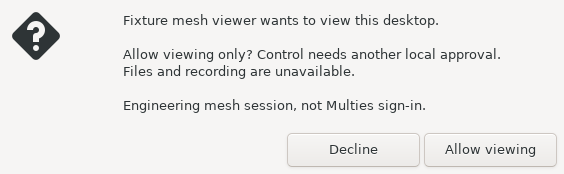
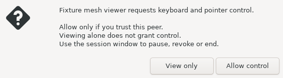
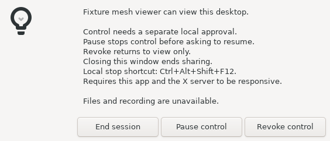

# Linux attended desktop host, engineering checkpoint

A new explicit `-session-attended` host mode separates local viewing approval from keyboard/pointer approval. It is Linux/X11 only and uses native Zenity dialogs. It is not enabled by default, a Multies-integrated consumer journey, a desktop graphical viewer or a new distributed binary. Existing explicit headless engineering mode is unchanged.

**Live local stop, not an always-available emergency stop.** Before capture, attended mode reserves Ctrl+Alt+Shift+F12 through a separate X connection. A missing/ambiguous keyboard mapping, conflicting shortcut or existing cooperating attended owner refuses the new session. The shortcut does not need the Mnet window focused. X11 still cannot guarantee availability under another application's active keyboard grab, a hung app/server, process death, secure desktops or a failing compositor. Synthetic XTEST events can invoke it, so this is not a physical-input security boundary. Actual physical/OEM/OS-session acceptance remains open.

## Entry and decisions

For an already configured engineering mesh, run the daemon in that person's X11 desktop console with Zenity installed:

```
mnetd -session-host -session-attended -session-allow trusted-peer
```

This example does not enroll the device or establish Multies authority. It uses the existing saved engineering configuration. A local X11 display and Zenity are required. Wayland and other platforms return an unsupported error rather than silently selecting legacy auto-accept. Attended mode rejects `-session-auto-accept`, `-session-record`, proof mode and service-control mode. Service/boot installation is not added.

- The existing source-address/current-key peer check and allow list run before a prompt. Local viewing approval is bounded to 45 seconds. Current authorization is rechecked after the answer and before capture. A closed, unavailable, canceled or timed-out dialog refuses viewing. No screen capture or input backend is created to obtain that answer.
- Untrusted hello I/O keeps its 15-second budget. Only a verified, allow-listed peer gets a 50-second socket budget for the local answer and reply. The ordinary legacy handshake path is unchanged. The current Android viewer's existing 70-second hello budget can accommodate this; no Android source or device run is changed here.
- Only one attended connection, including its dialogs and joined teardown, can own the desktop at once. Other requests are refused rather than creating parallel approval dialogs.
- After view approval and before capture, an atomic X11 selection claims the cooperating attended input owner and checked grabs reserve the stop chord on every X screen, including extra modifier/lock combinations. Selection loss, keyboard-mapping change or event-connection failure ends that session. This owner is not a control grant, cannot authorize Shared Desk, and does not isolate the unchanged legacy engineering injector or arbitrary X applications.
- After view approval, a persistent session window offers End, Pause and Revoke. Closing/failing that window ends sharing. A compatible viewer can request control, but only a separate host-local answer to the exact current connection/request can allow it. The control answer is bounded to 30 seconds. Unsupported old viewers remain view-only; there is no legacy input fallback in this mode.
- Pause disables control and closes its owned input backend before asking to resume. Revoke returns to viewing. Reconnect needs fresh view and control decisions. Replaced/canceled requests retire their prompt, and a late answer cannot grant a newer request.
- Input dispatch checks the exact current grant and local-owner/current-peer liveness again while holding the input owner's lock. A local answer rechecks liveness after backend creation too. Pause/revoke/cancel/End release owned backend resources. Input/cleanup failure terminates the session instead of reopening a failed backend. Already-processed OS actions cannot be recalled. Teardown joins capture/dialog/input workers before checked X-server release of the shortcut/owner. Cleanup failure closes the attended listener rather than admitting another owner. Process death can still leave XTEST button state pressed; session cleanup is not crash recovery.
- The local dialogs execute through fixed argument arrays, without a shell or remotely callable grant endpoint. Peer labels are bounded, control-character-filtered plain text, never markup. Output accepts only known local action labels and expected exit status. Zenity's extra-button status is handled explicitly, not mistaken for approval or an ordinary successful exit.
- Files and recording are unavailable in this new mode. It supplies no receive directory or recorder, and ignores no recording flag silently. Direct X11 keysym typing is used without an environment-selected clipboard-paste mode. No clipboard synchronization is added.

The existing `-session-host -session-auto-accept` mode still has its explicit engineering policy, combined admission and configured file/recording behavior. It must not be described as the new attended mode or as uniformly consumer-safe consent. An empty existing allow list still means every currently authorized mesh peer; deployments should select their intended peers explicitly.

## Actual native windows

These are pixels from the production dialog code on a disposable Xvfb display. The peer is a synthetic Go loopback protocol fixture, not an Android device, a personal desktop or a Multies user. Native toolkit appearance depends on the installed desktop theme.







All text and actions were visually inspected. These native prompts do not certify accessibility/screen-reader, high-DPI, physical keyboard, window-manager or cross-platform behavior.

## Verification

```
go test -race -count=20 -timeout=90s ./cmd/mnetd -run '^TestAttended'
python3 scripts/attended-x11-validation.py
sh scripts/local-gates.sh
```

The Python proof requires Xvfb, Zenity, xdotool, xwininfo and ImageMagick. It builds a race-enabled test binary, obtains its own display number, checks ownership/startup before any display command, uses only synthetic loopback peers and joins/kills its owned process group/display. It never drives the caller's desktop. Artifacts are retained in a new private temporary directory; the script prints that directory. Normal CI adds the same proof in its existing isolated X11 job, without trigger/permission changes.

Focused tests cover actual TCP grant/pause/revoke/end, disabled files, unsupported peers, stale/canceled local answers, missing input backend, terminal cleanup failure, parent cancellation, current authorization withdrawal, and option conflicts retaining legacy behavior. Real hello tests wait beyond the initial test hello budget for a local answer, then require a healthy post-approval round trip. Current authorization is rechecked after the answer. Process tests cover exact output/status handling and joined cancellation.

The current disposable GUI proof uses the actual native view/control windows, decoded X11 frames, granted XTEST pointer movement, local Pause/Resume/Revoke with viewing retained and a new approved request. It observes an injected left button held, focuses a different mapped application window, checks that actual focus, enables Caps Lock and invokes the reserved shortcut. It then requires released pointer state, joined dialog/capture/input teardown and immediate owner/grab reacquisition. This is a synthetic single-host Xvfb test, not physical keyboard/window-manager or active-keyboard-grab acceptance. Pause itself is still tested without a held remote pointer.

Real X11 safety tests cover second-owner refusal, a late conflicting modifier grab with partial-acquisition rollback, checked release/reacquisition, selection theft, mapping changes and owner loss with a pending control answer. A stale answer cannot create a backend, and old teardown must not clear another client's replacement owner. The new test caught an asynchronous XGB-close defect before publication: waiting for an already-exited event loop did not prove server-side release. Explicit checked ungrab/window destruction now completes before slot reuse. The original local failed log is retained separately; no timeout or assertion was weakened.

Twenty focused attended race repetitions and current-source build, Windows/Darwin cross-build, vet, vulnerability scan, whole-repository race, ordinary/burst proof-mesh file and source gates pass locally. The combined verification command was interrupted during its burst stage; only that unfinished stage and remaining source gates were resumed, with the completed-stage logs preserved. The current disposable GUI proof passed including Caps Lock. Hosted verification is still pending. The preceding fixture-only correction `148d7ba` passed all five [normal CI jobs](https://github.com/MaisySen/Mnet/actions/runs/44590061063), including the original focused-Escape journey, and [Pages](https://github.com/MaisySen/Mnet/actions/runs/44590060251). Deployed guide/STATUS/RELEASES matched its source bytes. That earlier success does not verify this new live-stop implementation or diagnose the preserved prior Chrome startup failures.

## Still open

The real Multies authorization/enrollment/revocation bridge, physical Linux/local-reclaim acceptance, Wayland/Windows/macOS attended surfaces and actual OS behavior, consumer file destination/approval, recording consent/retention and signed distribution remain separate. No production account/service, Multies, TestFlight, signing or release change is made by this source checkpoint.


## First hosted GUI result and fixture correction

The original attended checkpoint `c6b9caf` finished with four normal jobs successful (Go, Windows, macOS and kernel-vpn) and session-validation failed. It did not pass normal CI: its [session-validation job](https://github.com/MaisySen/Mnet/actions/runs/44587709286/job/135785042473) passed the preceding existing live session proof, then failed the new GUI proof while waiting for Pause. The [retained synthetic artifact](https://github.com/MaisySen/Mnet/actions/runs/44587709286/artifacts/14559689884) shows the hosted 606x341 native window had its button band at y268-312. The driver clicked y316 (`height-25`), below the button. No Pause result occurred; the grant correctly remained allowed until test cleanup. This is failed acceptance evidence, not a product pass or a held-input recovery result.

The corrective fixture changes only its local action hit point to an interior row shared by the inspected local GTK3 and hosted GTK4 layouts. It checks both exact observed button rectangles before running; gate, real XTEST, focused-Escape and joined-teardown assertions are retained. Local corrected runs passed at ordinary, 1.2 and 1.4 text scale, plus a fresh ordinary run with the pixel-rectangle guards. This is not a general high-DPI/accessibility claim or an actual local GTK4 run. The fresh corrected hosted run at `148d7ba` subsequently passed, as recorded above. The original `c6b9caf` run remains failed. No product timeout, grant policy, launch or workflow permission/trigger change is made to address this fixture mismatch. The failed first run is preserved and not blindly rerun.
