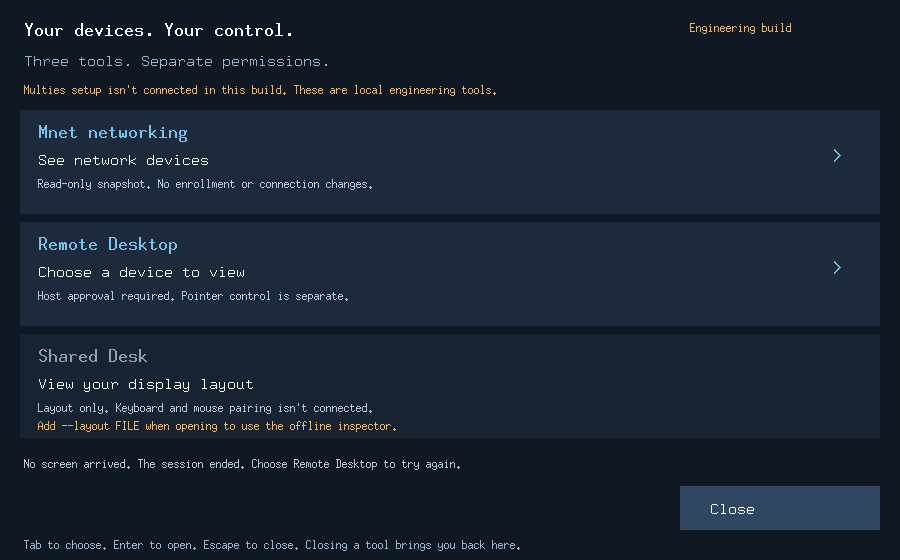

# Desktop entry and complete journey plan

This is a local Linux X11 engineering entry, not the installed consumer app. Production Multies setup, enrollment and Shared Desk pairing are not connected here. Explicitly configured List-only approval review is described at the end. No successful prototype, current network peer or layout file substitutes for those decisions.

## Current working entry

```
mnet open
mnet open --layout chosen-layout.json
```


The home has three distinct tool choices. Networking opens the actual authenticated read-only device snapshot. Remote Desktop opens the existing current-peer chooser with separate View Only and Pointer View choices. Shared Desk opens an offline arrangements window: browse drafts, create a starter seeded from the actual local root size, inspect or edit existing drafts, each as its own owned window. Drafts live in a private store under the explicit state directory; browsing creates nothing, saving always creates one new file and never replaces. A supplied --layout file appears as a pinned first row. Invalid drafts are listed honestly and refused in-window. A store draft can be duplicated into one new exclusively-created owner-only file whose source identity is pinned through the read, never replacing an existing draft. A store draft can be deleted with a two-press explicit confirmation that names the draft; choosing another row, another action or a 15-second wait cancels. The draft's device, inode, size and mtime are pinned at arming and re-checked before removal, so a same-name replacement or edit cancels with "nothing was removed" instead of deleting the new content. Only the named regular file inside a real store directory is ever removed: never the pinned opened file, a symlink, a directory, or a draft aliased by a second hard link, and a swapped or symlinked store directory fails closed. One residual boundary remains: the instant between the final identity check and unlink cannot be closed without fd-relative unlink; it is bounded by the private owner-only store under the explicit state directory, which only a same-uid process can reach, and it can never cross outside the store. No raw-input run, pairing, network or daemon path can start from this home.

## Specific Remote Desktop outcomes at home

Returning from Remote Desktop names what actually happened instead of one generic failure. A declined host approval reports that the host did not allow viewing and that nothing was shared. A selected device that changed before any connection reports the change and asks for a fresh review. A host or connection that ends an admitted session says so, and a session that showed real pixels and then ended locally reports that viewing ended and nothing remains connected. A chooser closed before any request stays a plain close. No outcome claims a session existed when none did, and every outcome still requires a fresh explicit journey with fresh host approval.

The outcome classification lives in the viewer path: the first arrived screen marks a viewed session, the attended admission refusal and the exact-peer revalidation failure keep their established CLI text while wrapping machine-checkable sentinels, and CLI `session browse/view/point` messages are unchanged. The home title carries the notice as a bounded note index for fixtures. Notices speak only about the viewing session, never about network membership: a device staying on the private network is separate from a viewing session or shared input existing.

The statements that no viewing session or shared input remains are proven, not only classified. The viewer joins its dial owner, session transport, viewer control and display owner before returning, so the home cannot show the notice first: focused race tests close that ordering at the function boundary for a clean local End, an abnormal mid-session host close after real pixels, and a canceled pending dial, each failing if the transport is still open or the dial owner has not joined when the function returns. `home-host-end-validation.py` ends an admitted session from the actual host control after real pixels arrived and checks the specific home outcome, the retired viewer and host sharing windows, and the host harness's own capture/safety cleanup assertions. Actual decline evidence: the built two-display fixture declines a first real request at the host's own approval prompt, checks the specific home outcome and that no chooser/viewer window survives, then completes a second separately approved pointer journey ending in the specific viewed-end outcome; the first-screen fixture checks its distinct outcome; model tests cover every notice, outcome mapping and text preservation.

## Consent-map explanation from home

A "How this works" control in the home header opens a consent-map explanation in place, without leaving the window. It states, per tool, what being connected means and what it never grants: networking is read-only, Remote Desktop viewing needs the host's approval every time with pointer control as a separate later question, Shared Desk input needs exact pairing and a fresh approval each run, and Multies setup is not connected here. The panel is not a route: it reads no daemon state, opens no child, and while it is open the tool choices are inert. Escape closes the panel first; a second Escape closes the home. The title bar carries the panel state as info0/info1 for the fixture, and the title flips only after the new pixels are on screen so evidence keyed on the title never shows stale content. This is explanation text ahead of the consumer first-run stage, not a signed-in or simulated setup state.

Opening the home reads no daemon state and starts no network/session operation. A selected home closes and joins its event reader before its child opens. Closing the child returns to a fresh home, not another session. A later device choice rereads current evidence and requires fresh host decisions. Signals cancel the current owner. Existing explicit CLI entry points retain their behavior.

This window uses larger headings/action text and short permission summaries. Technical setup and platform details belong in the owning guides rather than competing with the primary action. The current home uses embedded licensed proportional Go fonts. Supported local prerequisites are Linux X11, a24-bit TrueColor display with the supported32-bit little-endian image format and at least940x600pixels. Other child windows still have their own prerequisites. Unsupported configurations fail; there is no Wayland/native fallback or misleading success screen.

## Readable device choice and honest loading

The real peer chooser uses larger heading, device-row and mode-action text while retaining the complete bounded selected label/IP and exact key in its detail panel. Empty or expired rows do not gain eligibility from the new visual style. The viewer has a central waiting-for-host or waiting-for-first-screen panel rather than an unexplained empty canvas. End stays visible; the panel is removed by actual rendered pixels, never merely by host approval. These are implemented screens, not mockups.


The first local loading-panel attempt panicked before host admission because its explicit font-name length was wrong. Actual journey checks caught it, and the source now computes that length. Pixel inspection then caught an inherited text-background color; the drawing resets it before repainting the header. Neither intermediate version was committed or published. These failures are separate from the older unresolved blank-canvas fixtures.

## First-screen failure is a real session outcome

Host approval is not proof that pixels are arriving. After admission, the viewer waits at most15seconds for a usable complete screen. Pending host approval has no new timer. A first complete rendered frame disarms the bound, including when the desktop then stays unchanged. A silent or unusable initial stream ends the attempt, closes the viewer/transport and returns to a clear first-screen failure state when launched from home. No automatic reconnect or reuse of host approval occurs.



This bounds indefinite waiting. It does not diagnose the earlier two concurrent blank-canvas fixture failures. Later unchanged concurrent runs returned first-full captures in100ms-to1s and passed, but those passes are separate evidence. Hosted Chrome first-CDP startup failures are also distinct and remain unresolved.

## Consumer journey, before more surface expansion

The intended installed journey needs these real state transitions and visual priorities:

| Stage | Primary information and action | What must actually happen |
| --- | --- | --- |
| First run | Product name, one short setup explanation, Continue with Multies. | The production bridge must exist before this action can work. Until then show setup unavailable, never a simulated signed-in state or manual network-key fallback as consumer setup. |
| Workspace and device | Current workspace, this device, relevant permission decisions. | Bind fresh verified person/workspace/device/capability evidence. Declining an optional permission must not disable unrelated capabilities. |
| Tool selection | Mnet networking, Remote Desktop, Shared Desk, clearly separate. | Each tool checks its own current scope. A device being online grants no screen or input access. |
| Device selection | Eligible device name, current availability, exact intended mode. | Load real scoped current devices, erase stale selection, revalidate the exact selected key before connecting. |
| Host approval | Who is asking, view-only scope, Allow or Decline. | No pixels before host-local view approval. Pointer control requires its own later host answer. |
| Screen loading | Waiting for the first screen, always-visible End. | Bound absent first pixels after admission; distinguish failure from a working session. |
| Active session | Actual remote pixels, current narrow control state, prominent End. | Local controls never become remote input. Revoke returns to viewing; End retires transport/capture/input rather than only the label. |
| End or failure | Specific outcome and a deliberate return or retry. | Join old owners, discard selection/approvals and require a fresh explicit journey. No background auto-reconnect. |

The engineering home is a partial entry improvement within this plan. Real Multies integration, installed first-run setup, persistent trusted Shared Desk pairing and physical mixed-platform acceptance remain critical-path work. Multies stays read-only, and signing, release, accounts, production infrastructure and additional devices remain outside current execution authority. See [product scope](product-scope.md), [three-tool map](three-tools.md) and [authorization boundary](multies-boundary.md).

## Actual acceptance and limits

`home-validation.py` runs the built executable against a private Unix API and disposable X display. It checks zero home API reads, disabled layout, real device/chooser/inspector routing, child return, no implicit retry, pending-key cancellation and SIGTERM cleanup. No fake home UI replaces the executable.

`MNET_VIEWER_HOME=1 native-pointer-validation.py` takes the full actual home to chooser to host-approved view to separately approved pointer journey. It retains exact two native clicks, one scroll, zero native keys, all three native owners joined, decline/revoke/focus-loss behavior and End returning to a fresh home without surviving host/view windows. Both host sizes remain required.

`first-screen-validation.py` uses actual host approval with a deliberately silent capturer. It checks the production15second bound, native viewer/host closure and the inspected fresh-home failure state. Focused tests separately cover a silent admitted transport, no timeout on pending host consent, owner cleanup and disarming after the first frame on an unchanged desktop. These are same-computer disposable-X11 tests, not physical two-computer or live Multies evidence.

The general CI test steps include these journeys and retain failed synthetic screenshots/logs. Workflow triggers, all non-general native lanes and their path filters are unchanged. Source publication does not close any release gate.

## Installed engineering entry

The [private Linux source installation](linux-local-installation.md) now builds both executables into a new owned prefix and supplies an actual desktop entry. Its acceptance launches that entry through Gio from a special-character path, verifies the installed executable owns the actual home, closes it and removes only unchanged installation files. It does not install a service, start a daemon, enroll a device, alter Multies or create Mnet state. This is a working engineering install/launch/removal path, not the missing production first-run bridge.

An installed Remote Desktop attempt now reports missing local setup, an unreachable daemon, refused local capability and a disconnected local device separately. Fixed guidance does not expose the transport error, server body, key or local path. No peer/mode becomes selectable in these states. The installed acceptance uses the real installed daemon in an explicitly isolated in-memory-TUN down state, stops it, and checks fresh recovery without mutating its saved state. See [installed recovery evidence](linux-local-installation.md#missing-setup-is-now-a-distinct-recoverable-state). This does not invent a Multies sign-in path.

## Original hosted prerequisite failure

Original4b3 failed its first hosted home launch with `home readable fonts unavailable`. Its session job did not reach the new complete home or silent first-screen checks. The newer source declares `xfonts-base` explicitly and adds `home-font-validation.py`: a real built-ins-only X server must reproduce refusal and a server with the declared fonts must open the real home. The requirement is not relaxed. That local correction needs its own hosted run; earlier original failure remains recorded in [STATUS](STATUS.md).


## Branded local home, later isolated branch

The ordinary local entry now uses the same embedded proportional-font visual
style as the opt-in Multies preview. It still routes only the existing three
local tools. No production origin, sign-in bridge, network enrollment, saved
pairing or remote permission is inferred. The Shared Desk route always opens
its offline arrangements window; an explicit --layout file is pinned as its
first row. The title and route coordinates remain stable.

The home uploads complete strips into an offscreen pixmap and installs the
completed pixmap as the background before exposing the window. An initial
attempt copied pixels while the window was unmapped; X11 map cleared them and
the real screenshots were blank. Actual pixel inspection rejected that attempt.
The completed-background fix removes the initial blank canvas without a sleep
or test-deadline change. Layout/notice fit tests cover every route/focus state.

The font check intentionally now confirms actual home rendering and exact close
on both built-ins-only and normal-font X11 servers. This is a later embedded-font
implementation, not a repair claim for original4b3 or a change to its historical
missing-font result. Other native child windows still use their existing core
fonts, so their installer/CI prerequisites have not been removed.

## Explicit configured approval review from home

The later isolated branch adds this opt-in entry:

```
mnet open --multies-server https://operator-selected.example
```

The origin is explicit local launch configuration, strictly checked with the
same client-origin rules. There is no production default, remote-provided origin,
URL redirect, saved bridge credential or inferred enrollment. Repeated selectors,
unknown flags, mixed-purpose URLs and non-readable/oversized origins refuse
before opening the home. An offline layout can still be supplied separately.

With that origin configured, Review Multies approvals opens the existing actual
native key/browser/List-only review. The home itself still makes zero API reads,
creates no local identity and opens no browser. Starting in the child prepares
identity deliberately; opening the browser remains a second explicit action.
Close joins the worker and returns to a fresh home stating that network setup is
still not connected. No list is carried into the networking/desktop/Desk routes
as authority. Without configuration the review control remains disabled.

The source home fixture checks actual configured keyboard and mouse routing,
empty initial/returned API activity, no stale held-key activation, unavailable
configuration and child cancellation on SIGTERM. A failing-first control test
also found that an X11 NoSymbol keyboard release could complete a pending mouse
press because both used the zero key sentinel. The shared control now requires
a nonzero held keyboard key. Actual home acceptance injects a native NoSymbol
release during a held review-button press and requires no activation, then
retires the mouse press outside the target. Existing four-control consumers
retain their original fixed enabled-state wrappers.

This is useful List-review wiring, not completion of the first-run plan above.
Production configuration, enrollment consent and registration, persistent
lifecycle, trusted pairing and physical mixed-platform acceptance remain open.

### Installed configured home and real browser acceptance

Exact local installed Mnet `970e29c9ab05814bd6be2ed32d6dc0d846c4e930`
with isolated Multies `9f7245ce93f1ab61fdb707146befdebff803b73e`
completed the actual home-to-approval journey. A fresh private desktop home,
real system xdg-open/Gio association, disposable Chrome profile, real local
Multies server and fresh stopped fake-TUN daemon were used. The driver opened
Review Multies approvals from the actual installed home, deliberately started
identity preparation, reviewed the native key and separately opened the browser.
It signed into the fixture account, compared the exact native/browser key,
approved List, observed the native current-device row, waited for real expiry,
closed the review and verified the returned home explicitly said network setup
was still not connected. Actual native and browser pixels were inspected.

The home created no identity before that explicit Start. The saved local state
remained owner-only and unenrolled, with no Multies credential. Browser revoke
removed the approval. Both native processes and the fixture browser closed, and
the unchanged installed prefix was removed through the guarded installer.
Unrelated desktop notification/keyring helpers reported no-display warnings;
the system-browser, login, native List and return checks passed independently.
This is a local installed integration test, not a production deployment, normal
installed first-run enrollment or two-physical-device acceptance.

## Exact installed attended session and honest observation order

The native pointer/home harness can now use an explicitly supplied private
installed prefix. It verifies the installation's source commit, unchanged binary
hashes and clean matching source before using the installed CLI and daemon.
Only the test harness is compiled with the race detector in this mode. Normal
source-mode acceptance still builds race-enabled binaries.

The first default-size installed attempt reached the fresh home before the
independent host's status window disappeared. Its immediate cross-display
assertion failed; a separate larger-host run passed. The owner source closes the
local viewer/transport synchronously, while the host observes that closure and
joins its UI independently. The fixture now requires remote-window absence
within its existing readiness bound, not in the first cross-display read. It
still requires all three native injector owners joined, exactly two native
clicks, one scroll, zero native keys and no held button. This is an observation
ordering correction, not a new remote cleanup acknowledgement or a claim that
home return proves remote release.

Visual inspection also caught an old acceptance weakness: a broad blue-pixel
predicate could count the loading panel as received host pixels. The fixture
now requires the independently painted native target color in both a known
content pixel and a substantial region. Waiting panels cannot satisfy it. The
old screenshot remains evidence of that false-positive fixture, not a received
first screen. This correction changes no product timeout, transport or consent.

### Installed attended checkpoint

Exact local installed `e7387096fa15fab46050ea5bb28d6791ede893e0` passes
the full home/chooser/host-view approval/separate pointer approval/native input/
End/fresh-home journey for both native fixture host sizes. The corrected
first-screen check observes the actual independent target, not a waiting panel.
A separate allowed-pointer SIGTERM journey joins all native owners with the
same exact input counts. Actual pre-control received pixels and returned-home
pixels were inspected. The prefix was removed through guarded uninstall.

The preceding source checkpoint `b064f01` passes full uncached race/vet, CLI
cross-builds, unsupported8/16-bit controls/Desk refusal and expanded installed
offline file replacement/recovery/removal. Its earlier installed pointer runs
still used the weak blue predicate and are not first-screen acceptance. The
later `e738709` change is fixture/documentation-only, not a production viewer
repair. Neither checkpoint proves physical-device or Multies-authorized remote
sessions. A local End return is still not a remote-cleanup acknowledgement.
