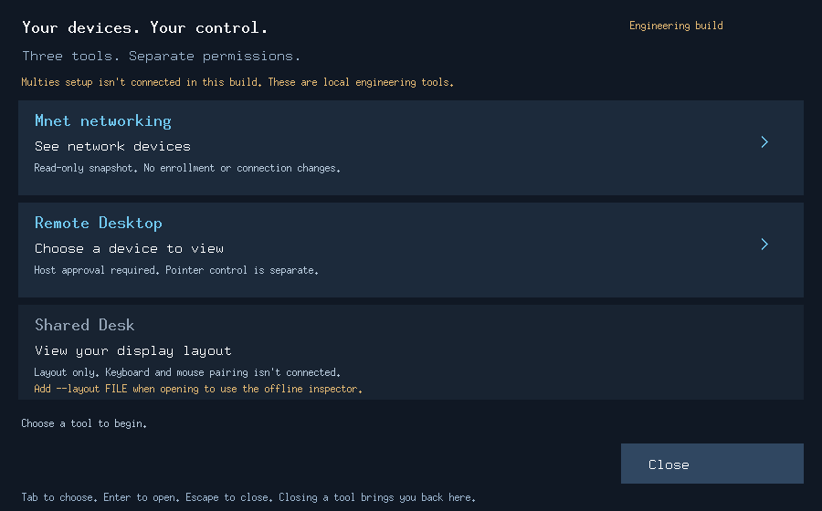
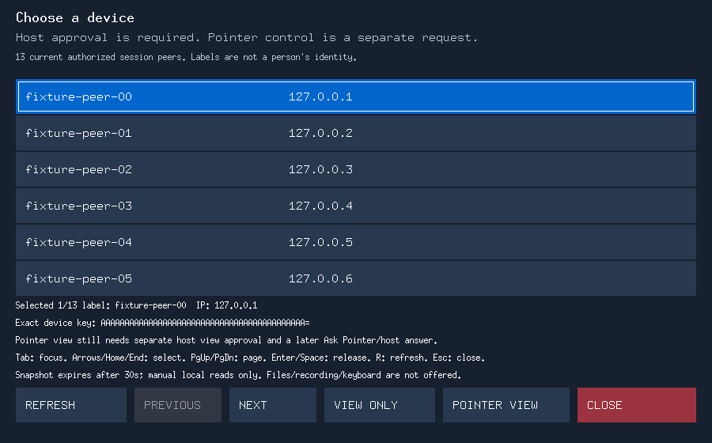

# Desktop entry and complete journey plan

This is a local Linux X11 engineering entry, not the installed consumer app. Multies sign-in, workspace eligibility, enrollment and Shared Desk pairing are not connected here. No successful prototype, current network peer or layout file substitutes for those decisions.

## Current working entry

```
mnet open
mnet open --layout chosen-layout.json
```



The home has three distinct tool choices. Networking opens the actual authenticated read-only device snapshot. Remote Desktop opens the existing current-peer chooser with separate View Only and Pointer View choices. Shared Desk opens only the supplied read-only arrangement inspector; without a supplied layout it is visibly unavailable. No raw-input run or pairing can start from this home.

Opening the home reads no daemon state and starts no network/session operation. A selected home closes and joins its event reader before its child opens. Closing the child returns to a fresh home, not another session. A later device choice rereads current evidence and requires fresh host decisions. Signals cancel the current owner. Existing explicit CLI entry points retain their behavior.

This window uses larger headings/action text and short permission summaries. Technical setup and platform details belong in the owning guides rather than competing with the primary action. Supported local prerequisites are Linux X11, the required readable core fonts, a24-bit TrueColor display and at least940x600pixels. Unsupported configurations fail; there is no Wayland/native fallback or misleading success screen.

## Readable device choice and honest loading

The real peer chooser uses larger heading, device-row and mode-action text while retaining the complete bounded selected label/IP and exact key in its detail panel. Empty or expired rows do not gain eligibility from the new visual style. The viewer has a central waiting-for-host or waiting-for-first-screen panel rather than an unexplained empty canvas. End stays visible; the panel is removed by actual rendered pixels, never merely by host approval. These are implemented screens, not mockups.




The first local loading-panel attempt panicked before host admission because its explicit font-name length was wrong. Actual journey checks caught it, and the source now computes that length. Pixel inspection then caught an inherited text-background color; the drawing resets it before repainting the header. Neither intermediate version was committed or published. These failures are separate from the older unresolved blank-canvas fixtures.

## First-screen failure is a real session outcome

Host approval is not proof that pixels are arriving. After admission, the viewer waits at most15seconds for a usable complete screen. Pending host approval has no new timer. A first complete rendered frame disarms the bound, including when the desktop then stays unchanged. A silent or unusable initial stream ends the attempt, closes the viewer/transport and returns to a clear first-screen failure state when launched from home. No automatic reconnect or reuse of host approval occurs.


This bounds indefinite waiting. It does not diagnose the earlier two concurrent blank-canvas fixture failures. Later unchanged concurrent runs returned first-full captures in100ms-to1s and passed, but those passes are separate evidence. Hosted Chrome first-CDP startup failures are also distinct and remain unresolved.

## Consumer journey, before more surface expansion

The intended installed journey needs these real state transitions and visual priorities:

| Stage | Primary information and action | What must actually happen |
| --- | --- | --- |
| First run | Product name, one short setup explanation, Continue with Multies. | The production bridge must exist before this action can work. Until then show setup unavailable, never a simulated signed-in state or manual network-key fallback as consumer setup. |
| Workspace and device | Current workspace, this device, relevant permission decisions. | Bind fresh verified person/workspace/device/capability evidence. Declining an optional permission must not disable unrelated capabilities. |
| Tool selection | Mnet networking, Remote Desktop, Shared Desk, clearly separate. | Each tool checks its own current scope. A device being online grants no screen or input access. |
| Device selection | Eligible device name, current availability, exact intended mode. | Load real scoped current devices, erase stale selection, revalidate the exact selected key before connecting. |
| Host approval | Who is asking, view-only scope, Allow or Decline. | No pixels before host-local view approval. Pointer control requires its own later host answer. |
| Screen loading | Waiting for the first screen, always-visible End. | Bound absent first pixels after admission; distinguish failure from a working session. |
| Active session | Actual remote pixels, current narrow control state, prominent End. | Local controls never become remote input. Revoke returns to viewing; End retires transport/capture/input rather than only the label. |
| End or failure | Specific outcome and a deliberate return or retry. | Join old owners, discard selection/approvals and require a fresh explicit journey. No background auto-reconnect. |

The engineering home is a partial entry improvement within this plan. Real Multies integration, installed first-run setup, persistent trusted Shared Desk pairing and physical mixed-platform acceptance remain critical-path work. Multies stays read-only, and signing, release, accounts, production infrastructure and additional devices remain outside current execution authority. See [product scope](product-scope.md), [three-tool map](three-tools.md) and [authorization boundary](multies-boundary.md).

## Actual acceptance and limits

`home-validation.py` runs the built executable against a private Unix API and disposable X display. It checks zero home API reads, disabled layout, real device/chooser/inspector routing, child return, no implicit retry, pending-key cancellation and SIGTERM cleanup. No fake home UI replaces the executable.

`MNET_VIEWER_HOME=1 native-pointer-validation.py` takes the full actual home to chooser to host-approved view to separately approved pointer journey. It retains exact two native clicks, one scroll, zero native keys, all three native owners joined, decline/revoke/focus-loss behavior and End returning to a fresh home without surviving host/view windows. Both host sizes remain required.

`first-screen-validation.py` uses actual host approval with a deliberately silent capturer. It checks the production15second bound, native viewer/host closure and the inspected fresh-home failure state. Focused tests separately cover a silent admitted transport, no timeout on pending host consent, owner cleanup and disarming after the first frame on an unchanged desktop. These are same-computer disposable-X11 tests, not physical two-computer or live Multies evidence.

The general CI test steps include these journeys and retain failed synthetic screenshots/logs. Workflow triggers, all non-general native lanes and their path filters are unchanged. Source publication does not close any release gate.

## Installed engineering entry

The [private Linux source installation](linux-local-installation.md) now builds both executables into a new owned prefix and supplies an actual desktop entry. Its acceptance launches that entry through Gio from a special-character path, verifies the installed executable owns the actual home, closes it and removes only unchanged installation files. It does not install a service, start a daemon, enroll a device, alter Multies or create Mnet state. This is a working engineering install/launch/removal path, not the missing production first-run bridge.
