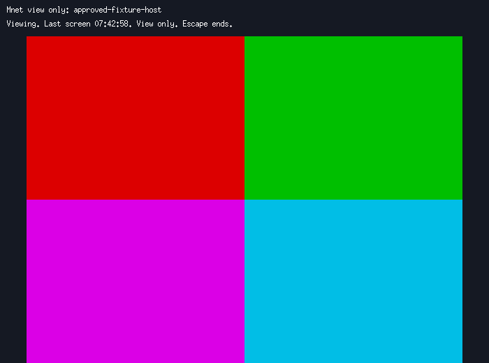
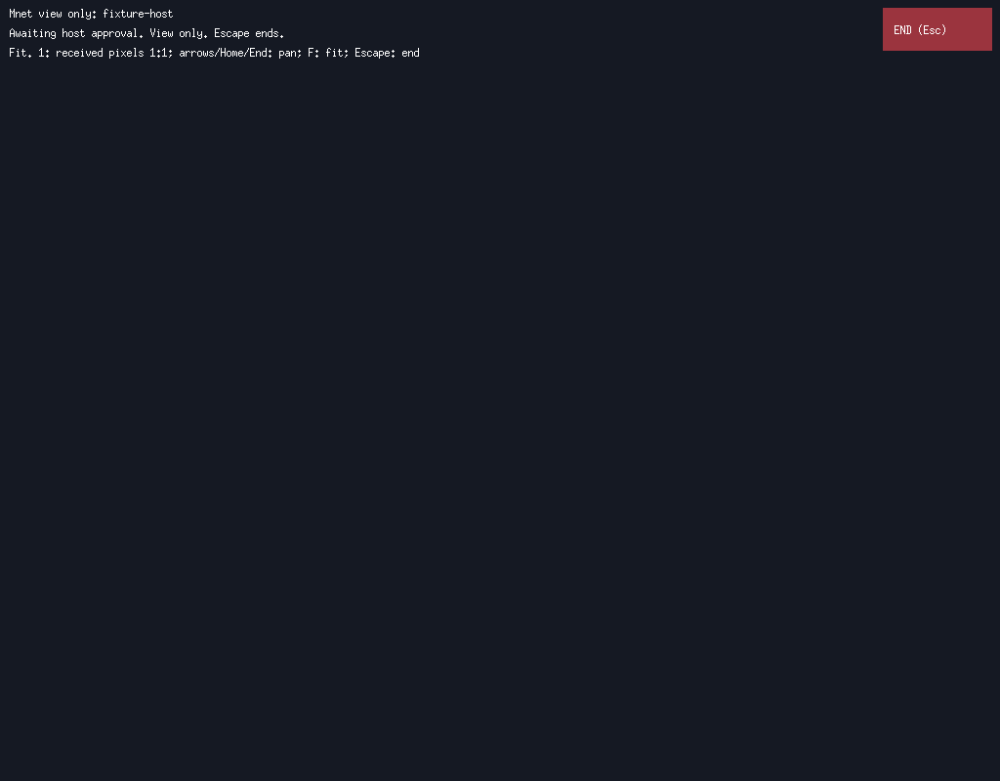
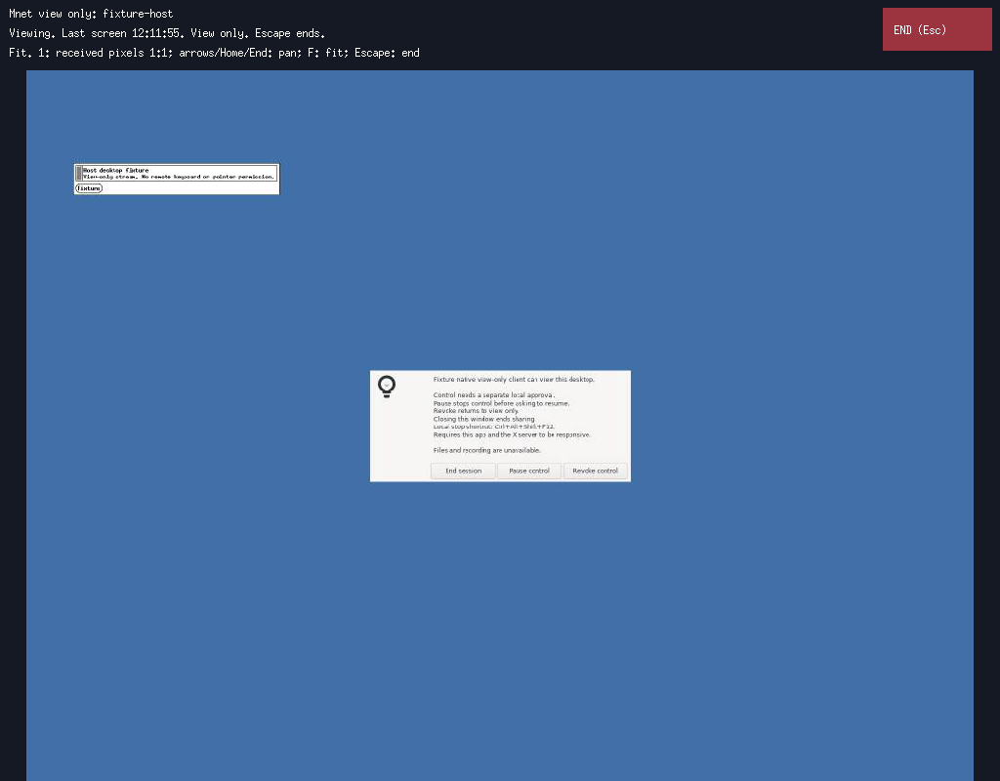
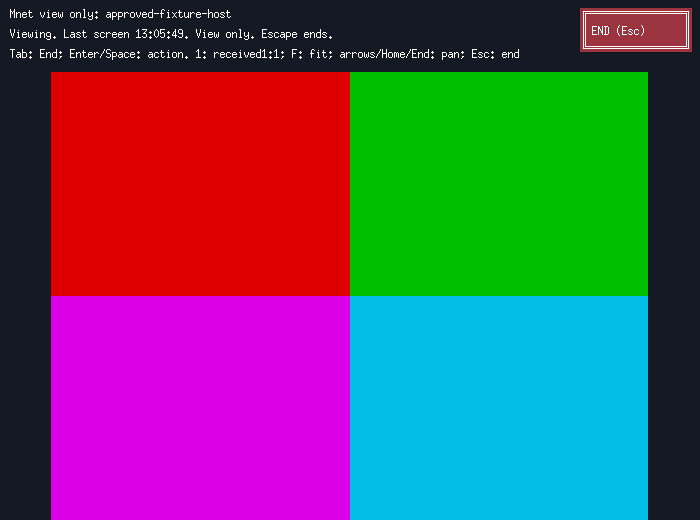

# Native Linux view-only client

This is an explicit engineering entry, not Multies sign-in or a released companion app.

```
mnet --state /path/to/viewer-state session view exact-peer-name
```

The viewer daemon must already be up with a uniquely selected current peer. On the host, run the existing attended X11 host in its local desktop console. The new client requires an explicit attended-view protocol reply, so older/headless auto-accept hosts cannot silently replace local approval. Existing terminal `session connect` and explicit legacy hosting are unchanged.

The local window opens before authorization/dial. It shows no desktop while waiting. Host-local viewing approval starts capture; input control is not requested. Local Escape/window close and Ctrl-C end the single attempt, including pending approval. There is no automatic reconnect. Each new invocation selects current peer/key evidence and requests viewing again.

No keyboard/pointer forwarding, screen saving, file destination, clipboard, recording or control UI is enabled by this entry. Receiving network frames is not a new workspace authority. The attended marker describes the supporting host code path; it cannot independently prove that an arbitrary remote application or person followed that policy. Current identity and authorized mesh transport are still required.

## Rendering and lifetime

Linux X11 with24-bit TrueColor/32-bit pixels in the supported byte/mask format is required. Wayland, absent/small displays and unsupported formats refuse, without fallback. Complete bounded JPEG images are fit to the local window without stretching. Fit is the default. Local `1` switches to one decoded received-frame pixel per local pixel, arrow keys pan64pixels, Home returns to the top-left and End to the bottom-right. `F` returns to fit. Small received images stay centered without upscaling in1:1mode. Pan clamps after received-frame or window size changes. All these keys stay local and grant no remote input. This avoids an extra client-side shrink but cannot undo host capture scaling or JPEG loss, especially on the2048px fixture. Wire deltas are composed before display coalescing. Offscreen composition prevents exposing partially uploaded strips. Peer text is bounded plain ASCII, and the last-screen receipt time is shown rather than treating an unchanged desktop as a broken connection. This is receipt time, not source capture latency or a freshness guarantee.

One run owns the display/window/GC, pending dial, active mux and one pending completed frame. Local close/cancel, host End, current-authority loss and display failure retire that run. No queued frame revives a retired window. The host now also cancels an unanswered view prompt on pending peer EOF, early data, authority withdrawal or parent cancellation. Its pending-only reader is joined before mux dispatch can start, so it never races the active session reader. No valid client data belongs before the hello reply.

An unresponsive X server can still block checked requests. This source does not establish an always-responsive stop UI, physical input safety, secure desktop/lock support, multi-machine behavior or macOS/Windows/Wayland viewing. Existing attended input cleanup limits remain unchanged.

## Acceptance evidence

The disposable runtime builds the actual CLI and host test executable, starts two isolated X servers, supplies explicitly synthetic local API identity evidence, and answers real Zenity approval windows. It exercises1024x768 and2048x1536 host displays, blank preapproval, decline, pending-view cancellation, actual host capture plus changed-desktop deltas, local End, host End, withdrawn authority and viewer X-server death. No host injector may be created. A protocol fixture checks fixed image landmarks, aspect-fit/resize/expose and joined Escape. A separate16-bit X server confirms refusal. These are real native processes/pixels on one machine, not physical/two-computer/Multies acceptance.

The pending-view regression first failed for both peer-close and authority-loss. The attended-only hello regression first showed that an unmodified legacy listener admitted the new intent; explicit capability negotiation now refuses that substitution. Renderer visual inspection caught blank/partial display between checked strip uploads; composition now publishes one completed pixmap.

Source checks include uncached full race tests, focused lifecycle/identity repetitions, vet/build/cross-build and existing session/mesh gates. Fresh hosted results must be recorded separately from these local results.

## Actual local pixels

These are synthetic owned desktops through the built client, not user devices:




## Received-pixel1:1 acceptance

The actual native protocol fixture first failed when pressing1left the same fit-scaled pixels. It now checks source landmarks in fit,1:1, bottom-right pan and restored fit, in addition to resize/expose. Geometry tests cover crop bounds, exact source/target pixel dimensions, frame-size changes and unrelated local keys. Both native host display sizes run the mode too with no input injector. Inspected1024px source text avoids the extra fit shrink;2048px source detail remains limited by host downscaling/JPEG.


## Separate pointer engineering entry

The [explicit native pointer viewer](desktop-pointer-viewer.md) is a separate `session point` command. This `session view` entry stays view-only, does not request control and never forwards local input. Shared rendering/lifetime checks do not combine their authority.

## Visible local End control

The native header now has a44px-high End button, visible while waiting as well as viewing. It ends this one attempt through the same joined path as Escape. The driver clicks the real button while host approval is pending and during actual viewing, then verifies host prompt/capture/window retirement. It does not send a remote click. View-only still has no control-request button. Existing Escape, window close and Ctrl-C remain available; End in the image-navigation key instructions still means the local keyboard pan key, not the red button.

Buttons live entirely above the received desktop. A left press and matching release must name the same local target. A press in the image followed by release over End does not activate it, nor does a press in a button followed by release in the image become remote input. Focus loss and resize retire a pending toolbar press. The supported window minimum is now320x120 for view-only and640x120 for pointer mode; insufficient initial displays or resized windows refuse rather than overlap controls. Existing header text is bounded to the space before buttons.





During local toolbar work, the larger protocol resize case twice missed its unchanged three-second pixel postcondition, retaining clipped preceding-size pixels. A longer private diagnostic observation established eventual Configure handling and slow full-image repaint, not a passed acceptance or root-cause repair. Repaint coalescing alone did not reliably solve it. The final path coalesces resize/expose work per event batch and precomputes nearest-pixel columns for each repaint, keeping the same pixels/stride/padding. Equivalence tests include crop origins, padded subimages, up/downsampling and partial strips. An isolated race-enabled pixel-preparation benchmark measured roughly55ms before and37ms after in this environment; it is not end-to-end display latency or an X11 responsiveness guarantee. A later unchanged larger resize acceptance failed again, so those isolated passes and the faster pixel loop were not treated as a reliable repair. The repeated full-frame work was then addressed with the bounded cache below. Final cache-enabled equal/large native journeys pass the original unchanged checks. These failures are retained, with no deadline/assertion relaxation or claim of physical/performance acceptance.

### One owned current-image cache

Repeated complete JPEG content now reuses its decoded image by a fixed SHA256 digest. The digest is local rendering metadata, never identity or input authority. No encoded JPEG copy or screen history is retained. Header/expose redraws reuse one owned server pixmap for the current image/crop/target geometry, instead of rescaling and uploading the same image again. A changed complete frame, pan/zoom or window geometry frees and replaces that pixmap. All strips must upload successfully before a new cache is copied into the offscreen composition. Display/upload failure remains terminal. Close frees the final pixmap, decoded image, cache references and digest.

This adds one bounded image pixmap alongside the existing bounded composition pixmap, not an unbounded frame queue. The existing16-megapixel geometry bound remains. A cache never supplies permission, keeps input enabled or starts reconnecting. Local authority/status text is repainted independently, including pointer grant changes. Receipt time continues to update for identical completed frames without implying source capture freshness.

A separate actual-X11 test executes12 identical completed frames and a header-only update, requiring the same decoded image/server pixmap. It checks native viewport/resize/changed-frame replacements, queries the server to prove each old pixmap was freed, and proves final native cache and in-memory ownership are gone after Close. Both final source display sizes pass this test and the unchanged resize/expose/fit/1:1/pan/End journeys. Both pointer sizes also pass with the cache. The earlier resize failures remain evidence; these owned fixtures do not establish a physical stop-latency guarantee or eliminate unresponsive-X11 risks.

## Local keyboard focus

Tab and Shift+Tab now focus enabled native header buttons with a visible double-line ring. Enter or Space activates only on the matching key release over the same focused action. The view-only window has only End; it never exposes Ask or Release. The pointer entry adds the existing narrow Ask/Release actions, not keyboard forwarding. A request still needs the host-local default-decline answer. Focus loss, resize, another local control gesture or a different key cancels a pending activation. Input-increasing activations also need the exact same permission snapshot at release; local End is not disabled by an unrelated remote revision. F8/F9/Escape and existing view controls remain local alternatives.

The old viewer fails the actual keyboard Ask regression. Actual equal/large pointer journeys now use keyboard Ask, Release and End, still requiring exactly two native clicks, one native wheel event, zero native key events and joined cleanup. A held End is canceled across real focus loss. Both view-only sizes verify focused keyboard End with no input owner. Thirty focused race repetitions and full uncached race/vet/build plus Darwin/Windows CLI builds pass locally. This is local keyboard usability, not screen-reader/native accessibility or cross-platform input completion.

An immediate screenshot after Tab once retained the previous focused button, despite a later successful keyboard action. The driver now waits for actual focus-ring pixels inside the existing bounded event wait before capture/activation. No timeout, input-count or cleanup assertion was relaxed. Final Ask/End/view-only ring pixels were inspected.


