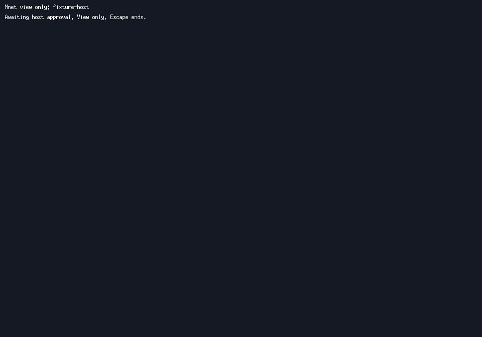
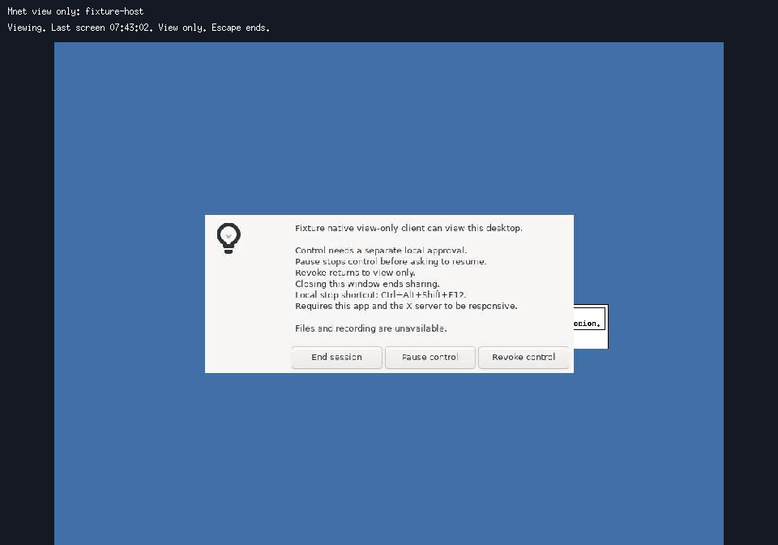
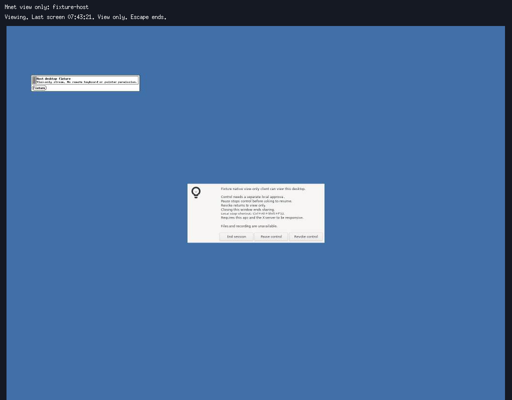
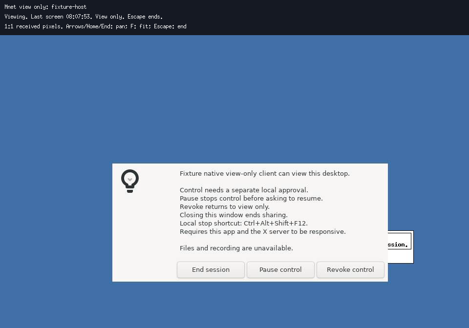
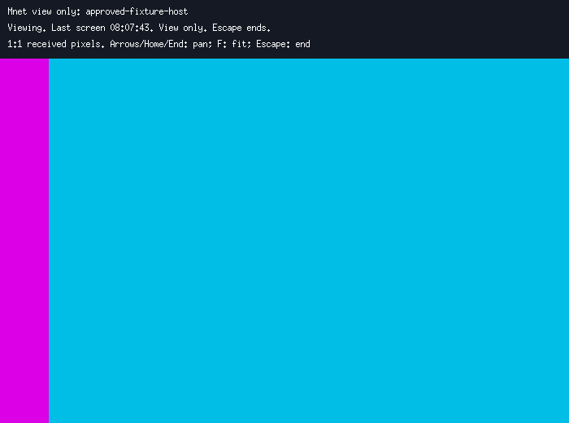

# Native Linux view-only client

This is an explicit engineering entry, not Multies sign-in or a released companion app.

```
mnet --state /path/to/viewer-state session view exact-peer-name
```

The viewer daemon must already be up with a uniquely selected current peer. On the host, run the existing attended X11 host in its local desktop console. The new client requires an explicit attended-view protocol reply, so older/headless auto-accept hosts cannot silently replace local approval. Existing terminal `session connect` and explicit legacy hosting are unchanged.

The local window opens before authorization/dial. It shows no desktop while waiting. Host-local viewing approval starts capture; input control is not requested. Local Escape/window close and Ctrl-C end the single attempt, including pending approval. There is no automatic reconnect. Each new invocation selects current peer/key evidence and requests viewing again.

No keyboard/pointer forwarding, screen saving, file destination, clipboard, recording or control UI is enabled by this entry. Receiving network frames is not a new workspace authority. The attended marker describes the supporting host code path; it cannot independently prove that an arbitrary remote application or person followed that policy. Current identity and authorized mesh transport are still required.

## Rendering and lifetime

Linux X11 with24-bit TrueColor/32-bit pixels in the supported byte/mask format is required. Wayland, absent/small displays and unsupported formats refuse, without fallback. Complete bounded JPEG images are fit to the local window without stretching. Fit is the default. Local `1` switches to one decoded received-frame pixel per local pixel, arrow keys pan64pixels, Home returns to the top-left and End to the bottom-right. `F` returns to fit. Small received images stay centered without upscaling in1:1mode. Pan clamps after received-frame or window size changes. All these keys stay local and grant no remote input. This avoids an extra client-side shrink but cannot undo host capture scaling or JPEG loss, especially on the2048px fixture. Wire deltas are composed before display coalescing. Offscreen composition prevents exposing partially uploaded strips. Peer text is bounded plain ASCII, and the last-screen receipt time is shown rather than treating an unchanged desktop as a broken connection. This is receipt time, not source capture latency or a freshness guarantee.

One run owns the display/window/GC, pending dial, active mux and one pending completed frame. Local close/cancel, host End, current-authority loss and display failure retire that run. No queued frame revives a retired window. The host now also cancels an unanswered view prompt on pending peer EOF, early data, authority withdrawal or parent cancellation. Its pending-only reader is joined before mux dispatch can start, so it never races the active session reader. No valid client data belongs before the hello reply.

An unresponsive X server can still block checked requests. This source does not establish an always-responsive stop UI, physical input safety, secure desktop/lock support, multi-machine behavior or macOS/Windows/Wayland viewing. Existing attended input cleanup limits remain unchanged.

## Acceptance evidence

The disposable runtime builds the actual CLI and host test executable, starts two isolated X servers, supplies explicitly synthetic local API identity evidence, and answers real Zenity approval windows. It exercises1024x768 and2048x1536 host displays, blank preapproval, decline, pending-view cancellation, actual host capture plus changed-desktop deltas, local End, host End, withdrawn authority and viewer X-server death. No host injector may be created. A protocol fixture checks fixed image landmarks, aspect-fit/resize/expose and joined Escape. A separate16-bit X server confirms refusal. These are real native processes/pixels on one machine, not physical/two-computer/Multies acceptance.

The pending-view regression first failed for both peer-close and authority-loss. The attended-only hello regression first showed that an unmodified legacy listener admitted the new intent; explicit capability negotiation now refuses that substitution. Renderer visual inspection caught blank/partial display between checked strip uploads; composition now publishes one completed pixmap.

Source checks include uncached full race tests, focused lifecycle/identity repetitions, vet/build/cross-build and existing session/mesh gates. Fresh hosted results must be recorded separately from these local results.

## Actual local pixels

These are synthetic owned desktops through the built client, not user devices:








## Received-pixel1:1 acceptance

The actual native protocol fixture first failed when pressing1left the same fit-scaled pixels. It now checks source landmarks in fit,1:1, bottom-right pan and restored fit, in addition to resize/expose. Geometry tests cover crop bounds, exact source/target pixel dimensions, frame-size changes and unrelated local keys. Both native host display sizes run the mode too with no input injector. Inspected1024px source text avoids the extra fit shrink;2048px source detail remains limited by host downscaling/JPEG.





## Separate pointer engineering entry

The [explicit native pointer viewer](desktop-pointer-viewer.md) is a separate `session point` command. This `session view` entry stays view-only, does not request control and never forwards local input. Shared rendering/lifetime checks do not combine their authority.
