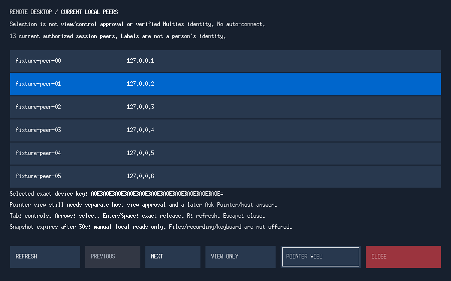

# Remote Desktop current-peer chooser

`mnet session browse` opens a native Linux X11 engineering chooser. It avoids typing a peer identifier. It is not Multies sign-in, installed consumer setup or a source of new device trust. Existing `session view <peer>`, `session point <peer>` and legacy engineering commands keep their existing behavior.

## Journey and consent

1. The chooser makes authenticated GET-only reads of the local daemon's status and private session-peer evidence. Only exact unambiguous name/address/key matches appear. Down, malformed, missing or refused evidence cannot supply a usable selection. It does not look outside this daemon or enroll anything.
2. Select a row explicitly. The chooser shows the full selected public device key, not a claimed person's identity. Selection alone makes no session connection.
3. Choose **View Only** or **Pointer View**. Before session TCP, current daemon evidence must still match the selected name, address and full key. Replacement or removal is a refusal, not selection of a successor. The existing dial checks and ongoing authorization watcher remain in place.
4. The existing host-local view approval is still required. Pointer View opens the existing pointer-only client, not an input grant. Ask Pointer and a separate host-local answer are still needed before pointer dispatch. No keyboard, dragging, clipboard, files or recording is offered by this path.

The chooser closes after its one choice. It does not reconnect, save trust or retain a selected peer for another run. Returning to choose another peer requires a fresh invocation.

## Local controls and freshness

- Six44px rows per page. Pagination is local, never a daemon read.
- Mouse selection and buttons require a matching press/release on one enabled target. A row press cannot become a mode choice on release.
- Tab/Shift+Tab moves through enabled rows and controls. Up/Down selects a current row. Enter/Space activates only on a matching focused release. Tab and focus loss cancel pending activation.
- Refresh manually reads current local evidence and clears rows/selection first. There is no automatic daemon polling.
- A snapshot expires after30seconds. Expiry, refresh, empty results, failures and cancellation cannot preserve an actionable old selection. Mode activation checks age directly, not only the expiry paint tick.
- Escape/Close cancels and joins any pending read. Unsupported resize or display failure ends the chooser, without a terminal fallback or hidden connection.

The window needs a supported local X11 desktop with at least940x600 pixels. Windows/macOS builds reject the chooser explicitly; compilation is not native UI support. Physical mixed-platform operation, OS accessibility integration, installed setup and the real Multies authorization bridge remain open.

## Actual source evidence

Model tests cover exact, duplicate, missing, wrong-key and non-Up evidence, explicit selection, future/expired snapshots and refresh invalidation. The real built-window fixture uses13 synthetic authorized peers across three pages. It checks mismatched/focus-lost gestures, exact keyboard mode focus pixels and Tab cancellation, local pagination, empty/error/expiry clearing, no polling, canceled read and a replaced selected key refused before a listening TCP socket is contacted.

Both equal and large disposable-display journeys enter the existing attended host through the chooser. View Only retains its zero-injector check. Pointer View still passes two native target clicks, one scroll, zero target keys, separate host consent, local release/focus-loss, host decline/revoke and joined End. All are same-host synthetic identity/X11 fixtures, not live Multies identity, physical computers or an internet path.

Two fixture mistakes were retained and corrected without changing product admission rules: a synthetic response used `public_key` instead of the real private API's `PublicKey`, correctly yielding no eligible peers; a keyboard driver initially counted one Tab too far, which visual inspection caught. The final driver waits for actual View/Pointer focus pixels before checking pending-key cancellation. Thirty focused model race repetitions, full uncached race/vet/build and Darwin/Windows CLI cross-builds pass.

## Inspected native windows

These images are captured from the actual current built chooser and use private synthetic local evidence.

