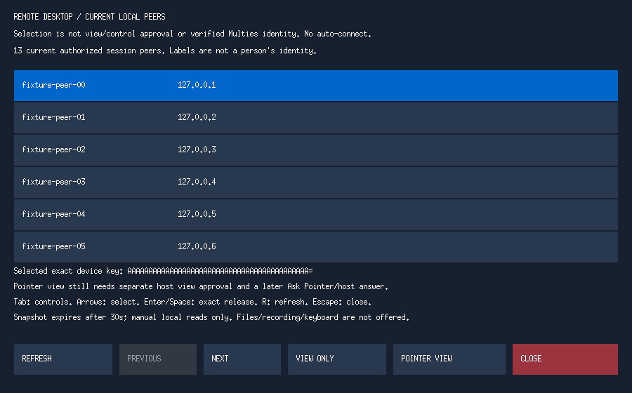
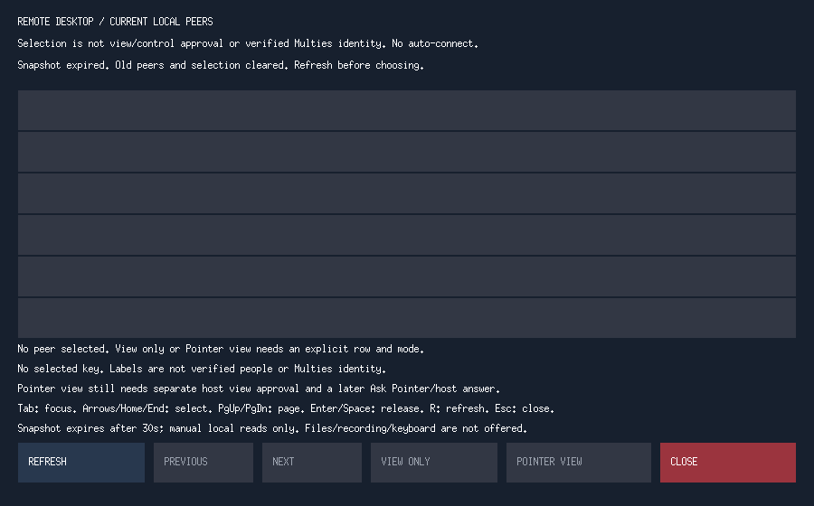
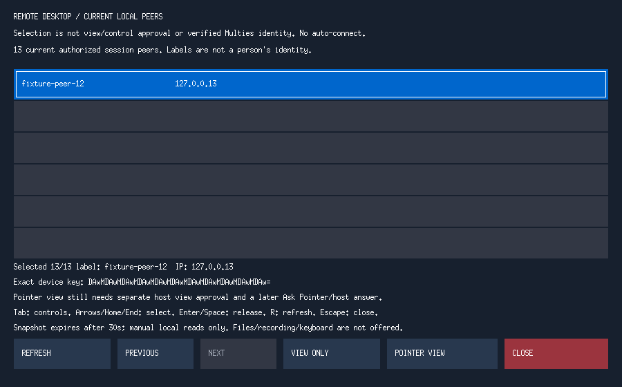
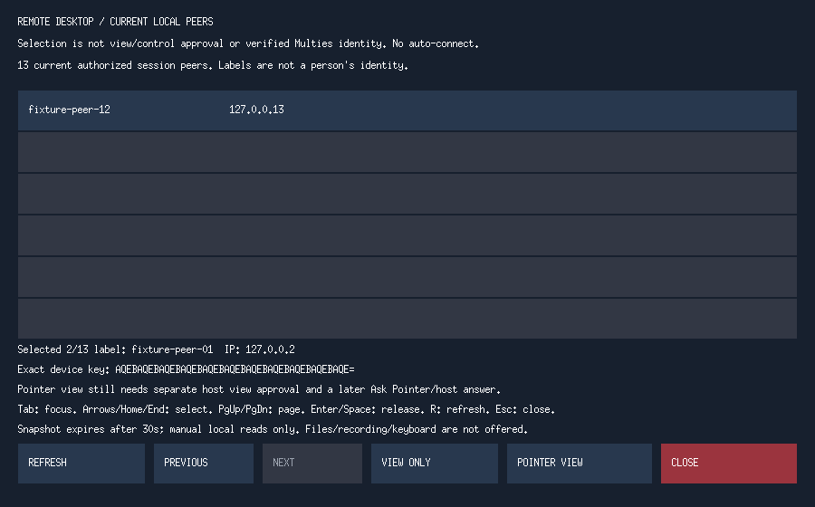
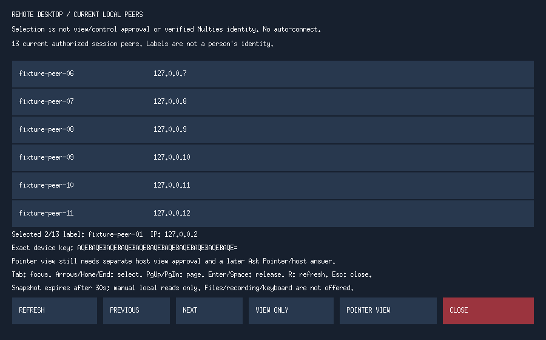
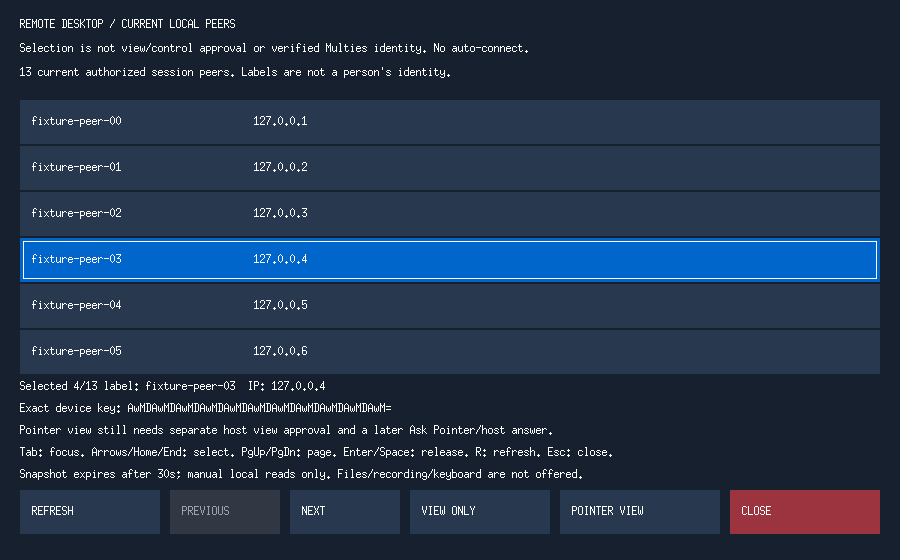

# Remote Desktop current-peer chooser

`mnet session browse` opens a native Linux X11 engineering chooser. It avoids typing a peer identifier. It is not Multies sign-in, installed consumer setup or a source of new device trust. Existing `session view <peer>`, `session point <peer>` and legacy engineering commands keep their existing behavior.

## Journey and consent

1. The chooser makes authenticated GET-only reads of the local daemon's status and private session-peer evidence. Only exact unambiguous name/address/key matches appear. Down, malformed, missing or refused evidence cannot supply a usable selection. It does not look outside this daemon or enroll anything.
2. Select a row explicitly. The chooser shows the full selected public device key, not a claimed person's identity. Selection alone makes no session connection.
3. Choose **View Only** or **Pointer View**. Before session TCP, current daemon evidence must still match the selected name, address and full key. Replacement or removal is a refusal, not selection of a successor. The existing dial checks and ongoing authorization watcher remain in place.
4. The existing host-local view approval is still required. Pointer View opens the existing pointer-only client, not an input grant. Ask Pointer and a separate host-local answer are still needed before pointer dispatch. No keyboard, dragging, clipboard, files or recording is offered by this path.

The chooser closes after its one choice. It does not reconnect, save trust or retain a selected peer for another run. Returning to choose another peer requires a fresh invocation.

## Local controls and freshness

- Six44px rows per page. Pagination is local, never a daemon read.
- Mouse selection and buttons require a matching press/release on one enabled target. A row press cannot become a mode choice on release.
- Tab/Shift+Tab moves through enabled rows and controls. Up/Down selects a current row. Home/End selects and focuses the first/last current row across pages, without a read or connection. Enter/Space activates only on a matching focused release. Tab and focus loss cancel pending activation.
- Refresh manually reads current local evidence and clears rows/selection first. There is no automatic daemon polling.
- A snapshot expires30seconds after the first local status read begins, not30seconds after its final authorization response arrives. Expiry, refresh, empty results, failures and cancellation cannot preserve an actionable old selection. Mode activation checks age directly, not only the expiry paint tick.
- Escape/Close cancels and joins any pending read. Unsupported resize or display failure ends the chooser, without a terminal fallback or hidden connection.

The window needs a supported local X11 desktop with at least940x600 pixels. Windows/macOS builds reject the chooser explicitly; compilation is not native UI support. Physical mixed-platform operation, OS accessibility integration, installed setup and the real Multies authorization bridge remain open.

## Actual source evidence

Model tests cover exact, duplicate, missing, wrong-key and non-Up evidence, explicit selection, future/expired snapshots and refresh invalidation. The real built-window fixture uses13 synthetic authorized peers across three pages. It checks mismatched/focus-lost gestures, exact keyboard mode focus pixels and Tab cancellation, local pagination, empty/error/expiry clearing, no polling, canceled read and a replaced selected key refused before a listening TCP socket is contacted.

Both equal and large disposable-display journeys enter the existing attended host through the chooser. View Only retains its zero-injector check. Pointer View still passes two native target clicks, one scroll, zero target keys, separate host consent, local release/focus-loss, host decline/revoke and joined End. All are same-host synthetic identity/X11 fixtures, not live Multies identity, physical computers or an internet path.

Two fixture mistakes were retained and corrected without changing product admission rules: a synthetic response used `public_key` instead of the real private API's `PublicKey`, correctly yielding no eligible peers; a keyboard driver initially counted one Tab too far, which visual inspection caught. The final driver waits for actual View/Pointer focus pixels before checking pending-key cancellation. Thirty focused model race repetitions, full uncached race/vet/build and Darwin/Windows CLI cross-builds pass.

## Inspected native windows

These images are captured from the actual current built chooser and use private synthetic local evidence.

## Supported control colors

The device window, Remote Desktop chooser and offline layout inspector paint literal RGB control pixels. They now require the root's exact supported 24-bit TrueColor RGB visual before creating a window or reading local daemon evidence. Palette, 16-bit, missing/mismatched-root, swapped-mask and other unsupported visuals fail rather than rendering misleading selection/disabled/focus colors. This is separate from the desktop viewer's stricter raw-frame upload format check; it does not claim new display support.

An actual old-source 8-bit device window rendered black controls with green text instead of the intended colors. The new real built three-window fixture rejects both 8-bit and 16-bit root visuals before any window or local daemon call. Exact root/mask model checks pass, and the complete supported 24-bit native device, chooser and offline inspector journeys still pass with inspected pixels. Full uncached race/vet/build and CLI cross-builds pass. This does not change networking, session or Shared Desk authority.

## Oldest-read freshness and canceled evidence

Snapshot age now begins before the first status request. Sequential status/authorization reads cannot extend the age of the oldest evidence by stamping only the final response. Nil/already-canceled owners refuse before any HTTP operation. Cancellation after a status response prevents the authorization read; cancellation after a buffered authorization response prevents publication. A response completing after the age budget is refused rather than presented as fresh. These checks create no automatic polling, connection or authority.

New deterministic custom-transport tests return successful bodies despite cancellation and verify zero/one/two requests at each cancellation stage, without publishing a snapshot. The age test compares the recorded snapshot timestamp to the first request itself, and checks exact30second selection refusal. Thirty focused model race repetitions, the complete actual chooser journey, full uncached race/vet/build and CLI Darwin/Windows cross-builds pass. Actual selected/expired pixels inspected; no UI layout changed. This does not make two sequential reads atomic or replace the exact current peer revalidation before connection and ongoing authorization watcher. Fresh hosted verification remains separate.

## Keyboard list endpoints

Home and End now move explicitly to the first and last eligible peer across all local pages and place keyboard focus on that row, not on a previously focused connection mode. Any pending key/mouse gesture is canceled first. Empty, future, expired or cleared snapshots cannot supply an endpoint. A mode still requires its own matching focused activation and exact current peer revalidation.

The actual13peer journey checks Home/End page movement, selected/focused pixels and unchanged local request count with no connection. Model cases include empty/one/full/partial pages, first/last endpoints and invalid-age refusal. Thirty focused model races, complete chooser, both-size attended view/pointer entry and full uncached race/vet/build plus CLI cross-builds pass. Current first/last peer and ordinary selected/expired/focus pixels inspected. All are synthetic local X11 evidence, not physical or Multies identity acceptance.

## Actual selected-peer changes before connection

The complete real chooser journey now repeats the final selection-to-mode transition with six separate current-evidence changes: selected key replaced, peer removed, name changed, address moved, duplicate record added and local daemon no longer Up. Each fresh actual command refuses before a passive TCP sentinel can accept any session connection. Key/name changes also require the exact selected-peer-changed diagnostic. These checks cover the actual CLI handoff, not only its selector model. All six cases and the complete current chooser journey pass, followed by thirty model race repetitions. No product admission rule changed, and no successor is chosen automatically. Host view approval and separate pointer approval still apply to successful journeys. This is private synthetic evidence, not live Multies identity or physical-network acceptance.

## Retained selection is explicit across pages

Local pagination keeps the explicit selection, but now the detail panel names its eligible-row index/total, bounded printable label, IP and full exact device key. Moving to another page cannot make the visible rows look like the selected peer: the detail still identifies the original row. The label is only a label, not a person's verified identity. Future, expired, refreshed and cleared evidence cannot retain the old label or key.

Thirty focused model race repetitions and the complete actual chooser pass, including a selected row on another page and all six pre-TCP refusal cases. Full uncached race/vet/build, Darwin/Windows CLI cross-builds, and both-size actual attended view/pointer chooser entry pass. Current selected, off-page, keyboard focus and expired pixels were inspected. No connection, consent or trust rule changed.

## Delayed actual evidence still ages from request start

The actual chooser fixture now delays each of its two local reads by1second. The selected snapshot is expired at30.80seconds from its first observed request, while only28.78seconds have elapsed since the final response was shown. No automatic request occurs. This distinguishes request-start freshness from a receipt-stamped snapshot in the built UI, alongside deterministic cancellation/age model tests. Complete chooser and full uncached race/vet/build pass.

An initial fixture delayed both reads by2seconds and hit the existing bounded chooser read timeout instead of reaching ready. The fixture was corrected to1second per read; no product timeout was extended or retry added. This remains same-host synthetic local evidence, not an atomic read or proof of live Multies identity.

## Keyboard pages without changing selection

Page Up/Page Down now inspect previous/next local pages, clamped at the first/last page. Unlike Up/Down or Home/End, they do not select a different peer. The exact retained selection stays in the detail panel. A page key cancels any pending activation and drops mode focus, so releasing an earlier Enter cannot connect from the new page. Unavailable/expired snapshots have no peer pages. No daemon read, connection or renewed snapshot age is created.

Thirty focused model race repetitions cover empty/one/full/partial and4096peer lists, invalid-age evidence, boundaries and unchanged selection/timestamp. The actual chooser checks PageDown during a pending Pointer activation, dropped focus pixels, unchanged local request count, PageUp return and both page boundaries. The complete actual journey, both-size attended view/pointer chooser entry, full uncached race/vet/build and CLI Darwin/Windows cross-builds pass. Updated page/selection/focus/expiry pixels inspected. One combined validation shell exceeded its outer time limit after actual chooser/full race output; vet/build/cross-builds were rerun separately, then the final complete source gates passed. No product timeout or assertion was relaxed.

## Mouse pagination also drops old mode focus

A failing-first actual pixel check found that clicking Next after keyboard Pointer focus left that old mode focused. Previous/Next now drop mode focus as Page Up/Page Down do. The retained selected peer stays explicit; another deliberate mode focus/activation is required rather than Enter using the mode from a different page. This changes no peer admission or host approval.

The actual fixture now inspects the unfocused Pointer pixels after mouse paging, presses Enter and requires no exit, connection or extra local read, then restores keyboard focus explicitly for the existing pending-page-key case. Before/fixed actual page pixels were inspected. Complete actual chooser, thirty focused model race repetitions, both-size actual attended view/pointer entry and full uncached race/vet/build plus CLI cross-builds pass.

## Selecting another row cannot inherit an old mode

Clicking a peer row now places keyboard focus on that selected row, matching Up/Down and Home/End. It cannot leave View Only or Pointer View focused from a previously reviewed peer. Enter on the new row reviews that row only; a connection mode needs its own deliberate focus/activation. Existing exact peer revalidation and host view/pointer approvals remain unchanged.

A failing-first actual image showed selected peer4/13 with Pointer mode still focused. Fixed pixels show the focus ring on peer4/13 and no Pointer ring; actual Enter does not connect, exit or read local evidence. Complete actual chooser, thirty focused model races, both-size attended view/pointer chooser entries and full uncached race/vet/build plus CLI cross-builds pass. Before/fixed pixels inspected. This is private synthetic local identity evidence, not a Multies person or physical-device claim.

## Cancellation also reaches local eligibility computation

After bounded HTTP reads, the chooser now checks its owner between each peer's existing exact selector/admission calculation and again after sorting. A canceled owner cannot require processing the remaining4096row limit or return partly accepted rows. The legacy selector and identity-matching rules are unchanged; no cache, alternative matcher or larger evidence limit is introduced.

A one-shot local benchmark of the existing4096peer computation took about680ms on this runner, motivating cooperative cancellation rather than a claim that HTTP cancellation alone joins every stage immediately. This is a synthetic measurement, not supported fleet/UI latency. Deterministic owner tests cancel before computation and after multiple eligible rows, requiring no partial result and no further loop checks. Thirty focused model races, the complete actual chooser, full uncached race/vet/build and CLI cross-builds pass. Actual pending-request SIGTERM remains a separate native case; this new computation-stage check is model evidence, not relabeled native cancellation acceptance.

## Both sequential request owners cancel on SIGTERM

The actual chooser fixture separately sends SIGTERM during its initial status request and during the later session-authorization request after status has completed. Each process exits normally within the fixture bound and joins its request. This adds second-stage native acceptance to the existing computation-stage cancellation models. Complete actual chooser, thirty focused model race repetitions, full uncached race suite, vet and build pass. No request timeout, retry, polling, evidence or connection rule changed.

## Fixed-size windows retire on desktop geometry change

These engineering controls now subscribe to root-window structure changes before opening the child window or reading local evidence. A geometry round trip after subscription also checks the setup-to-watch gap. Any later root width/height change ends that window instead of leaving fixed controls clipped or actionable on a changed desktop. Restoring the desktop size does not revive the old snapshot, selection or pending gesture. This is deliberately fail-closed, not automatic reflow; reopen the command for a fresh window. Ordinary window placement changes without a size change remain supported.

A failing-first actual offline-inspector case remained open after the root shrank while its own child size stayed unchanged. After the repair, the complete actual device and chooser fixtures pass ready, pending-read and immediately-restored root changes. Both-size offline inspectors end on root resize with unchanged files and zero daemon calls. Thirty focused race repetitions, fresh whole-repository race/vet/build, Darwin/Windows cross-builds, unsupported8/16bit refusal and both-size attended view/pointer chooser journeys pass. Current pre-change native pixels were inspected for all three windows. One combined fixture shell reached its outer time limit after both fixtures had printed their final passes; independent full race/vet/build and the remaining native checks then completed separately. No daemon polling, reconnect, admission, consent or release change.

## Cancellation during a stalled response body

Actual process acceptance now separately reaches successful HTTP headers and one response-body byte, then stalls the disposable local server for5seconds. SIGTERM must cancel and join within2seconds rather than wait for that body. The device status path and both sequential chooser paths pass separately. These cases distinguish body-read cancellation from the existing waits before response headers. They add no product timeout, retry or network behavior. Complete actual device/chooser fixtures and thirty focused snapshot model race repetitions pass. Evidence remains private synthetic local API/X11, not a live fleet or Multies identity claim.
