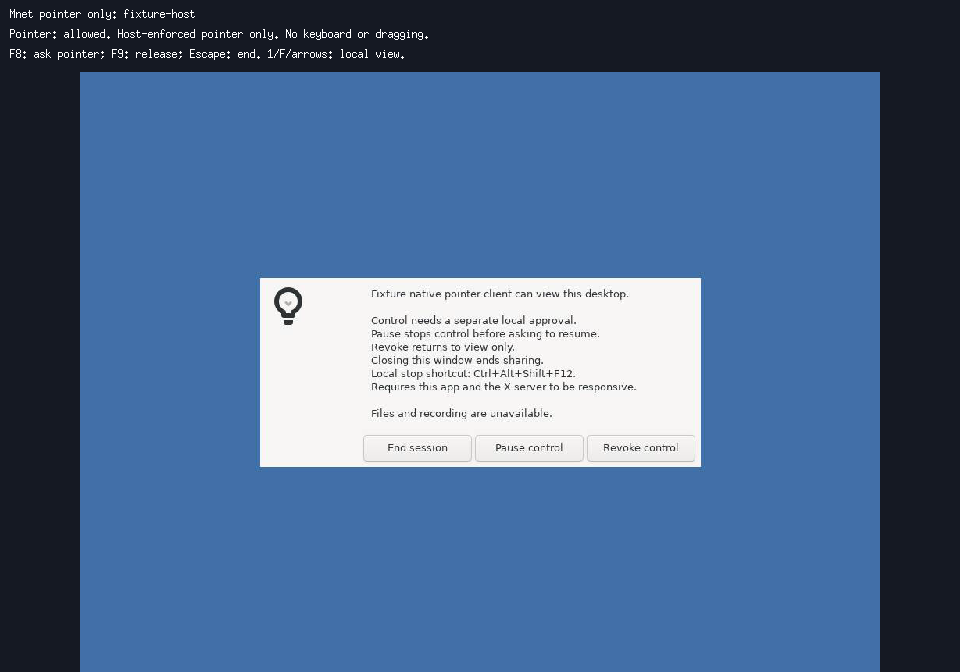
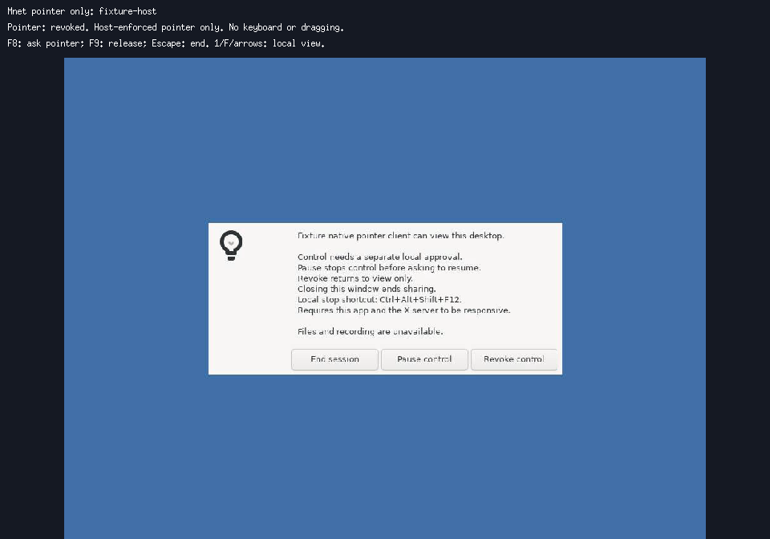
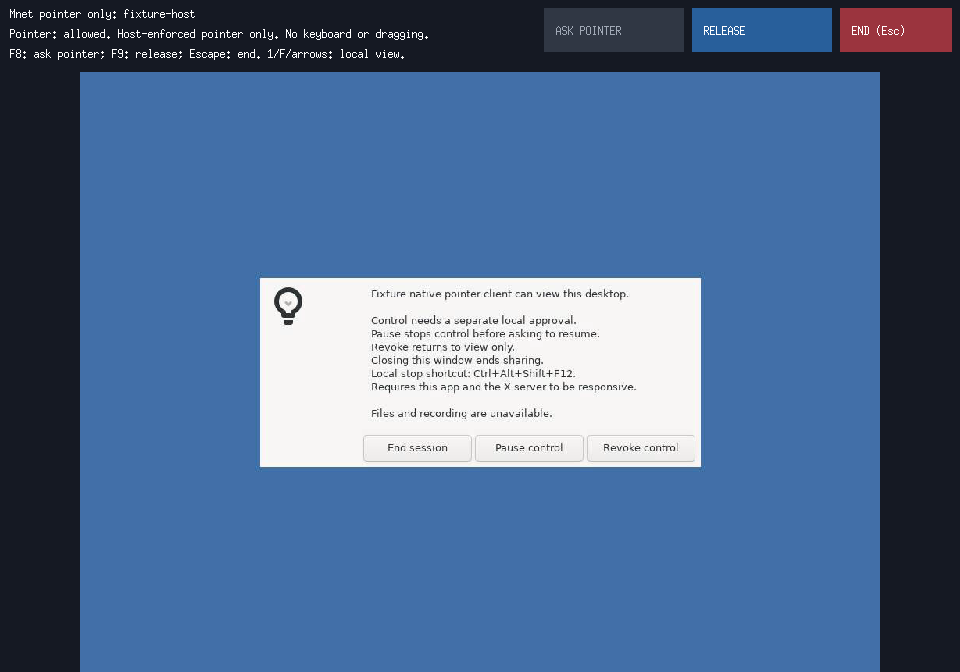
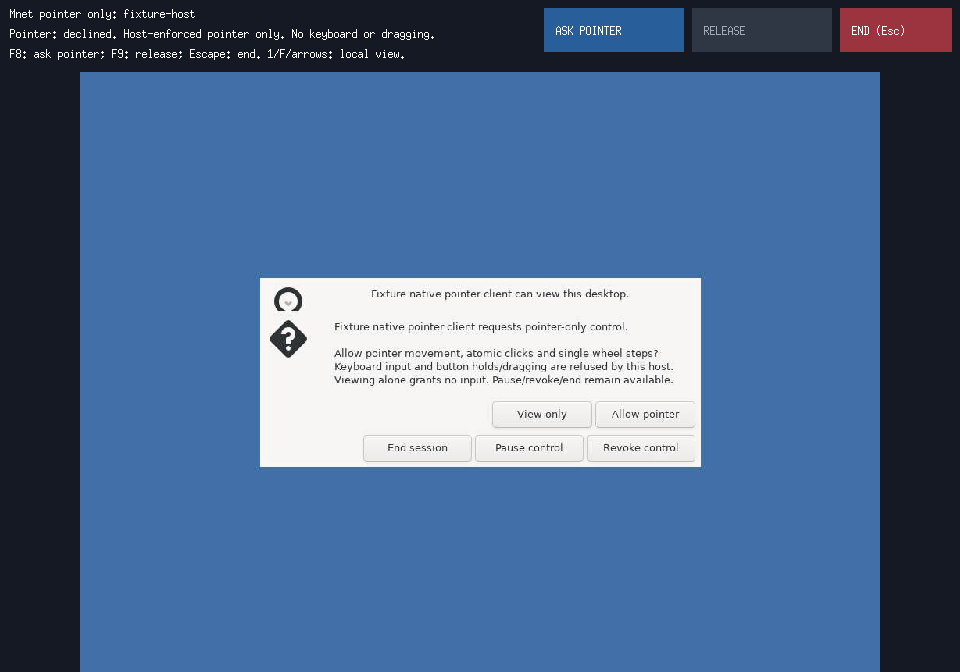
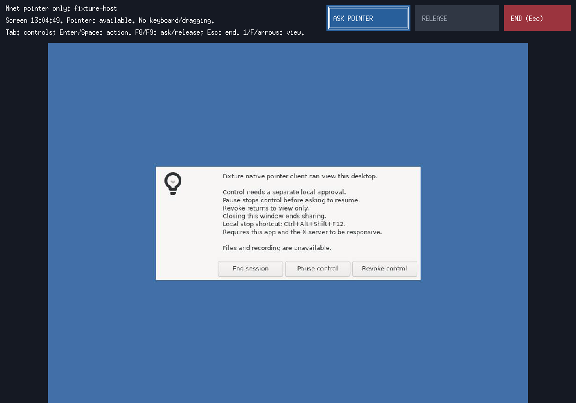
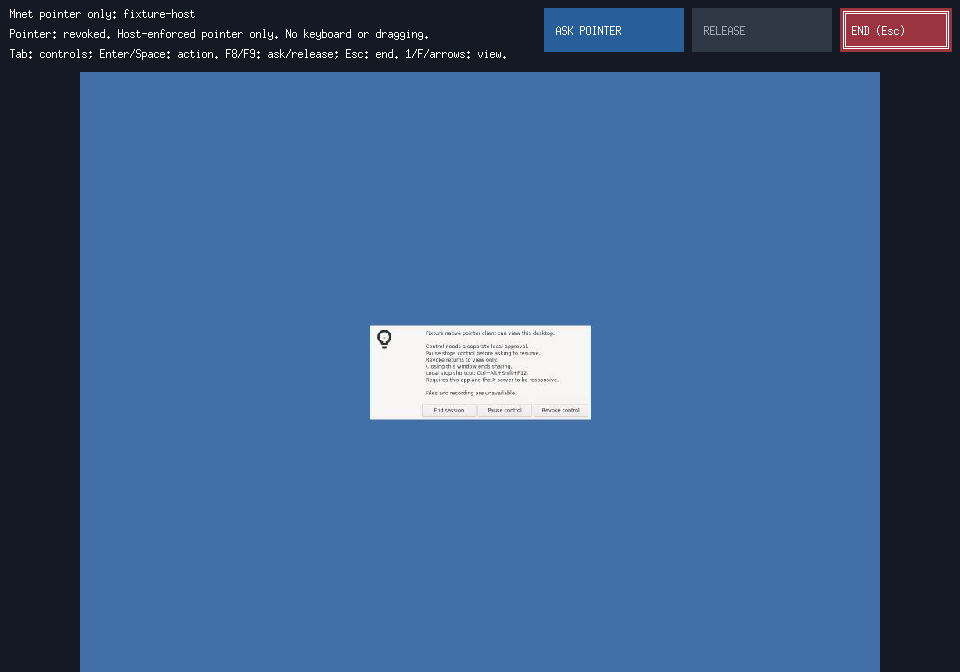

# Explicit native pointer viewer

This is a separate Remote Desktop engineering entry. Existing `session view` remains view-only and never requests control. It is not Shared Desk, Multies sign-in or a released consumer app.

```text
mnet --state /path/to/viewer-state session point exact-peer-name
```

The daemon must already be up with one uniquely selected current peer. The host must run the existing attended X11 host in its local desktop console. This entry requires its attended-view protocol reply. Current peer/key and source-address verification still applies at admission and through the session; a peer label, network membership, screenshot or control request cannot grant input.

Host-local viewing approval first shows the screen, without input. In this separate pointer window:

- F8 explicitly requests the host-enforced pointer-only tier. A scope-aware attended host gets a separate default-decline pointer dialog. A pending request is not a grant. An older or generic-only host cannot silently downgrade this to keyboard-and-pointer control; this entry stays view-only and explains why.
- Only an exact current host-approved request enables pointer movement, clicks and vertical wheel steps inside the displayed image. Header/gutter/outside coordinates are refused. Fit and received-pixel 1:1/panned coordinates map back to the received frame. The host's existing injector maps capture coordinates to its native desktop.
- F9 withdraws pending, allowed or paused control, preserving viewing. Actual focus loss also withdraws it. A new F8 needs a new local host answer.
- Host decline, pause and revoke disable pointer input. Revoke leaves viewing intact. Escape, close or Ctrl-C ends the single viewing attempt. There is no reconnect or old-grant reuse.

The status header and window title show actual protocol state, including pending, allowed, declined, paused and revoked. All keyboard events stay local, including F8/F9, Escape and the existing 1/F/arrow/Home/End view controls. No text or key forwarding is implemented. The pointer entry supports atomic left/middle/right clicks and vertical wheel steps, not remote held buttons or dragging. A press sends nothing remotely; only a matching release under the same revision can send a click. Movement beyond four local pixels cancels that click. Window/frame-geometry or viewport changes, focus loss and grant changes discard a pending click. This is a narrow pointer-control slice, not complete TeamViewer-style input support.

The attended host explicitly opts into and advertises `pointer_v1` on its host-originated control stream. This entry requests `pointer-v1`; the local prompt and every accepted status remain bound to that scope, session and request. A broader or differently scoped reply is not a grant. The host input gate, not this window's UI alone, refuses keys/text, button down/up/holds, mixed key/pointer payloads, invalid buttons and wheel input other than a single vertical step. Only pointer movement and atomic left/middle/right clicks, plus those wheel steps, can reach native dispatch under this grant. Coordinate/capture checks still apply at the backend.

An explicit generic engineering control request remains generic and needs its existing local answer. Mobile/generic hosts do not advertise or accept the new tier merely by using the existing control constructor. Only the scope-aware attended host opts in. There is no automatic reconnect or broader fallback. This entry does not turn a Shared Desk approval into Remote Desktop permission, or the reverse.

## Exact queued-event authority

Native actions record the complete control snapshot, including session, request and revision. The final bind checks that same allowed snapshot atomically rather than decorating queued input with whatever grant is current later. A paused/resumed grant has a new revision, so a click queued before pause cannot be rebound after resume. Movement coalesces only within the same revision. A bounded 64-action queue ends the session on overflow rather than replaying a backlog. Local withdrawal drops queued input. The host independently rechecks its live grant at native dispatch. An OS action already dispatched before withdrawal may complete; no cancellation can recall it.

F9/focus loss uses the protocol's cancel path for an active as well as a pending request. Host input ownership is retired through the existing checked native-child cleanup. No remote button is intentionally held between local events by this entry. This does not fix X11 physical/synthetic input provenance, another application's active keyboard grab, dead-server responsiveness or a killed injector's owned-state limits. Those remain documented in the attended host and recipient-owner guides.

## Native acceptance

`python3 scripts/native-pointer-validation.py` builds the actual viewer CLI and recipient child and runs an attended host fixture on two disposable X servers. Synthetic local API identity is explicitly fixture evidence, not a live Multies integration. Both 1024x768 and 2048x1536 host sizes are exercised. The driver:

- Answers the real host view dialog, waits for actual host pixels and verifies local clicks/keys before a control request do not reach the target.
- Explicitly requests and answers the real host pointer-only control dialog, then observes two native target left-button press events and one native wheel event. The test also attempts a local keyboard event, which must not reach the target.
- Withdraws locally, gets a host decline, obtains a new grant, loses actual viewer focus, obtains another new grant and invokes actual host Revoke. Clicks while declined/revoked must not add target input. Exactly three grants create native input owners.
- Joins session teardown and native cleanup, drains target events through a same-connection marker, and requires exact click/scroll/key counts and no held native left button. Viewing must survive control withdrawal/revoke until explicit End.

The first driver tried input before any actual screen image, and its guessed keyboard traversal did not select Revoke. Actual pixels exposed both assumptions. It now waits for real image content and native target events, and uses the inspected Revoke button band with actual revoked-state acceptance. An early end-of-test nonblocking event poll could miss queued X events; the target event drain is now explicitly joined instead of treating an empty instantaneous poll as a complete event history. These driver corrections do not relax grant, input-count or cleanup assertions. Visual inspection also caught a title/pixel ordering gap: the window title could report the new grant state while its header still showed the previous state during redraw. The renderer now publishes the corresponding completed pixels before updating the title; final allowed/revoked pixels were re-inspected. Unit tests cover fit/letterbox/1:1 mapping, exact click revisions, unsupported drag refusal and local release queue clearing. Protocol tests reject pre-pause input after resume, broader raw input sent around the viewer gate, scope-confused replies, unknown scopes and generic-only/older hosts. The explicit generic path remains covered separately. Local-answer tests verify scope reaches the prompt, not just the wire.

A larger-size native run found a real in-flight retirement bug: a wheel event raced local F9 withdrawal; the child reported retired authority and then confirmed clean release, but the coordinator treated retirement as device failure and ended viewing. Instrumented native repetition reproduced that exact result. A deterministic failing-first regression now distinguishes only the checked backend's typed retirement result after authority actually ended. It joins cleanup before preserving viewing and still reports that the command was interrupted, not successful. Unrelated dispatch failures, a retirement error while authority is still live, and unconfirmed cleanup remain terminal. A protocol-only subprocess fixture deliberately withholds its ACK until cancellation to make this ordering repeatable. Repeated native acceptance and race tests follow the correction; no failure is hidden by weakening the input-count or view-preservation assertions.

The unchanged view-only native journey is run again to check its existing no-injector invariant and local view controls. Source gates include full uncached race tests, vet/build and Windows/Darwin viewer cross-builds. Fresh hosted validation is separate from these local results. These are real native processes/pixels on one machine, not physical two-computer, secure-desktop, Wayland, Windows/macOS input or consumer-readiness acceptance. Files, recording and clipboard remain disabled in attended mode.

## Actual local pixels






## Native header buttons

The pointer entry now adds44px-high Ask Pointer, Release and End buttons in its always-local header. Ask Pointer is available only when the current same-session host advertises the narrow pointer tier and the protocol permits a new request. It asks the existing default-decline host dialog; it does not grant input. Release withdraws pending/allowed/paused pointer authority while keeping viewing. End closes this one viewing attempt. F8/F9/Escape remain local alternatives. The separate view-only entry has End but no Ask/Release.

Disabled controls are visibly gray. Header gestures never become remote input, even when crossing the image boundary. A button needs a matching left press/release; input-increasing toolbar presses are discarded on a permission-revision change, focus loss or resize. No stale press can enable another session. Actual remote image clicks remain bound to the exact allowed revision, with no keyboard, held-button or drag support.

The first local toolbar journey ended with zero observed scroll events after a fixed150ms delay before Release. The fixture now waits for an actual target-side scroll marker before testing withdrawal, while retaining exact final counts and joined cleanup. A later larger journey exposed a new local request-filter issue: discarding all queued requests on any status revision could lose a fresh narrow request when a late same-session cancellation acknowledgement arrived. A deterministic failing-first test now retains only that same-session narrow request across the acknowledgement, never another session. A request still cannot grant input, change host scope or bypass the host's fresh local answer.

Final actual built pointer acceptance uses the real Ask, Release and End buttons, preserves keyboard F8/focus-loss cases, and passes both source display sizes with two actual allowed native clicks, one delivered scroll, zero native key events, host decline/revoke, no held native button and joined cleanup. Thirty focused race repetitions cover toolbar geometry/press ownership and same-session request behavior. This is engineering UI/owned-fixture evidence, not a complete cross-platform remote-control product or an always-responsive local-stop guarantee.





## Local keyboard focus

Tab and Shift+Tab now focus enabled native header buttons with a visible double-line ring. Enter or Space activates only on the matching key release over the same focused action. The view-only window has only End; it never exposes Ask or Release. The pointer entry adds the existing narrow Ask/Release actions, not keyboard forwarding. A request still needs the host-local default-decline answer. Focus loss, resize, another local control gesture or a different key cancels a pending activation. Input-increasing activations also need the exact same permission snapshot at release; local End is not disabled by an unrelated remote revision. F8/F9/Escape and existing view controls remain local alternatives.

The old viewer fails the actual keyboard Ask regression. Actual equal/large pointer journeys now use keyboard Ask, Release and End, still requiring exactly two native clicks, one native wheel event, zero native key events and joined cleanup. A held End is canceled across real focus loss. Both view-only sizes verify focused keyboard End with no input owner. Thirty focused race repetitions and full uncached race/vet/build plus Darwin/Windows CLI builds pass locally. This is local keyboard usability, not screen-reader/native accessibility or cross-platform input completion.

An immediate screenshot after Tab once retained the previous focused button, despite a later successful keyboard action. The driver now waits for actual focus-ring pixels inside the existing bounded event wait before capture/activation. No timeout, input-count or cleanup assertion was relaxed. Final Ask/End/view-only ring pixels were inspected.






The separate [current-peer chooser](desktop-peer-chooser.md), `mnet session browse`, can explicitly select Pointer View. That opens this existing pointer client, not an input grant. Host-local view approval and later Ask Pointer/host approval remain separate.

## Active pointer owner joins on SIGTERM

The actual pointer journey now has a separate termination case after its third explicit host-approved pointer grant, before host revoke or local End. SIGTERM reaches the viewer's owned cancellation path. The actual host fixture requires all three native owners to close successfully, capture/UI teardown to join, exact two native clicks and one scroll with zero keys, no held button and no surviving host control/session prompt. These are previously completed clicks, not a held-button/drag grant.

Direct and chooser-entered cases pass on both equal and large disposable displays. Actual allowed-pointer pixels were inspected before termination. The ordinary local End/host revoke journey still passes separately. Full uncached race/vet/build pass, and the existing general CI session job now includes both direct termination sizes. No Android/native workflow trigger or release is added. These are same-host X11 checks, not physical multi-device cleanup or SIGKILL guarantees; native unresponsive/externally killed backend limits remain separate.

## A new button press cannot reuse an earlier click candidate

Every new button press now clears the prior local click candidate, including a press outside the received image or on an unsupported button. A later left release cannot borrow a left press from before that intervening event. A fresh supported press/release still works; supported right/middle click and scroll behavior are unchanged. This is not added chord, drag or remote button-hold support.

Failing-first models found an old left click surviving outside/unsupported/scroll presses. The actual attended pointer client also emitted an unwanted native left click when an extra button8was pressed between left down and left up. After the repair, direct and chooser entries at both fixture sizes reject that sequence, then pass the original exact two native clicks, one scroll, zero keys, separate host approvals, release/focus-loss/revoke and joined End. Thirty focused race repetitions, fresh full uncached race/vet/build and Windows/Darwin cross-builds pass. Current actual allowed-pointer pixels were inspected. No host admission, consent, protocol, Multies or release change.

## Independent received-pixel pointer mapping oracle

A bounded offline geometry target independently derives fit and received-pixel source/destination rectangles, including clamped pan, centered small frames, extreme aspect ratios and header/letterbox boundaries. Accepted positions must exactly match integer source coordinates inside the received frame. View-only, paused, revoked, pending and wrong-scope states must refuse every tested position without queuing input. Four seeds, thirty focused race repetitions and87994executions over10seconds pass, followed by a fresh full uncached race/vet/build. This reaches no X server, transport, approval or native input. It adds model coverage, not physical-device acceptance or a new input capability. No product behavior changed.

## Local desktop geometry is part of the viewer owner

The shared native viewer now ends on any local root geometry change, including shrink-then-restore, before a clipped local End control can silently persist. Reopening is a fresh explicit invocation with normal current-peer and host checks, never reconnect or grant carryover. Ordinary supported viewer-window resizing remains separate. Actual pointer cases after the third approved grant pass exact input counts, all three owners joined, no held button and no host UI after shrink/transient change. See [the native viewer evidence and limits](desktop-native-viewer.md#a-changed-local-desktop-retires-the-viewer). No broader input capability or physical/SIGKILL safety claim is added.

## Bounded local action queue model

A new stateful offline queue test compares ordered actions against an independent copied list across motion coalescing, completed clicks, exact-grant requests, grant revisions, withdrawal and drains. Motion may replace only the immediately preceding same-grant motion. Withdrawal removes queued input without granting access. The64entry bound refuses overflow, including when no room remains for a new control action; draining returns each accepted action once. Explicit seeds cover full click/request queues, withdrawal after saturation and repeated motion.

The10second bounded fuzz run passed8677executions and30focused race repetitions passed. Fresh whole-repository uncached race/vet/build also pass. No display, session, native backend or control grant is created, so this is local ordering/error-model evidence, not new native-input acceptance. No product behavior changed.

## Actual canceled mouse gestures stay local

The full actual pointer journey now travels away from a held left press and back to its exact starting pixel before release. That must not become a remote click. A separate held image press followed by local Tab and release must also leave the native click count at zero. A subsequent fresh click still works; the unchanged final host checks require exactly two completed clicks, one scroll, zero keys and all native owners joined.

Direct and chooser-launched journeys pass at both1024and2048host sizes. Current large-host chooser pixels after the canceled gestures were inspected. One initial concurrent direct/chooser invocation correctly failed because the existing disposable fixture uses the fixed loopback session port5909; both chooser sizes were rerun sequentially and passed. No failed partial journey is counted as completion. No product behavior, permission or physical-input guarantee changed.

## Concurrent native fixtures own separate loopback hosts

The built attended-viewer fixture now binds the unchanged session port on a randomly selected127/8loopback address before publishing that address in its private local-API snapshot. It owns that listener for the full attempt and fails if binding is unavailable. This removes the shared127.0.0.1:5909fixture collision without changing any product port, CLI argument, discovery or authority rule. Randomness selects a disposable local address, not a peer identity.

Actual direct and chooser pointer journeys now pass concurrently at each host size, retaining exact native click/scroll/key/owner checks. The complete view-only journey also passes using the same host helper. Fresh full uncached race/vet/build pass. This corrects the independently observed local fixture collision; the earlier collision remains a failed partial attempt, and this does not explain or repair any hosted Chrome startup failure.

## Restored viewer dimensions cannot restore a pending click

An additional actual pointer case holds a press, resizes the local viewer, restores its original dimensions and releases at the original pixel. The native click count must remain zero before a fresh press. The full journey still ends with exactly two intentional clicks, one scroll, zero keys and joined native owners. Direct and chooser journeys pass at both host sizes, with the two chooser sizes running concurrently using separate owned loopback hosts. No product geometry or permission behavior changed.

The loopback-host change also passes concurrent complete large view-only and chooser view-only journeys. These successful fixture runs do not replace an original hosted checkpoint or physical input acceptance.

## First-frame diagnostics preserve unresolved blank-canvas failures

Two local concurrent pointer cancellation journeys reached available status but timed out under the unchanged five-second pixel check with an empty viewer canvas. Their cause remains unresolved. Later sequential SIGTERM and concurrent transient-root/large-SIGTERM journeys passed unchanged; those successes do not erase or diagnose the earlier failures.

The actual fixture now logs fixed aggregate evidence when the first capture starts and returns, plus any capture failure: full-frame present, tiles present, failure boolean and a coarse duration category. It never logs desktop bytes, hashes, exact image sizes, paths or arbitrary backend error strings. A concurrent SIGTERM/transient-root pair passes with first full captures in the100ms-to1second category. Fresh full uncached race/vet/build pass. No pixel assertion, timeout, transport or product behavior changed. The added evidence still needs its own hosted checkpoint.
