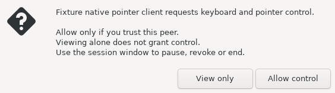

# Explicit native pointer viewer

This is a separate Remote Desktop engineering entry. Existing `session view` remains view-only and never requests control. It is not Shared Desk, Multies sign-in or a released consumer app.

```text
mnet --state /path/to/viewer-state session point exact-peer-name
```

The daemon must already be up with one uniquely selected current peer. The host must run the existing attended X11 host in its local desktop console. This entry requires its attended-view protocol reply. Current peer/key and source-address verification still applies at admission and through the session; a peer label, network membership, screenshot or control request cannot grant input.

Host-local viewing approval first shows the screen, without input. In this separate pointer window:

- F8 explicitly requests control. The host gets its existing separate, default-decline control dialog. A pending request is not a grant.
- Only an exact current host-approved request enables pointer movement, clicks and vertical wheel steps inside the displayed image. Header/gutter/outside coordinates are refused. Fit and received-pixel 1:1/panned coordinates map back to the received frame. The host's existing injector maps capture coordinates to its native desktop.
- F9 withdraws pending, allowed or paused control, preserving viewing. Actual focus loss also withdraws it. A new F8 needs a new local host answer.
- Host decline, pause and revoke disable pointer input. Revoke leaves viewing intact. Escape, close or Ctrl-C ends the single viewing attempt. There is no reconnect or old-grant reuse.

The status header and window title show actual protocol state, including pending, allowed, declined, paused and revoked. All keyboard events stay local, including F8/F9, Escape and the existing 1/F/arrow/Home/End view controls. No text or key forwarding is implemented. The pointer entry supports atomic left/middle/right clicks and vertical wheel steps, not remote held buttons or dragging. A press sends nothing remotely; only a matching release under the same revision can send a click. Movement beyond four local pixels cancels that click. Window/frame-geometry or viewport changes, focus loss and grant changes discard a pending click. This is a narrow pointer-control slice, not complete TeamViewer-style input support.

The existing host control dialog describes keyboard and pointer control because its protocol currently grants generic attended control. This particular client sends only pointer operations; it does not create a narrower host-enforced permission tier. A different client with a generic control grant is not constrained by this window's UI. This entry does not turn a Shared Desk approval into Remote Desktop permission, or the reverse.

## Exact queued-event authority

Native actions record the complete control snapshot, including session, request and revision. The final bind checks that same allowed snapshot atomically rather than decorating queued input with whatever grant is current later. A paused/resumed grant has a new revision, so a click queued before pause cannot be rebound after resume. Movement coalesces only within the same revision. A bounded 64-action queue ends the session on overflow rather than replaying a backlog. Local withdrawal drops queued input. The host independently rechecks its live grant at native dispatch. An OS action already dispatched before withdrawal may complete; no cancellation can recall it.

F9/focus loss uses the protocol's cancel path for an active as well as a pending request. Host input ownership is retired through the existing checked native-child cleanup. No remote button is intentionally held between local events by this entry. This does not fix X11 physical/synthetic input provenance, another application's active keyboard grab, dead-server responsiveness or a killed injector's owned-state limits. Those remain documented in the attended host and recipient-owner guides.

## Native acceptance

`python3 scripts/native-pointer-validation.py` builds the actual viewer CLI and recipient child and runs an attended host fixture on two disposable X servers. Synthetic local API identity is explicitly fixture evidence, not a live Multies integration. Both 1024x768 and 2048x1536 host sizes are exercised. The driver:

- Answers the real host view dialog, waits for actual host pixels and verifies local clicks/keys before a control request do not reach the target.
- Explicitly requests and answers the real host control dialog, then observes two native target left-button press events and one native wheel event. The test also attempts a local keyboard event, which must not reach the target.
- Withdraws locally, gets a host decline, obtains a new grant, loses actual viewer focus, obtains another new grant and invokes actual host Revoke. Clicks while declined/revoked must not add target input. Exactly three grants create native input owners.
- Joins session teardown and native cleanup, drains target events through a same-connection marker, and requires exact click/scroll/key counts and no held native left button. Viewing must survive control withdrawal/revoke until explicit End.

The first driver tried input before any actual screen image, and its guessed keyboard traversal did not select Revoke. Actual pixels exposed both assumptions. It now waits for real image content and native target events, and uses the inspected Revoke button band with actual revoked-state acceptance. An early end-of-test nonblocking event poll could miss queued X events; the target event drain is now explicitly joined instead of treating an empty instantaneous poll as a complete event history. These driver corrections do not relax grant, input-count or cleanup assertions. Visual inspection also caught a title/pixel ordering gap: the window title could report the new grant state while its header still showed the previous state during redraw. The renderer now publishes the corresponding completed pixels before updating the title; final allowed/revoked pixels were re-inspected. Unit tests cover fit/letterbox/1:1 mapping, exact click revisions, unsupported drag refusal and local release queue clearing. Protocol tests reject pre-pause input after resume and verify local withdrawal keeps viewing open.

The unchanged view-only native journey is run again to check its existing no-injector invariant and local view controls. Source gates include full uncached race tests, vet/build and Windows/Darwin viewer cross-builds. Fresh hosted validation is separate from these local results. These are real native processes/pixels on one machine, not physical two-computer, secure-desktop, Wayland, Windows/macOS input or consumer-readiness acceptance. Files, recording and clipboard remain disabled in attended mode.

## Actual local pixels





