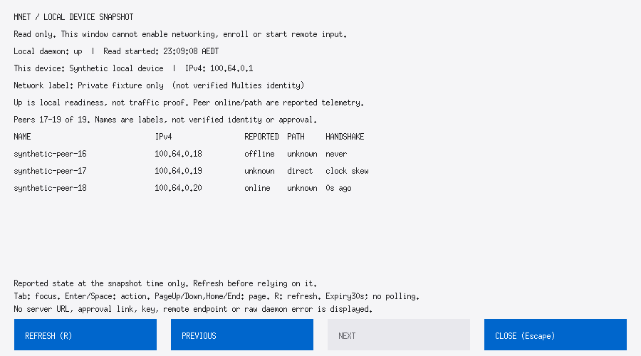
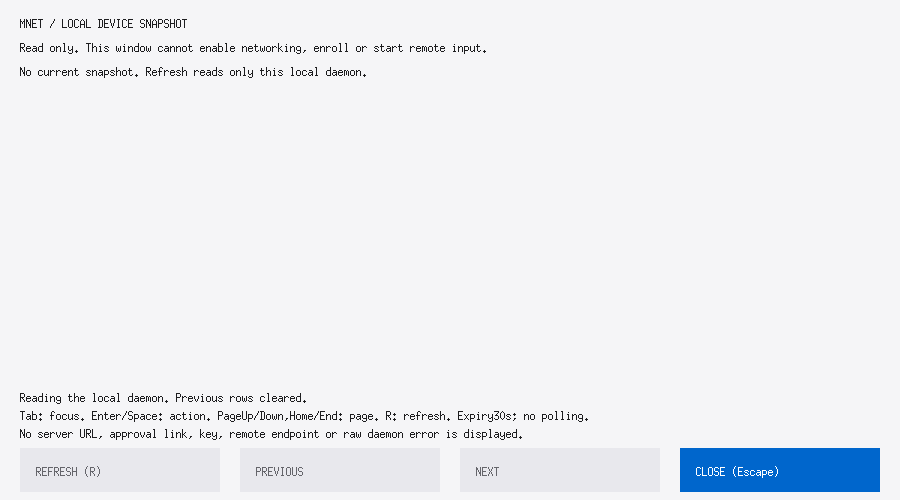
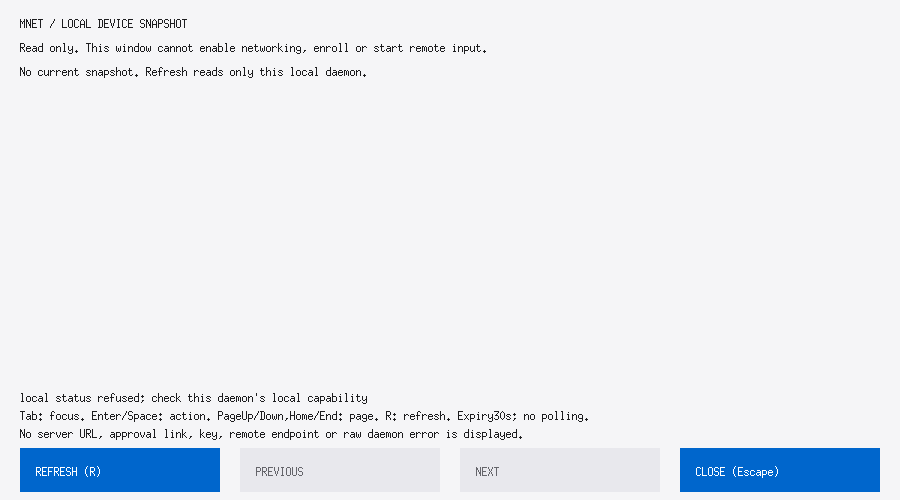

# Read-only native Mnet device window

Linux X11 engineering builds now accept:

```text
mnet [--state /absolute/path/to/state] devices
```

This is an actual native window backed by the selected running daemon's capability-protected local status API, not prototype device data. It belongs to Mnet networking diagnostics, not Remote Desktop or Shared Desk. It cannot enable or disable networking, enroll, select a session recipient, approve access, send input, change a layout or save trust. It has no Multies sign-in or eligibility verifier. Existing engineering enrollment and all consumer release gates remain unchanged.

## Snapshot, not a live-access claim

On open, the window makes one authenticated `GET /localapi/status` through the existing local client. Refresh or R requests another snapshot. Pagination makes no request. There is no background polling. The selected local state directory supplies the existing capability; no token, approval link or server URL is requested or displayed by this window.

The window shows the daemon-reported state, local device/address, network label and snapshot read-start time. Up means reported local readiness, not end-to-end traffic proof. Names and network labels are not verified people, Multies identity, workspace membership or remote-input consent. Peer rows show reported online/offline/unknown state, path category and handshake age at that snapshot. Unknown and future-clock telemetry are not turned into online claims. Endpoint strings, approval URLs, keys, server URLs and raw error text are omitted.

Eight peers fit each page. Previous/Next, Left/Right or PageUp/PageDown page through every reported row. Home/End jumps to the first/last local page without selecting or contacting a peer. Text is bounded printable ASCII for the fixed X11 font; unsupported characters become `?`. Truncated labels cannot be used for an action because this window offers no peer action.

Refresh immediately clears old readiness and peer rows while its bounded request runs. Repeated Refresh cannot create concurrent requests. Failure or a malformed response leaves no previous successful rows behind. Non-Up states hide peer rows, even if the daemon response contains an older map. Snapshots expire30 seconds after the read starts and their rows disappear until a person refreshes. Time labels and fixed explanatory text remain explicit about this being reported snapshot telemetry.






## Keyboard focus and activation

Tab and Shift+Tab now move a visible double-line focus ring among enabled Refresh, Previous, Next and Close controls. Enter or Space acts only when that same key is released on the same still-enabled focused control. Moving focus through Tab, losing local window focus, receiving a snapshot, expiry, or starting a new Refresh cancels a pending activation. A disabled control is skipped, not silently activated later. Existing R, arrow keys, Escape and mouse controls remain available. This adds no peer selection or network/input authority.


The actual built-window acceptance drives Tab/Shift+Tab, Enter/Space pagination and keyboard Refresh/Close. It verifies that pagination sends no API request, an unmatched release cannot close the window, and a held activation cannot transfer through Tab or an independent focused X11 window. The old UI fails the keyboard pagination regression. Thirty model/device race repetitions, the full uncached race/vet/build suite and Darwin/Windows CLI builds pass locally. Final focus, populated and loading pixels were inspected. This is keyboard usability on the supported X11 window, not native accessibility, DPI or screen-reader acceptance.

## Local lifecycle and limits

Close, Escape, normal window-manager close and process termination end this read-only window. Its outstanding request is canceled and joined; it does not stop the daemon or alter its network state. Display/drawing failure or unsupported resize ends the window rather than hiding live controls. A missing local capability fails without contacting the daemon. Status responses are bounded to1MiB and4096 peers; malformed, trailing, missing-state or oversized responses are rejected with fixed local diagnostics. Unknown nonempty daemon states are displayed as unknown, with no peer rows.

The window requires a local Linux X11 display of at least940x540 pixels and the built-in fixed font. Its fixed900x500 layout has44px-high action targets and visibly unavailable Refresh/page controls. Other platforms return an explicit unsupported diagnostic and retain ordinary `mnet status`; no headless or browser fallback starts. Native accessibility, DPI scaling, Windows/macOS UI and physical display acceptance remain work. This is small engineering UI, not the intended installed consumer device/setup experience.

## Acceptance evidence

`python3 scripts/devices-window-validation.py` builds the real race-enabled CLI, starts a private synthetic Unix daemon fixture and opens the actual window on a disposable1024x768 X server. It checks:

- Only authenticated status GETs occur; extra CLI arguments are refused before an API request.
- Nineteen peers are reachable across three pages without API fetches for pagination.
- Down, waiting-approval, request error, malformed JSON, loading and expiry remove previous peer pixels. The driver inspects the actual row-region pixels, not only a title or model state.
- There is no automatic polling during the real31-second expiry wait. Repeated Refresh while waiting is coalesced.
- Escape during an outstanding request promptly cancels and joins the real process. The actual Close button and SIGTERM also end cleanly. A missing capability or absent X11 display sends no request. Unsupported resize ends the process.

Pure tests cover cancellation, bounded decoding, private-field omission, text controls, unknown/future telemetry, pagination and absent owners. Thirty focused race repetitions and full uncached race/vet/build plus Darwin/Windows CLI cross-builds passed locally. The unchanged general session CI job now includes the native private-fixture check and retains only synthetic screenshots/client diagnostics on failure, never the disposable capability state. Hosted results must still be accounted per exact commit.

This fixture proves built UI/local-API behavior. It does not join a live network, validate production Multies identity, prove real peer traffic, grant remote authority or establish physical/mixed-OS readiness.


## Exact mouse gesture ownership

The read-only device window now requires a matching left press and release inside the same enabled44px control. An outside press released over Next, Next pressed then released over Refresh, or an inside press released outside cannot paginate, read the daemon or close the window. This corrects a concrete old-source native regression, not a new peer action.

Pending mouse activation is retired by focus loss, Tab or another keyboard gesture, snapshot refresh, expiry or disabled state. Holding Refresh across a new snapshot or expiry does not turn its later release into a new request. Existing keyboard controls, manual authenticated GET-only Refresh and local-only pagination remain unchanged. No peer is selected and no network, session or enrollment authority is created.

The actual built-window journey reproduces the old mismatch failure, then passes exact/mismatched targets, pending Close through independent focus loss, held Refresh across expiry/new snapshot,19-peer pagination and existing fail-closed lifecycle checks. Thirty focused races, full uncached race/vet/build and Darwin/Windows CLI builds pass. Current populated/expired native pixels were inspected. These remain private synthetic local-daemon fixtures, not live Multies eligibility or physical-device VPN proof.

## Supported control colors

The device window, Remote Desktop chooser and offline layout inspector paint literal RGB control pixels. They now require the root's exact supported 24-bit TrueColor RGB visual before creating a window or reading local daemon evidence. Palette, 16-bit, missing/mismatched-root, swapped-mask and other unsupported visuals fail rather than rendering misleading selection/disabled/focus colors. This is separate from the desktop viewer's stricter raw-frame upload format check; it does not claim new display support.

An actual old-source 8-bit device window rendered black controls with green text instead of the intended colors. The new real built three-window fixture rejects both 8-bit and 16-bit root visuals before any window or local daemon call. Exact root/mask model checks pass, and the complete supported 24-bit native device, chooser and offline inspector journeys still pass with inspected pixels. Full uncached race/vet/build and CLI cross-builds pass. This does not change networking, session or Shared Desk authority.

## Read-start age and late-response cancellation

The native status window now carries the start timestamp of its request through the response and uses that timestamp for expiry. A slow successful response cannot renew older telemetry for another30seconds. The visible timestamp is labeled Read started, not receipt time. Nil/already-canceled requests refuse before transport, and a successful buffered response returned after cancellation cannot publish status. The read-only status helper still uses bounded decoding and fixed diagnostics.

The actual window fixture holds a successful response for two seconds, then verifies that readiness and peer pixels have disappeared by31.2seconds from request start, before a receipt-based expiry would occur. No extra status read is allowed during that wait. Existing31second expiry,19peer pagination, request coalescing, hidden private fields and joined cancellation checks also pass. Thirty focused device/chooser model races, complete native window, full uncached race/vet/build and CLI cross-builds pass; final populated/last-page/focus/delayed-expired pixels inspected. An initial combined native-plus-full-test command exceeded its outer execution budget after the native check passed; the whole-repository gates were run separately and passed, not inferred from the interrupted run. This changes no daemon/network state, peer eligibility, input authority or release setting. Fresh hosted verification remains separate.

## Local keyboard page navigation

PageUp/PageDown and Home/End now navigate only the current snapshot's peer pages. Boundaries clamp, missing/non-Up snapshots have no pages, and page gestures cancel pending button activation. They cannot fetch status, select a peer, enable networking or open a session. The actual19peer journey visits/clamps first/middle/last pages with exactly one status request before an explicit refresh. Thirty device/chooser model races, complete actual window and full uncached race/vet/build plus CLI cross-builds pass. Updated populated/last/loading/focus pixels inspected. This is fixed-layout local keyboard usability, not screen-reader or physical-platform acceptance.

## Service failure is not a capability diagnosis

Only an actual401/403 local status response suggests checking this daemon's local capability. Other non-success responses now say that local daemon status is unavailable and offer manual Refresh, without blaming credentials for a service failure. All failures still clear old rows and expose no response body or private endpoint. No automatic retry or wider read is added.

A failing-first response-copy test caught the earlier capability suggestion on301. The final matrix covers301/302/400/401/403/404/429/500/503, confirms response bodies are closed and keeps private body text out. Thirty focused model races, the complete actual device window and chooser, full uncached race/vet/build and Darwin/Windows CLI cross-builds pass. Actual503 service failure,403 capability refusal and manual200 recovery pixels inspected. This is local fixture evidence, not live daemon repair or consumer setup.




## Fixed-size windows retire on desktop geometry change

These engineering controls now subscribe to root-window structure changes before opening the child window or reading local evidence. A geometry round trip after subscription also checks the setup-to-watch gap. Any later root width/height change ends that window instead of leaving fixed controls clipped or actionable on a changed desktop. Restoring the desktop size does not revive the old snapshot, selection or pending gesture. This is deliberately fail-closed, not automatic reflow; reopen the command for a fresh window. Ordinary window placement changes without a size change remain supported.

A failing-first actual offline-inspector case remained open after the root shrank while its own child size stayed unchanged. After the repair, the complete actual device and chooser fixtures pass ready, pending-read and immediately-restored root changes. Both-size offline inspectors end on root resize with unchanged files and zero daemon calls. Thirty focused race repetitions, fresh whole-repository race/vet/build, Darwin/Windows cross-builds, unsupported8/16bit refusal and both-size attended view/pointer chooser journeys pass. Current pre-change native pixels were inspected for all three windows. One combined fixture shell reached its outer time limit after both fixtures had printed their final passes; independent full race/vet/build and the remaining native checks then completed separately. No daemon polling, reconnect, admission, consent or release change.

## Cancellation during a stalled response body

Actual process acceptance now separately reaches successful HTTP headers and one response-body byte, then stalls the disposable local server for5seconds. SIGTERM must cancel and join within2seconds rather than wait for that body. The device status path and both sequential chooser paths pass separately. These cases distinguish body-read cancellation from the existing waits before response headers. They add no product timeout, retry or network behavior. Complete actual device/chooser fixtures and thirty focused snapshot model race repetitions pass. Evidence remains private synthetic local API/X11, not a live fleet or Multies identity claim.
