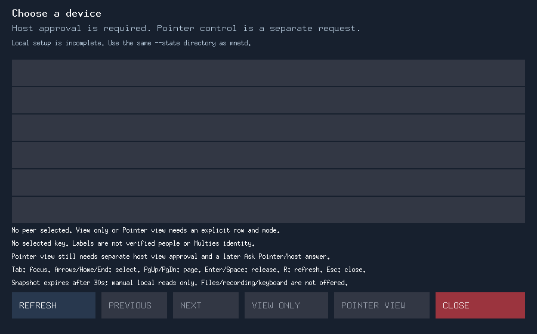

# Private Linux engineering installation

This is an opt-in source installation into a new private prefix, not a release, signed package, system installer or completed first-run setup. It supports the current Linux X11 engineering home. No Multies code or configuration is changed.

From the repository, as a non-root Linux user with Go available:

```sh
python3 scripts/linux-local-install.py install /absolute/private/parent/mnet-engineering
/absolute/private/parent/mnet-engineering/bin/mnet open
```

The parent must already exist, be owned by the current user and not be writable by others. The prefix must be new. Existing directories are never merged or overwritten. Paths with line breaks or percent field-code characters are refused. Spaces, dollar signs, quotes, backticks and backslashes are exercised through the actual desktop-entry parser and launched executable.

The prefix contains `bin/mnet`, `bin/mnetd`, a desktop entry under `share/applications/`, an explanation and an installation manifest. Binaries build from an isolated archive of one exact clean committed source revision, with the ambient Go workspace and GOFLAGS disabled and modules read-only. The installation manifest records the source commit, exported-source archive hash and both binary hashes. Dirty or untracked source refuses installation before creating a prefix. This records build provenance, not signed or reproducible-build attestation. Directories and executable files are private 0700; other files are 0600. No desktop entry is copied into the user's menu, no PATH/startup/systemd/global file is changed, and no daemon starts. A failed build leaves an explicitly incomplete private prefix for inspection rather than recursively removing a pathname.

The installed home opens without local daemon access, enrollment or creating Mnet state. Networking and Remote Desktop still need separately configured authenticated local daemon state. Installing is not evidence that a node is online or that another device has approved access. Shared Desk still requires independent setup and fresh local approvals. Consumer Multies sign-in and workspace/device eligibility remain unavailable. Wayland-only sessions are unsupported by this home.

To remove an unchanged prefix:

```sh
python3 scripts/linux-local-install.py uninstall /absolute/private/parent/mnet-engineering
```

Removal checks its fixed manifest, file hashes/modes, regular-file ownership, directory ownership, exact tree contents and whether either installed executable is running. Changed files, extra files, a linked prefix or a running installed executable cause refusal before deleting anything. It never kills a process, recursively removes a supplied path or deletes daemon/user state. These checks do not defend against a malicious process running as the same user or a filesystem administrator. Close programs and avoid concurrent changes during removal.

## Actual installed journey

`python3 scripts/linux-installed-validation.py` builds into a disposable prefix, validates the desktop entry, uses Gio to launch that entry and verifies that the native home is the installed binary. It inspects a screenshot, closes the actual window, checks no Mnet state was created, then removes the unchanged prefix. It also checks existing-prefix refusal, changed/extra-file refusal, running-program refusal, linked-prefix refusal and writable-parent refusal.

The first local desktop acceptance exposed a real parser limitation: a percent-containing executable path passed desktop-file validation but Gio refused to construct the application. Such prefixes are now refused before creation rather than shipping a launcher known not to work. A separate fixture attempt allowed Gio to autostart a session bus; the fixture now explicitly disables bus autolaunch and separates launcher cache from the empty Mnet home. Neither attempt changed user accounts or services. Both intermediate acceptance failures remain distinct from the later passing installed journey.

This closes a bounded developer installation/launch/removal path. It does not close production setup, signed distribution, OS permission onboarding, persistent trusted pairing or physical mixed-platform acceptance. See [desktop journey](desktop-home.md) and [the still-missing Multies bridge](multies-boundary.md).

A later local provenance check found that the available Go toolchain omitted VCS metadata even when requested explicitly. That attempted installation refused and retained a partial private prefix. Rather than silently accepting unverifiable embedded metadata, the installer now builds both programs from an isolated `git archive` of the exact recorded commit and hashes that source snapshot. No toolchain metadata claim is made.

## Missing setup is now a distinct recoverable state

Opening Remote Desktop from the installed home distinguishes missing local capability, unreachable local daemon, refused local capability and a daemon that reports this device is not connected. These are fixed local categories, not raw filesystem/transport/server messages. The chooser keeps every device/mode action disabled when current evidence is unavailable. Closing returns to a fresh home; Refresh is deliberate, not polling. A down status now ends the chooser read before requesting session-peer evidence.




The installed acceptance now explicitly starts the installed daemon in an isolated `-fake-tun` fixture with no Up, control-plane URL, network or session-host options. It observes the real authenticated down-state device window and the disconnected chooser, then stops that exact process and observes the separate unreachable-daemon state. Missing-state journeys create no Mnet state; the explicitly started fixture daemon creates its own private state, which subsequent failure journeys and uninstallation preserve byte-for-byte. No real TUN, remote service, membership or user device is used. These checks improve an actual installed failure/recovery journey, not production setup or connectivity acceptance.

## Local capability read hardening

A failing-first regression found that the old CLI accepted a publicly readable local capability file. The old reader also separated pathname metadata lookup from an unbounded read. Unix reads now open with NOFOLLOW and NONBLOCK, inspect that exact descriptor for a current-user-owned regular file with no group/other access, and read at most 65 bytes before requiring the exact 64-character encoded capability. No read changes file modes. FIFOs, final-component links, public modes and oversized files are refused. This does not defend against hostile parent-directory administrators or another process running as the same user.

Windows has a separately bounded reader that verifies regular-file identity before reading; Unix modes are not treated as a Windows DACL. Existing dedicated-state ACL protection remains separate. Windows and Darwin cross-builds passed, but no new live Windows ACL or reparse-point acceptance is claimed.

Thirty local race repetitions pass. The actual installed acceptance starts its isolated daemon, makes its test-only local capability publicly readable, observes that the installed CLI refuses without disclosing the token, restores private mode and verifies actual authenticated down status recovers. It does not modify a user's daemon or credential. The current full uncached race/vet/build and Windows/Darwin cross-build gates pass independently.
