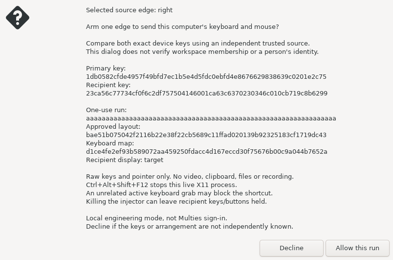
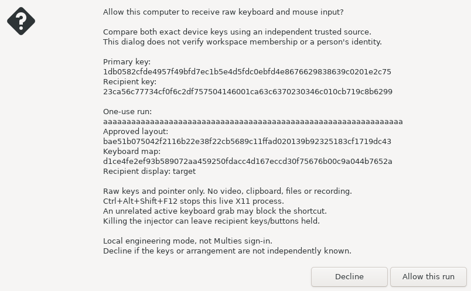

# Shared Desk: first independent Linux engine slice

This is source-level engineering progress, not a released or consumer-ready tool. Shared Desk now has its own layout, physical input protocol, exact one-use pairing transport, native source capture and recipient ownership. It does not use the Remote Desktop video/text session. Mnet network membership alone grants no Desk input.

The supported demonstration is two disposable X11 displays on one computer, using fresh test-only certificates and explicit fixture approvals. There is no production pairing UI, saved trust store, workspace authority verifier or user-facing enable command yet. The only new normal CLI command checks an offline arrangement.

## What runs

```sh
mnet desk layout-check docs/examples/desk-layout.json --edge left right 800
python3 scripts/desk-native-validation.py
```

The layout command reads only the named file. It reports `offline_only: true`, `active: false`, validated neighboring edges and an optional mapped candidate. It does not connect, pair, capture or inject input, start a daemon, or create state.

The native test script creates two isolated X servers, compiles the current daemon tests with the race detector and runs the distinct Desk path:

1. Generate fresh test-only TLS device keys. Independently provide the same exact run, primary/recipient key pins, immutable layout hash, keyboard map hash and recipient display to both endpoints.
2. Complete TLS 1.3 over an actual loopback TCP connection, with the dedicated Desk ALPN and exact public-key pins on both ends. The recipient consumes its local approval once. A hello is not consent. Foreign keys, changed run/layout/keyboard/display and reused approvals are refused.
3. Prepare a separate recipient child process. Check the local keyboard map, desktop geometry, no preheld input, cooperating input-owner locks and the reserved local stop shortcut. The child accepts raw key/button transitions and native pixel positions, never logical text.
4. Explicitly enter the approved destination. Grab keyboard/pointer on the source display, capture real X events and forward them through the Desk channel. The test uses XTEST to generate those source events, not physical hardware. Observe key 38 and button 1 held on the independent recipient X server, then verify a source motion maps to the exact recipient pixel.
5. Stop locally or press the source Ctrl+Alt+Shift+F12 chord. Drop the source grabs before awaiting remote cleanup. Verify recipient key/button release, acknowledged stop and actual keyboard-grab acquisition by another local source client.

The screenshots are checked fixture windows, not proposed product UI. Their green observations come from the current native acceptance stage. The test queries the X servers and awaits native acknowledgements; the labels by themselves are not input evidence.


## Ownership and failure rules

- Layout v1 accepts 2 to 32 nonoverlapping, connected display rectangles. Negative origins, split edges, narrow overlaps and different pixel densities are supported by pure geometry. Corner-only islands, ambiguous edges, duplicate IDs/JSON keys, unknown fields and oversized documents are refused. Half-open intervals avoid mapping a corner into two neighbors.
- The exact pair binds one run, primary key, recipient key, layout hash, keyboard map and display. Approval is an in-memory single-use object supplied by the caller after independent local consent. Reconnect must obtain a fresh approval/run. Persistent anti-reuse and production consent/enrollment remain caller work, not an implied property of TLS.
- Each recipient requires increasing nonzero input sequence numbers. Duplicate presses, unowned releases/repeats, malformed events and out-of-bounds pixels retire the run. Held state is tracked separately for physical key codes and buttons. Successful cleanup clears the ledger; failed cleanup is retained and blocks successor activation.
- The switchboard joins old-destination cleanup before creating its successor. The first-slice policy refuses crossing with any key or button held. Drag-across and modifier transfer are not implemented. A stopped generation cannot activate a late factory result.
- Wire records are bounded to 4 KiB, strictly decoded and separately framed. No video, logical text, clipboard, file, chat or recording messages exist. Native effects and clean stop are acknowledged. Lost acknowledgement is an error, not proof of release; no input is replayed.
- Client pulses run every 500 ms; a recipient read deadline is 2 seconds. Current approval loss closes an idle channel. The recipient child also requires a coordinator pulse lease. Separate native tests kill or stop the coordinator and observe held-state release while its child and X server survive. These bounds are engineering settings, not production service guarantees under a stalled OS/native call.
- Desk and attended Remote Desktop input share cooperating native ownership locks, not authority. Simultaneous input ownership is refused. The existing attended mapping-notification policy remains unchanged. Desk continues after a notification only if the entire current keyboard map still exactly matches the approved hash. An actual map change retires Desk and releases held input.
- The source explicitly grabs input only after the destination is ready. Its local stop disables the grabs before remote cleanup. The capture adapter now supports a terminal return across an approved local neighboring edge, after held-input guards and acknowledged cleanup. Other edges clamp motion. Explicitly armed initial edge entry is now exercised by the native fixture. Consumer enable UI and live cross-recipient routing are not wired yet.

## What this does not establish

No two-physical-computer, mixed-OS, secure desktop, lock/sleep, IME, arbitrary keyboard-layout or full multi-monitor runtime acceptance has occurred. Native input currently supports one X screen, matching keyboard maps and signed X11 coordinates. Geometry supports more arrangements than this native adapter. Root size change retires the recipient; full monitor hotplug/session-lock integration is still absent.

X11 cannot distinguish physical from synthetic input. A foreign press before admission is refused, but an overlapping physical press after an accepted synthetic press is not isolated. The local shortcut can be blocked by an unrelated active X keyboard grab. Killing the injector itself can leave XTEST state held. Surviving-child cleanup after coordinator loss is not crash-proof cleanup. Do not expose this as unattended, secure or production-ready input.

Multies remains untouched. Production workspace authorization, discover/pair/enable UI, automatic edge journeys, persistent exact-key trust, physical-device validation and platform-specific permission/reclaim work remain required. Clipboard, file transfer and recording are not enabled by Desk pairing. This is an independent native engine slice, not completion of Shared Desk or all three tools.

## Verification

The normal CI session job now runs the same bounded dual-X11 native script. Pure tests cover exact binding, stale/reused/foreign approval, held-state guards, terminal stop during a blocked factory, release failure retention, strict frame/document limits, missing heartbeat and idle authority loss. Local full uncached race tests, vet, build, vulnerability checks and Darwin/Windows daemon cross-builds passed before this source checkpoint. Native evidence and screenshots are Linux fixture evidence only. New hosted checks must be verified on this exact checkpoint separately.

## Idle transport-loss correction

The first independent engine checkpoint (`9c7e36d`) could leave source capture grabbed when the TLS backend retired while source input was idle. The source watched current pair authority but did not watch that backend's terminal channel. Further input or the local stop chord could reclaim it, but automatic idle-loss reclaim was missing.

A native failing-first regression now releases the source key to prevent auto-repeat from hiding the idle condition, keeps the mouse button held, waits for acknowledged input, closes the TLS peer and tests acquisition of the source keyboard by another local client. The old implementation fails that postcondition. Exact-backend terminal propagation now stops the switchboard and source capture without another input. The corrected native case passes, and unavailable remote release acknowledgement is still an error rather than a clean-stop claim.

A backend from an old destination cannot stop its successor. A backend already terminal at construction is refused. Explicit Stop and backend failure share terminal source notification, with local grabs dropped before waiting for remote cleanup. This fixes the native fixture path, not the remaining physical-X11, automatic-edge, persistent-pairing or production authority gates above.

## Idle recipient-backend death correction

The source-side idle-loss fix (`5fa0479`) does not by itself detect an idle native recipient child dying while its TLS connection still answers pulses. A separate failing-first wire regression exposed that gap. The recipient now watches its exact native backend terminal channel and closes that run's TLS connection on unexpected native death, so source capture stops without another event. Native acceptance kills the recipient child and verifies actual source keyboard reacquisition. Intentional Stop disarms this failure watcher before joined release, retaining the clean-stop acknowledgement; that ordering has its own regression.

This is failure propagation, not recovery of a killed injector's held state. The native child-SIGKILL case explicitly verifies that its synthetic button can remain held on the recipient, then the isolated test cleans up its own generated button. Do not generalize source reclaim into crash-proof recipient cleanup or physical ownership safety.


## Native edge return

The source capture loop now uses actual source motion and the approved arrangement to return from a remote recipient to the local primary. A native failing-first case showed that the old adapter clamped at the remote edge forever. The new case first pushes left while a key and button are held and verifies that it stays remote. It releases both, waits for native acknowledgements, then pushes across the same edge again. The source grabs are dropped before waiting for the recipient release. Only confirmed cleanup allows pointer placement on the approved local display. The run is terminal afterward, not silently re-enabled.

The test queries the actual local X pointer at its exact mapped pixel and acquires the keyboard from another local client. Default1024x768 and unequal1024x768-to1280x960 native display journeys pass. The primary layout must exactly match the single supported local X screen. Missing neighboring edges, held input and nonlocal neighbors do not activate an unapproved destination. Release failure retains its error and produces no mapped pointer activation.


This is one completed native return path inside the explicit paired fixture. Initial automatic edge activation, cross-recipient routing, multiple local native monitors, persistent pairing UI and two-physical-computer acceptance remain open. It does not overcome the X11 physical/synthetic overlap or killed-injector limitations above.

## Explicitly armed edge entry

The Linux engine now has a one-shot armed-edge entry path for an independently approved pair, primary and layout. The source stays local while armed. A pointer already resting on the selected edge does not activate it. The source must visit the interior and then arrive at that edge with no held keys or buttons. Only then does the caller's exact approved pair factory run, followed by native capture readiness checks. No discovery result, edge movement or TLS hello creates pair consent.

The native fixture tries resting-edge and held-button arrivals first and verifies no activation, then makes a fresh unheld arrival and runs actual source-to-recipient input. Canceling the arm never creates a recipient and releases the cooperating native owner. Context cancellation remains part of capture liveness after entry. Current authority, map, source geometry and local stop are checked; setup failure ends the generation instead of retrying or automatically reconnecting.

Default and unequal-size disposable X11 journeys pass. This is a native engine entry point exercised by the acceptance harness, not a consumer pair/enable screen or a new normal CLI input command. The only normal Desk CLI remains the offline layout checker. Persistent exact-key trust, authenticated workspace approval UI, lock/sleep integration and physical-device acceptance are still required. The local pointer watch currently samples every10ms and can miss an extremely short edge visit; it does not promise hardware latency or input isolation.

## Native local run review

Real default-decline dialogs now gate both roles in the native reviewed-entry journey. The recipient reviews receiving raw input, and the primary reviews arming its selected source edge. Each dialog shows the full independently supplied primary/recipient public-key pins, one-use run, layout hash, keyboard hash and recipient display. The primary also shows the exact selected edge. No discovered name, peer text or markup is presented as proof of identity.

The user must compare the keys and arrangement through an independent trusted source. The dialog explicitly does not verify workspace membership or a person's identity. It states the raw-input-only scope, disabled video/clipboard/files/recording, local shortcut limits and killed-injector held-state risk. These are local engineering review dialogs, not Multies sign-in or a production trust-store flow.





Native acceptance answers both real dialogs on their separate disposable displays before creating the test connection and native recipient, then exercises armed edge entry and actual input. It also presses default Return to decline a separate real dialog, and withdraws current authority while another is visible, verifying closure without approval. Pure regressions reject late successful answers after authority loss and check that required exact evidence is present. The driver waits for a dialog to actually close before moving the pointer, rather than treating an injected approval key as proof that review completed.

Current authority is checked before and after the answer, monitored during review and retained through the resulting approval/capture lifetime. Closing, declining, unavailable dialogs, changed authority and unexpected output refuse the run. Initial discovery, workspace verification, normal app launch wiring, persistent pairing, arrangement editing, live status/stop UI and two-physical-computer acceptance remain open. The normal Desk CLI still only checks an offline layout; these review functions are connected to the native harness, not advertised as an installed consumer app.
