# Shared Desk: first independent Linux engine slice

This is source-level engineering progress, not a released or consumer-ready tool. Shared Desk now has its own layout, physical input protocol, exact one-use pairing transport, native source capture and recipient ownership. It does not use the Remote Desktop video/text session. Mnet network membership alone grants no Desk input.

The supported demonstration is two disposable X11 displays on one computer, using fresh test-only certificates and explicit fixture approvals. There is no production pairing UI, saved trust store, workspace authority verifier or user-facing enable command yet. The only new normal CLI command checks an offline arrangement.

The separate [offline native arrangement inspector](shared-desk-layout-viewer.md), `mnet desk layout-view FILE`, makes geometry and edge candidates visible without creating a run, trust or input.

## What runs

```sh
mnet desk layout-check docs/examples/desk-layout.json --edge left right 800
python3 scripts/desk-native-validation.py
```

The layout command reads only the named file. It reports `offline_only: true`, `active: false`, validated neighboring edges and an optional mapped candidate. It does not connect, pair, capture or inject input, start a daemon, or create state.

The native test script creates two isolated X servers, compiles the current daemon tests with the race detector and runs the distinct Desk path:

1. Generate fresh test-only TLS device keys. Independently provide the same exact run, primary/recipient key pins, immutable layout hash, keyboard map hash and recipient display to both endpoints.
2. Complete TLS 1.3 over an actual loopback TCP connection, with the dedicated Desk ALPN and exact public-key pins on both ends. The recipient consumes its local approval once. A hello is not consent. Foreign keys, changed run/layout/keyboard/display and reused approvals are refused.
3. Prepare a separate recipient child process. Check the local keyboard map, desktop geometry, no preheld input, cooperating input-owner locks and the reserved local stop shortcut. The child accepts raw key/button transitions and native pixel positions, never logical text.
4. Explicitly enter the approved destination. Grab keyboard/pointer on the source display, capture real X events and forward them through the Desk channel. The test uses XTEST to generate those source events, not physical hardware. Observe key 38 and button 1 held on the independent recipient X server, then verify a source motion maps to the exact recipient pixel.
5. Stop locally or press the source Ctrl+Alt+Shift+F12 chord. Drop the source grabs before awaiting remote cleanup. Verify recipient key/button release, acknowledged stop and actual keyboard-grab acquisition by another local source client.

The screenshots are checked fixture windows, not proposed product UI. Their green observations come from the current native acceptance stage. The test queries the X servers and awaits native acknowledgements; the labels by themselves are not input evidence.

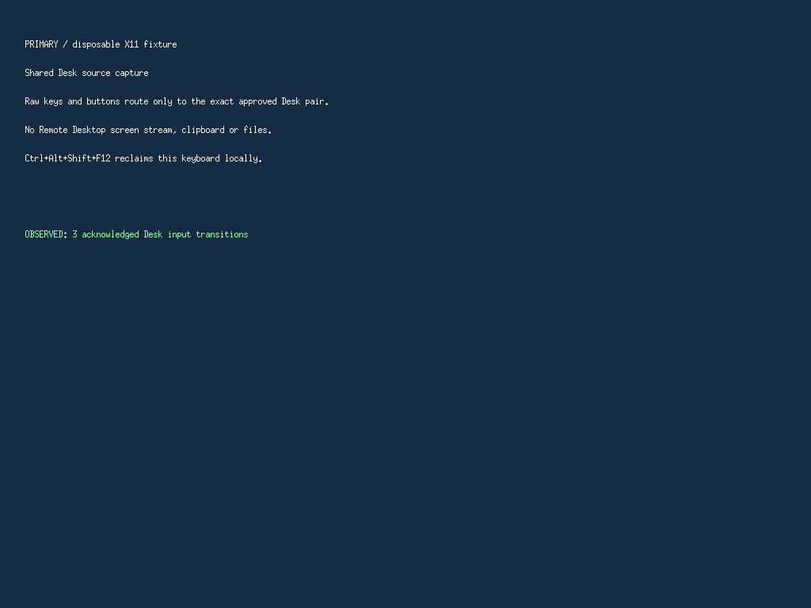

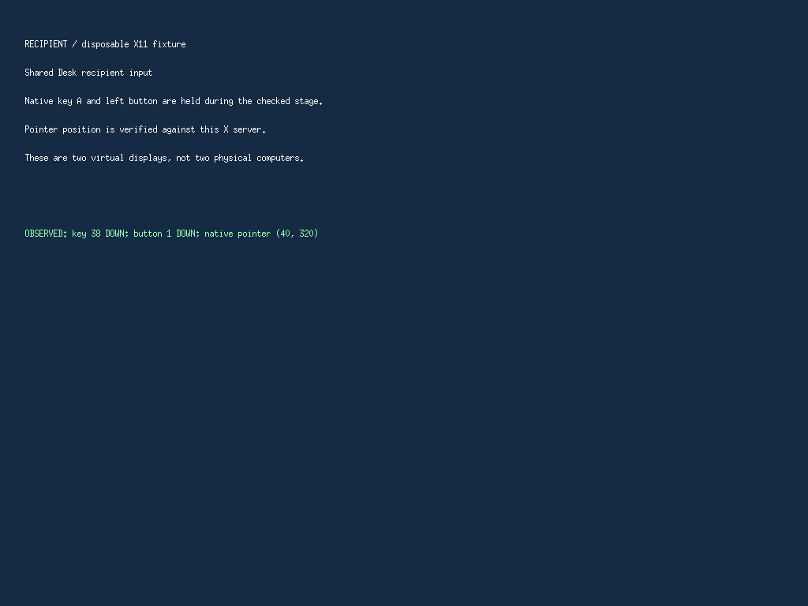

## Ownership and failure rules

- Layout v1 accepts 2 to 32 nonoverlapping, connected display rectangles. Negative origins, split edges, narrow overlaps and different pixel densities are supported by pure geometry. Corner-only islands, ambiguous edges, duplicate IDs/JSON keys, unknown fields and oversized documents are refused. Half-open intervals avoid mapping a corner into two neighbors.
- The exact pair binds one run, primary key, recipient key, layout hash, keyboard map and display. Approval is an in-memory single-use object supplied by the caller after independent local consent. Reconnect must obtain a fresh approval/run. Persistent anti-reuse and production consent/enrollment remain caller work, not an implied property of TLS.
- Each recipient requires increasing nonzero input sequence numbers. Duplicate presses, unowned releases/repeats, malformed events and out-of-bounds pixels retire the run. Held state is tracked separately for physical key codes and buttons. Successful cleanup clears the ledger; failed cleanup is retained and blocks successor activation.
- The switchboard joins old-destination cleanup before creating its successor. The first-slice policy refuses crossing with any key or button held. Drag-across and modifier transfer are not implemented. A stopped generation cannot activate a late factory result.
- Wire records are bounded to 4 KiB, strictly decoded and separately framed. No video, logical text, clipboard, file, chat or recording messages exist. Native effects and clean stop are acknowledged. Lost acknowledgement is an error, not proof of release; no input is replayed.
- Client pulses run every 500 ms; a recipient read deadline is 2 seconds. Current approval loss closes an idle channel. The recipient child also requires a coordinator pulse lease. Separate native tests kill or stop the coordinator and observe held-state release while its child and X server survive. These bounds are engineering settings, not production service guarantees under a stalled OS/native call.
- Desk and attended Remote Desktop input share cooperating native ownership locks, not authority. Simultaneous input ownership is refused. The existing attended mapping-notification policy remains unchanged. Desk continues after a notification only if the entire current keyboard map still exactly matches the approved hash. An actual map change retires Desk and releases held input.
- The source explicitly grabs input only after the destination is ready. Its local stop disables the grabs before remote cleanup. The capture adapter now supports a terminal return across an approved local neighboring edge, after held-input guards and acknowledged cleanup. Other edges clamp motion. Explicitly armed initial edge entry is now exercised by the native fixture. Consumer enable UI and live cross-recipient routing are not wired yet.

## What this does not establish

No two-physical-computer, mixed-OS, secure desktop, lock/sleep, IME, arbitrary keyboard-layout or full multi-monitor runtime acceptance has occurred. Native input currently supports one X screen, matching keyboard maps and signed X11 coordinates. Geometry supports more arrangements than this native adapter. Root size change retires the recipient; full monitor hotplug/session-lock integration is still absent.

X11 cannot distinguish physical from synthetic input. A foreign press before admission is refused, but an overlapping physical press after an accepted synthetic press is not isolated. The local shortcut can be blocked by an unrelated active X keyboard grab. Killing the injector itself can leave XTEST state held. Surviving-child cleanup after coordinator loss is not crash-proof cleanup. Do not expose this as unattended, secure or production-ready input.

Multies remains untouched. Production workspace authorization, discover/pair/enable UI, automatic edge journeys, persistent exact-key trust, physical-device validation and platform-specific permission/reclaim work remain required. Clipboard, file transfer and recording are not enabled by Desk pairing. This is an independent native engine slice, not completion of Shared Desk or all three tools.

## Verification

The normal CI session job now runs the same bounded dual-X11 native script. Pure tests cover exact binding, stale/reused/foreign approval, held-state guards, terminal stop during a blocked factory, release failure retention, strict frame/document limits, missing heartbeat and idle authority loss. Local full uncached race tests, vet, build, vulnerability checks and Darwin/Windows daemon cross-builds passed before this source checkpoint. Native evidence and screenshots are Linux fixture evidence only. New hosted checks must be verified on this exact checkpoint separately.

## Idle transport-loss correction

The first independent engine checkpoint (`9c7e36d`) could leave source capture grabbed when the TLS backend retired while source input was idle. The source watched current pair authority but did not watch that backend's terminal channel. Further input or the local stop chord could reclaim it, but automatic idle-loss reclaim was missing.

A native failing-first regression now releases the source key to prevent auto-repeat from hiding the idle condition, keeps the mouse button held, waits for acknowledged input, closes the TLS peer and tests acquisition of the source keyboard by another local client. The old implementation fails that postcondition. Exact-backend terminal propagation now stops the switchboard and source capture without another input. The corrected native case passes, and unavailable remote release acknowledgement is still an error rather than a clean-stop claim.

A backend from an old destination cannot stop its successor. A backend already terminal at construction is refused. Explicit Stop and backend failure share terminal source notification, with local grabs dropped before waiting for remote cleanup. This fixes the native fixture path, not the remaining physical-X11, automatic-edge, persistent-pairing or production authority gates above.

## Idle recipient-backend death correction

The source-side idle-loss fix (`5fa0479`) does not by itself detect an idle native recipient child dying while its TLS connection still answers pulses. A separate failing-first wire regression exposed that gap. The recipient now watches its exact native backend terminal channel and closes that run's TLS connection on unexpected native death, so source capture stops without another event. Native acceptance kills the recipient child and verifies actual source keyboard reacquisition. Intentional Stop disarms this failure watcher before joined release, retaining the clean-stop acknowledgement; that ordering has its own regression.

This is failure propagation, not recovery of a killed injector's held state. The native child-SIGKILL case explicitly verifies that its synthetic button can remain held on the recipient, then the isolated test cleans up its own generated button. Do not generalize source reclaim into crash-proof recipient cleanup or physical ownership safety.


## Native edge return

The source capture loop now uses actual source motion and the approved arrangement to return from a remote recipient to the local primary. A native failing-first case showed that the old adapter clamped at the remote edge forever. The new case first pushes left while a key and button are held and verifies that it stays remote. It releases both, waits for native acknowledgements, then pushes across the same edge again. The source grabs are dropped before waiting for the recipient release. Only confirmed cleanup allows pointer placement on the approved local display. The run is terminal afterward, not silently re-enabled.

The test queries the actual local X pointer at its exact mapped pixel and acquires the keyboard from another local client. Default1024x768 and unequal1024x768-to1280x960 native display journeys pass. The primary layout must exactly match the single supported local X screen. Missing neighboring edges, held input and nonlocal neighbors do not activate an unapproved destination. Release failure retains its error and produces no mapped pointer activation.

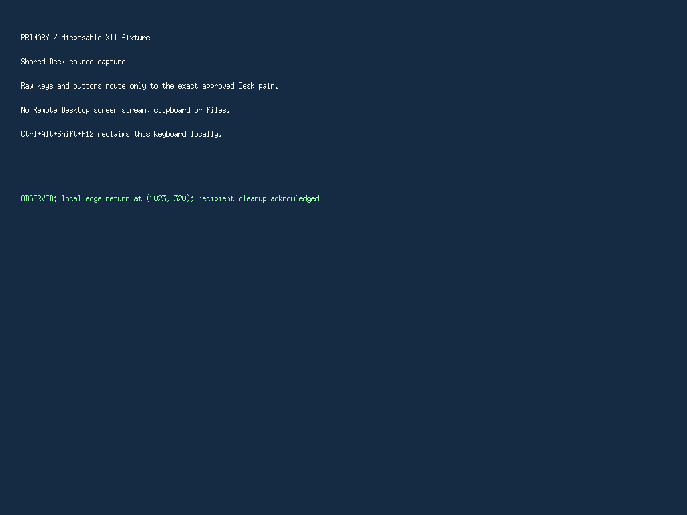

This is one completed native return path inside the explicit paired fixture. Initial automatic edge activation, cross-recipient routing, multiple local native monitors, persistent pairing UI and two-physical-computer acceptance remain open. It does not overcome the X11 physical/synthetic overlap or killed-injector limitations above.

## Explicitly armed edge entry

The Linux engine now has a one-shot armed-edge entry path for an independently approved pair, primary and layout. The source stays local while armed. A pointer already resting on the selected edge does not activate it. The source must visit the interior and then arrive at that edge with no held keys or buttons. Only then does the caller's exact approved pair factory run, followed by native capture readiness checks. No discovery result, edge movement or TLS hello creates pair consent.

The native fixture tries resting-edge and held-button arrivals first and verifies no activation, then makes a fresh unheld arrival and runs actual source-to-recipient input. Canceling the arm never creates a recipient and releases the cooperating native owner. Context cancellation remains part of capture liveness after entry. Current authority, map, source geometry and local stop are checked; setup failure ends the generation instead of retrying or automatically reconnecting.

Default and unequal-size disposable X11 journeys pass. This is a native engine entry point exercised by the acceptance harness, not a consumer pair/enable screen or a new normal CLI input command. The only normal Desk CLI remains the offline layout checker. Persistent exact-key trust, authenticated workspace approval UI, lock/sleep integration and physical-device acceptance are still required. The local pointer watch currently samples every10ms and can miss an extremely short edge visit; it does not promise hardware latency or input isolation.

## Native local run review

Real default-decline dialogs now gate both roles in the native reviewed-entry journey. The recipient reviews receiving raw input, and the primary reviews arming its selected source edge. Each dialog shows the full independently supplied primary/recipient public-key pins, one-use run, layout hash, keyboard hash and recipient display. The primary also shows the exact selected edge. No discovered name, peer text or markup is presented as proof of identity.

The user must compare the keys and arrangement through an independent trusted source. The dialog explicitly does not verify workspace membership or a person's identity. It states the raw-input-only scope, disabled video/clipboard/files/recording, local shortcut limits and killed-injector held-state risk. These are local engineering review dialogs, not Multies sign-in or a production trust-store flow.


Native acceptance answers both real dialogs on their separate disposable displays before creating the test connection and native recipient, then exercises armed edge entry and actual input. It also presses default Return to decline a separate real dialog, and withdraws current authority while another is visible, verifying closure without approval. Pure regressions reject late successful answers after authority loss and check that required exact evidence is present. The driver waits for a dialog to actually close before moving the pointer, rather than treating an injected approval key as proof that review completed.

Current authority is checked before and after the answer, monitored during review and retained through the resulting approval/capture lifetime. Closing, declining, unavailable dialogs, changed authority and unexpected output refuse the run. Initial discovery, workspace verification, normal app launch wiring, persistent pairing, arrangement editing and two-physical-computer acceptance remain open. The one-run local status/Stop window below is now wired to the actual launcher. The normal Desk CLI still only checks an offline layout; these review functions are connected to the native harness, not advertised as an installed consumer app.

## Explicit one-run engineering launcher

The Linux X11 daemon now exposes two separate engineering operations. They cannot combine with daemon, session, service, or other flags:

```text
mnetd -desk-inspect /absolute/path/to/local-public-cert.pem
mnetd -desk-run /absolute/path/to/local-run.json
```

`desk-inspect` reads one local PEM public certificate and the current single X screen. It prints the exact certificate public-key pin, keyboard-map hash and native dimensions, marked local-evidence-only and not approval. It reads no private key, reserves no run, claims no desktop owner, starts no listener and proves no person or workspace identity. Each endpoint can compare this evidence independently before accepting a run. A public certificate file alone does not prove possession; the TLS handshake later must prove the matching private key.

Explicit empty or repeated `-desk-run` / `-desk-inspect` file selectors now refuse during argument parsing. Empty selectors never fall through to daemon or version mode; repeats never silently replace the first path. A single nonempty path stays exact, including spaces and relative form, and still cannot combine with other modes. `python3 scripts/desk-flags-validation.py` tests the actual built daemon without starting a daemon, network or display; the check is in normal Go CI. The old main fails the empty-selector regression, the fixed parser and actual CLI pass, and equal/mixed actual launcher input, Stop, replay, decline and deadline journeys still pass. This is engineering mode isolation, not production setup or pairing.

`desk-run` is a finite attended attempt, not a background service or consumer setup. It requires an explicitly prepared version-1 JSON with these fields:

| Field | Required meaning |
| --- | --- |
| `role` | Exactly `primary` or `recipient`; neither is selected by discovery. |
| `address` | Explicit recipient IP and nonzero TCP port. Both files name that same recipient endpoint. DNS, multicast and wildcard listening are refused. The primary dials it; the recipient binds it only after local approval. |
| `certificate_file`, `private_key_file` | This role's existing matching local certificate/key. Exactly one certificate, with its pin equal to this role's approved binding. Key file must be regular, owned by the launching user and owner-only. No automatic enrollment or key download. |
| `run_directory` | Existing owner-only directory owned by the launching user. A durable exclusive run marker is reserved before review. Missing/insecure storage refuses the attempt; it is never silently recreated or reset. |
| `lifetime_seconds` | 1 through 600, measured from launch, including validation, local review, waiting and active input. |
| `source_display`, `edge` | Exact primary display ID and selected left/right/top/bottom edge leading only to the exact recipient display. |
| `binding` | Full `run`, `primary_key`, `recipient_key`, `layout_hash`, `keyboard_hash` and `display`, as specified in the exact pair engine above. Both endpoints independently accept the same values. |
| `layout` | Version-1 layout document. This launcher supports exactly one primary and one recipient display. The offline geometry engine remains broader. |

Set top-level `version` to `1`. Local paths resolve relative to the selected run file, not the daemon state directory. Config/key reads are bounded and refuse a symlink in the named file itself. The private replay directory and its records likewise cannot be named symlinks. The caller must protect local file parents and private state from other processes. Clearing, replacing or choosing a different replay directory removes its historical protection; there is no external anti-replay authority. Do not reset it to reuse a run. Generate and independently approve a new unpredictable 256-bit lowercase-hex run for every attempt, including after decline, closure, failure or cancellation. A consumed run cannot reconnect or resume.

The JSON decoder rejects duplicate, mixed-case, unknown and trailing fields, oversized documents, bad pins and mismatched layout hashes before activation. Local keyboard hash and actual geometry must match the approved layout. Recipient native-child readiness is checked against the same dimensions again after approval. This engineering operation does not generate the run/config/certificates for the user; normal setup, enrollment and arrangement editing remain open work.

The recipient reviews locally before opening its one-connection listener. While waiting, it reserves the local stop shortcut and cooperating input owner without creating an injector. Local stop, process termination or deadline closes that listener. At native handoff, pending real shortcut/mapping/owner loss remains terminal, even if it races deliberate release of the waiting owner. A failed or unauthenticated first connection ends the attempt; it cannot keep probing under an old approval.

The primary reviews locally, arms only the selected edge and stays local until a fresh unheld interior-to-edge arrival. It then dials exactly once and starts exact-key TLS/native capture. Active status is printed in its launching terminal and shown in the exact-run local window described below. Local stop, mapped return, peer/backend loss, deadline or process termination ends the attempt. There is no automatic reconnect, input queue replay, saved grant or daemon/network auto-enable. This command does not join a network, open a Remote Desktop session, change any Multies state, or install a service.

Stopping input authority must not prevent cleanup. A bounded stop-only exchange may still run after local revocation solely to obtain recipient native-release acknowledgement. It cannot send input or restore the run. Input remains refused, and missing release acknowledgement remains an error. The first actual launcher test exposed the previous refusal to send cleanup once local authority ended; that failure is retained as the reason for the change, not relabeled a clean shutdown. An in-flight already-acknowledged input can race requested stop and report authority retirement. That diagnostic is treated as expected cancellation only when the source and recipient cleanup checks both succeed. Other errors remain errors.

### Actual command acceptance

`python3 scripts/desk-launch-validation.py` builds and launches two real `mnetd -desk-run` processes on separate disposable X servers. Test-only code prepares their ephemeral TLS files and exact public configuration, but does not run their review, networking, capture or injection functions. The driver compares actual read-only inspection, checks incompatible flag refusal, answers each real dialog, moves across the selected edge and queries native recipient key/button state. It then sends SIGTERM, checks recipient release, reacquires both source keyboard and pointer, and requires clean process exits. Further attempts verify persistent same-config refusal on both endpoints, default-Return decline, local stop while waiting, and automatic deadline/listener closure. The script deletes its disposable private keys before retaining artifacts. Native Windows/macOS, Wayland and physical two-computer acceptance are not established by these tests.

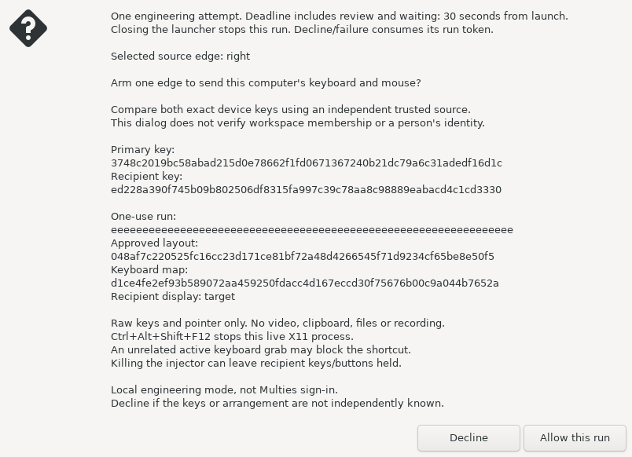

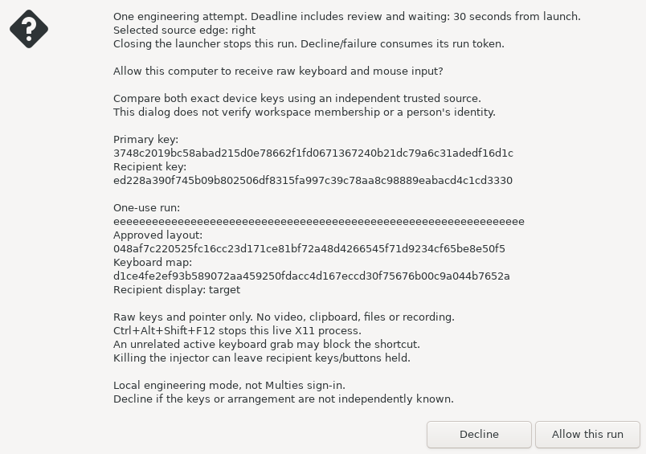

These dialogs are real launcher UI, with launch deadline, consumed-attempt warning and complete exact evidence. They remain technical engineering review, not the planned consumer setup or live arrangement/status/stop design. The user should not need to assemble keys, hashes or server details in the intended consumer product. The held production Multies verifier is still absent. Existing X11 physical/synthetic overlap, unrelated active keyboard-grab and killed-injector held-state limitations remain unchanged.

## Exact-run local status and Stop

The actual `mnetd -desk-run` launcher now opens a local status window after its default-decline review succeeds. This window belongs to that one reviewed role/run/key pair. It is not another approval dialog. It cannot choose a peer, change an arrangement, restart, reconnect or save trust.

The primary shows armed, connecting and sending stages. Armed means input still stays local until a fresh unheld arrival at the reviewed edge. Sending is published only after exact-key pairing and native source capture succeed. The recipient shows waiting, native ready and receiving stages. Ready means its native owner was prepared after the exact pair checks; receiving appears only after native input was accepted. These labels do not claim workspace identity, remote health, guaranteed current delivery or completed cleanup. No earlier state is reused as permission for a successor run.

The full one-use run and other-device public-key pin are shown. The window has a large Stop target, plus Escape while it has focus and the existing X11 stop shortcut. Stop, window close, unexpected display failure or unsupported window resize cancels its context. Waiting listeners, native owners and source capture remain tied to that context. Teardown joins the window and native cleanup; a window disappearing is not proof of clean remote release. An unavailable acknowledgement or failed native release remains an error in the launching terminal. There is no automatic re-enable.

While sending, the primary intentionally owns source keyboard/pointer grabs. Those grabs can stop its window button from receiving clicks, so the primary window explicitly directs the person to the reserved Ctrl+Alt+Shift+F12 shortcut in that phase. The recipient's local button is exercised independently. An unrelated active keyboard grab can still block the shortcut. This window does not solve that existing X11 limitation, physical/synthetic overlap, killed-injector held-state risk, sleep/lock, other operating systems or accessibility integration. X11 cannot prove that an event came from a physical local person. The button can only withdraw authority, never create it.

The status window requires at least760x330 local pixels, the built-in fixed font and the existing supported X11 desktop. If it cannot start, the reviewed run refuses before arming/listening. It has no no-window fallback. Unexpected drawing failure retires the run rather than leave hidden enabled input. It is a small native engineering UI, not the planned consumer setup or pairing experience.

The extended actual-command acceptance runs equal1024 and mixed1024-to1280 display journeys. It verifies visible armed/sending/waiting/receiving windows, the previous SIGTERM cleanup and a recipient Stop click while native key38 and RIGHT button are held. The Stop click uses LEFT button, so that click cannot itself explain release of the held right button or key. After both processes end, the driver queries recipient state and reacquires source keyboard and pointer. Further fresh runs test waiting-recipient Stop before any peer/native input, armed-source window close before activation, unsupported status resize cancellation, deadline/window/listener closure, default decline and consumed-run replay refusal. Disposable private keys are deleted from artifacts. Pure phase tests reject invented approval/completion labels and backwards role transitions. Full uncached race/vet/build and daemon cross-builds remain separate source gates; hosted results are accounted per commit.

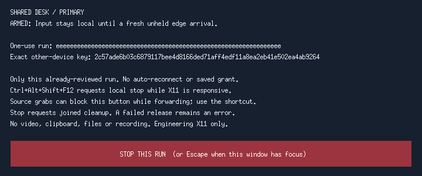

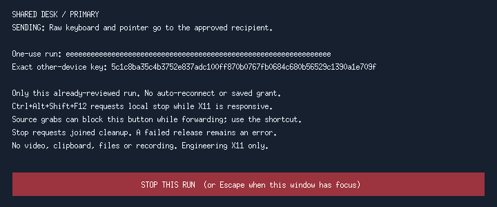

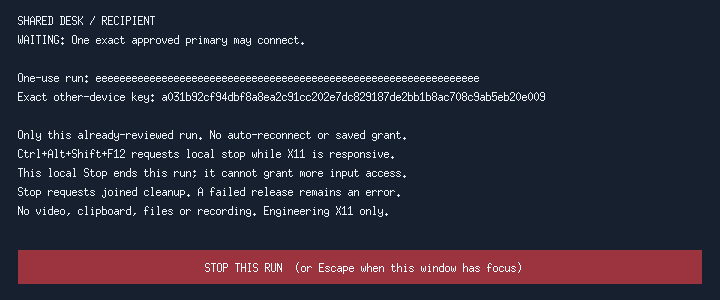

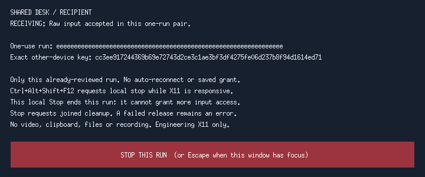

## Exact arrangement inside local review

Both finite launcher review dialogs now show the exact primary/recipient display IDs, layout origin and width/height, native pixel dimensions, shared source edge and half-open shared layout span. This is the compiled arrangement associated with the displayed layout hash, not discovered device metadata, an editable preview or an independent identity proof. Layout units are explicitly distinguished from native pixels; gaps and corner-only adjacency do not switch input. The selected run edge, both independent key pins, one-use run and keyboard/layout hashes remain visible with default Decline.

The native review supports the launcher's one-source/one-recipient pair only. Extra displays or another role/device are refused rather than silently truncating the arrangement into a misleading two-device approval. The broader offline layout checker remains broader and creates no approval. The compiled arrangement accessor returns a copy, so rendering review evidence cannot mutate the approved geometry or its hash. Display IDs are validated bounded identifiers, not markup or claimed people.

A failing-first regression shows that the former hash-only dialog omitted this evidence. Tests cover all four edges, unequal native pixel sizes, offsets and partial shared spans, both roles, wrong/extra device refusal and immutable compiled state. The actual built launcher runs both equal1024 and1024-to1280 native journeys with the new real dialogs, edge activation, exact-key TLS, held input, SIGTERM/recipient Stop release, replay refusal, default decline, waiting/armed close, unsupported status resize and deadline cleanup. The driver now waits for actual painted review pixels before answering: an earlier captured mixed-size dialog was still black immediately after window discovery, so title presence alone was not accepted as visual evidence. Final primary/recipient pixels were inspected with all lines and action buttons visible.

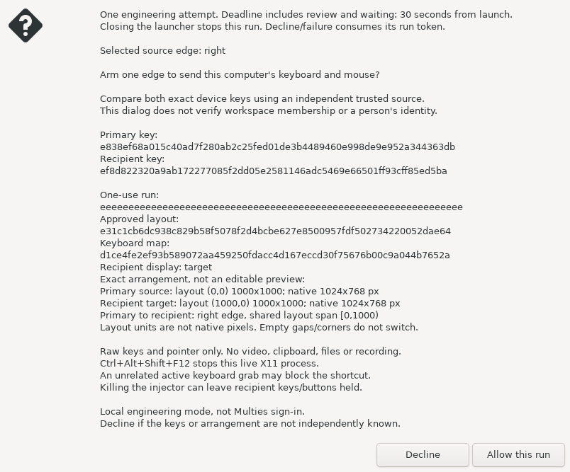

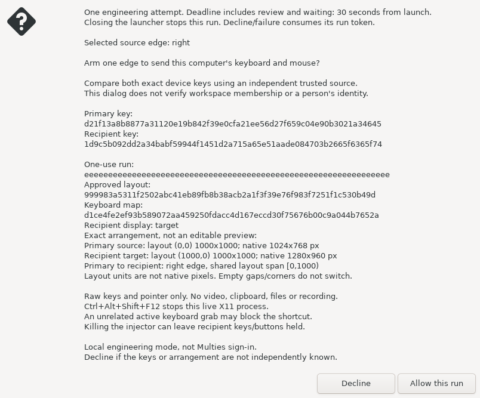

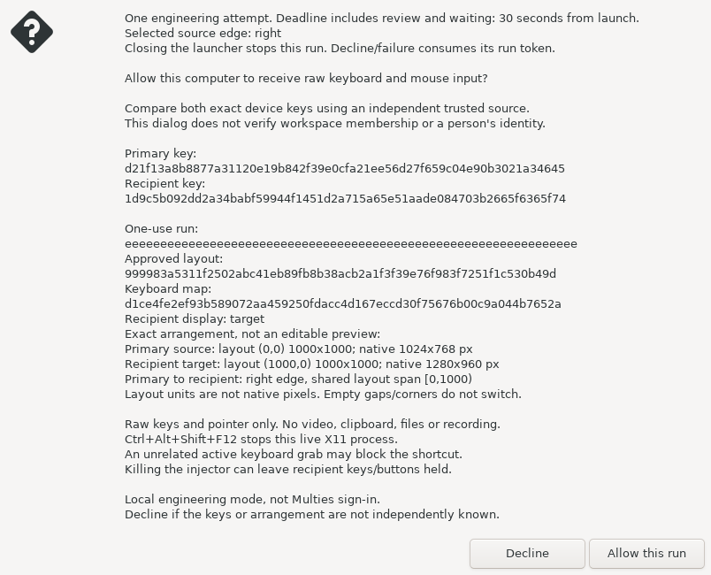

This closes a finite engineering review-evidence gap. It does not edit arrangement, generate identity/configuration, enroll, save pairing trust, verify Multies membership or change input scope. Persistent pairing, production authorization, lock/sleep integration, other native platforms and physical two-computer acceptance remain open. Local race/vet/build/cross-build checks and disposable native processes do not close those gates. Hosted results remain per exact commit.

## Exact local Stop gesture

The finite run-status Stop target is now44pixels high. It needs a left press and release inside the same local target. A press above Stop followed by release over it, a release outside after pressing Stop, or local focus loss cancels that pending gesture. Escape and the existing local live-stop chord remain separate stop paths; this does not promise they bypass another X11 grab or an unresponsive server. The source forwarding-grab caveat remains visible.

The old published status handler fails the actual outside-press/inside-release regression by ending the waiting run. Current equal/mixed actual launcher journeys reject both mismatched directions and focus-loss activation, then cancel from the newly included top edge of the44pixel band. Existing recipient Stop with held key/right button, joined release and source reclaim still pass. Thirty focused status/hit-test races, full uncached race/vet/build and Darwin/Windows daemon builds pass locally. Final actual role-specific status pixels inspected. This cannot approve, reconnect or save trust.


## Keyboard-focused local Stop

The existing one-run status window now exposes its local Stop through Tab or Shift+Tab, with a visible white focus ring. Matching Enter or Space release withdraws only this already-reviewed run. A release without a press does nothing; Tab, focus loss, a pointer press or an unrelated key cancels pending keyboard activation. Local Escape and Ctrl+Alt+Shift+F12 remain unchanged. This adds no approval, saved trust, reconnect or remote-input command.

The source window's warning remains: source input grabs can prevent interacting with its Stop button while forwarding, so use the local shortcut while X11 remains responsive. A focus ring does not fix that platform limitation. Stop requests joined cleanup; failed native release or lost remote acknowledgment remains an error, not a clean-stop claim.

The actual built-launcher fixture fails the new focus-pixel check against the old source. Current equal and mixed-size X11 runs check actual white focus pixels, unpressed-release refusal, focus-loss/Tab cancellation, waiting listener/window teardown and keyboard Stop while an independent source key38 and right button are held on the recipient. Native queries show both released and the source keyboard/pointer grabs reclaimed. Existing exact mouse gesture, default-decline, shortcut, resize and deadline checks still pass. Thirty focused race repetitions, full uncached race/vet/build and Darwin/Windows daemon cross-builds pass. These are disposable same-host X11 fixtures, not physical-computer, other-OS input or consumer integration acceptance.

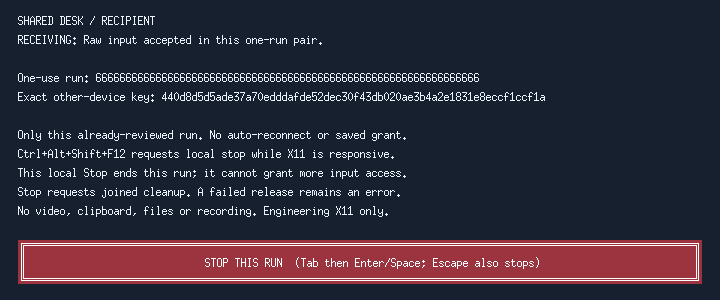


## Actual launcher return and abrupt-loss acceptance

The finite-launcher fixture now checks the return edge through both actual `mnetd -desk-run` processes, beyond the lower-level capture test. A held native key38/right button blocks returning to the primary. After both releases are acknowledged, the next crossing joins recipient cleanup and restores the exact mapped primary pixel. Both processes and status windows end, source grabs are reclaimed and a later edge arrival does not restart the consumed run. Equal and mixed native pixel sizes pass. This remains a terminal one-run return, not saved trust or automatic reconnection.

The same fixture independently sends SIGKILL to each launcher while recipient key38/right-button state is held. The actual surviving input child is identified before the crash. Native queries then require both transitions released, the input child exited, the peer ended with an error rather than false clean success, and source grabs/status surfaces retired. Killing the recipient launcher leaves its child alive long enough to do EOF/lease cleanup. This does not test or solve killing the native injector itself; its established SIGKILL limitation remains.

These are same-host disposable X11/TLS fixtures, not physical mixed-platform, secure-desktop or OS-crash acceptance. Test cleanup acts as a Linux child subreaper and reaps only the exact observed disposable child. The first child-identification attempt looked only at the Go leader thread and failed to locate the child. That fixture failure is preserved; the corrected check combines all thread child lists, then both size journeys pass without changing product assertions, deadlines or source. No app behavior, input authority, persistent pairing, Multies or release boundary is changed by this evidence expansion.

## Source keyboard-map retirement acceptance

Normal disposable-X11 acceptance now explicitly checks source keyboard changes in two states, not only recipient map changes:

- While armed, changing the source map retires the generation without creating a recipient. The exact local safety owner is gone. Restoring the old map cannot reactivate the retired board, and a fresh safety owner can be acquired only as a separate fixture action.
- While forwarding an actual held key38 and button1 to the other X server, an unchanged source mapping notification preserves routing. A later native pointer transition still reaches its exact destination pixel. An actual source mapping change then retires capture, joins the pair's recipient cleanup, releases the target's held key/button and lets an independent source client acquire the keyboard. The retired board rejects more input.

Both equal and mixed-display full journeys pass. Ten race-enabled repetitions of both source-map paths also pass, plus full uncached race/vet/build. The active-path local close retained its explicit source-map-change error in these runs. The fixture accepts either terminal event-loop or safety-watcher cleanup ordering, not a claim that a map change is a clean user stop. No product defect was found in this slice and no product behavior changed. These are same-host disposable servers, not physical keyboard-layout or mixed-platform acceptance. Injector-itself SIGKILL remains unsolved.

## Active source display-geometry retirement

A failing-first actual-X-server check found that the active source capture only compared its geometry on entry. Shrinking that source root from1024x768 to800x600 left the old capture active with a native recipient key/button held. The initial failure is retained as a regression finding, not explained away as a fixture mismatch.

The source now selects root structure-change events and retires on a size change. A50ms local geometry check also retires an idle capture when the source dimensions differ or the root cannot be queried. This interval is local native state checking, not a remote service poll. Geometry retirement disables source grabs first, joins the recipient's owned held-input release through the existing pair teardown and reports a source-geometry error. A deliberate local stop does not get relabeled by a late failed geometry query. No approved layout is rewritten and no successor geometry/run is selected automatically.

Actual equal/mixed disposable-X11 journeys shrink the source root, verify the root's real dimensions, require capture retirement and pair join, independently query released recipient key38/button1, acquire the source keyboard and reject more input on the old board. A separate immediate shrink-and-restore journey proves that a transient change still retires the old generation rather than relying only on a later size sample. Armed geometry loss also refuses activation without creating a recipient; restoring the root cannot reactivate its retired board. Ten race-enabled active/armed geometry repetitions pass. Full uncached race/vet/build and Darwin/Windows daemon cross-builds pass, plus original equal/mixed actual-launcher return, Stop, abrupt-launcher-loss and deadline regressions. The launcher's mixed fixture uses its supported1280x960 target; an attempted2048target was rejected by the fixture's existing size policy, not a product result.

This corrects active source-root dimensions on the supported Linux path. It does not establish physical monitor topology/DPI/hotplug behavior or other platforms, and does not solve injector-itself SIGKILL. Screens below are actual disposable fixture roots after native state queries, not consumer product screens. The source fixture's old text clears during resize; its current observed-state line and800x600 captured root are visible.

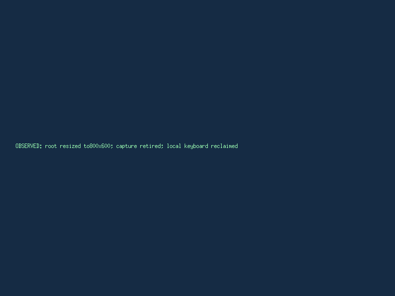

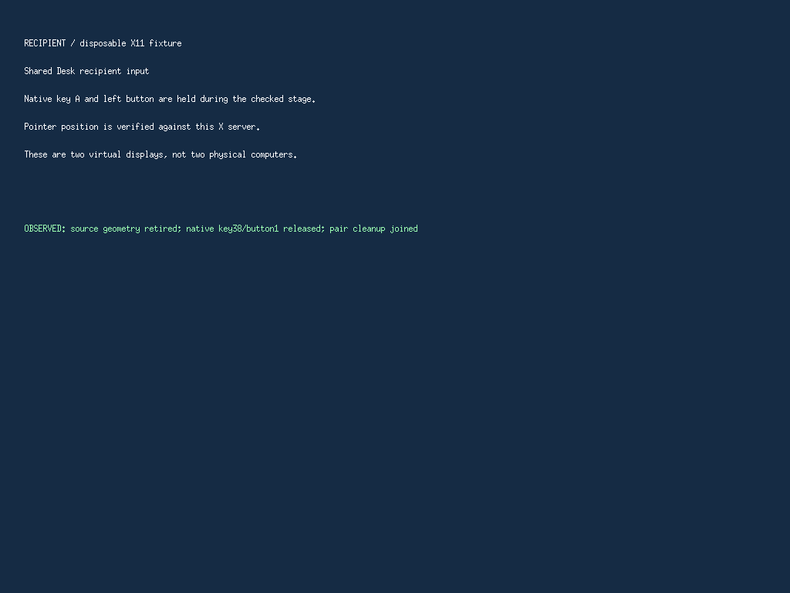

## Actual launcher root and map retirement

The real finite `mnetd -desk-run` commands now exercise source and recipient root resize independently, with actual local reviews, fresh edge entry and native held key38/right-button state. Changing either disposable root to800x600 ends both launchers, releases the recipient-owned ledger before a source key-up, lets an independent client reclaim source keyboard/pointer, closes status windows/listener and cannot reactivate when the old root dimensions return. The source-root case must preserve its explicit geometry error; the recipient-root case must report failure rather than clean success.

Separate actual-launcher source and recipient keyboard-map changes also require the native ledger released before map restoration or source key-up, source grabs reclaimed, status/listener gone and no restart after the old map returns. The fixture changes the map through the X server's real keyboard-mapping API and restores its exact original symbols only as cleanup. It does not invoke a private capture helper to retire the run.

Both complete equal/mixed launcher suites pass with these checks included. Existing local Stop, joined edge return, anti-reuse, deadline and abrupt-launcher-loss journeys still run. Full uncached race/vet/build passes. An initial recipient-map fixture reused the first run's ID and was correctly refused by persistent anti-reuse before its review window; the driver now assigns that case a distinct run ID. Product reuse guards were unchanged. The resized root screenshots were inspected: the old live status windows are gone and the roots are800x600. Empty root pixels alone do not prove native release; independent X queries, process exits and listener probes provide that evidence. These remain same-host synthetic native fixtures, not physical display/keyboard or multi-platform acceptance.

## Geometry fixture decoder-map race

Original c96d CI failed in the mixed-display armed-geometry check. The race detector identified `randr.Init` writing XGB's process-global event decoder map concurrently with the safety connection's response reader. The geometry helper introduced this in-process initialization; local passes had not exposed that schedule. This original hosted failure remains failed and is not rerun or relabeled as a product geometry failure. Source retirement checks themselves passed in that run before the fixture race.

The geometry helper now runs the checked `xrandr` resize/restore in a separate process, with its own X connection and decoder map. Its existing real root-size query, cleanup and retirement assertions are preserved. It does not disable the race detector, serialize product safety/capture or alter product behavior. A disposable-source `screen` output is an explicit fixture prerequisite, not a physical-monitor assumption in the app.

Both full equal/mixed native suites and complete actual launcher suites pass locally after this fixture change. Twenty race-enabled repetitions each of armed resize, active resize and immediate shrink/restore pass, plus full uncached race/vet/build. Current native resized/released pixels were inspected. Fresh hosted accounting remains pending, so these local results do not turn original c96d green or establish the later checkpoint's hosted outcome.

## Reviewed waiting-recipient geometry lifetime

A failing-first actual-launcher check found a separate gap before input: after local review, a waiting recipient kept its approved listener/status alive when its X root changed dimensions. Native input would still reject a mismatched size on connection, but the reviewed waiting run had not been retired. It could outlive a transient root change and later restoration. The old actual command failed the new three-second retirement check.

The recipient run now has an exact reviewed-geometry guard immediately after local review and before its status, safety owner or listener. It verifies the current root against the bound recipient display, watches root structure events and checks local geometry every50ms. A changed/unavailable root cancels this run, closes status/listener and preserves a reviewed-recipient-geometry error. Cancellation joins its event reader and closes its independent X connection. The guard neither captures/injects input nor changes the layout, approval, trust or lifetime. Active recipient input keeps its own independent geometry checks.

Actual equal/mixed finite launcher suites now include a waiting root shrink and an immediate shrink/restore. Both retire without a peer or native input child, close the listener/status, preserve a geometry error and keep the run consumed on attempted replay. Restoring the old dimensions cannot resume it. Fifty race-enabled guard repetitions cover exact/wrong device/display/dimensions, absent/canceled ownership, close/cancel versus actual/transient resize, joined readers and no input-owner claim. Both full equal/mixed native suites, full uncached race/vet/build and daemon cross-builds pass. Current waiting and retired root pixels were inspected. Empty root pixels only show the window is gone; process, listener, child and native ownership checks provide the lifecycle evidence.

This is a supported-X11 root-size lifetime rule, not physical monitor/DPI/hotplug or cross-platform acceptance. It does not broaden any pairing/approval authority or solve injector-itself SIGKILL.

## Actual first-connection refusal and pending TLS Stop

The complete actual launcher journey now checks four failures after local recipient approval: plaintext instead of TLS, a TLS1.3/ALPN client presenting the recipient certificate in the primary role, the correct primary certificate with a different one-use run in its hello, and an accepted socket that sends no ClientHello while local Stop is pressed. Each actual command ends with failure, closes listener/status and refuses replay of the consumed run. No second connection gets a retry under the old approval. The wrong-role and wrong-run cases require their exact refusal diagnostics, not an arbitrary crash. Recipient key/right-button remain released; the pending socket has no native child before local Stop.

Both equal/mixed complete actual launcher suites pass, as do both complete native suites and full uncached race/vet/build. The geometry-only guard now also explicitly tests loss of its X connection: it cancels, joins and retains the unavailable-geometry error, without an input owner or reactivation. Actual waiting-during-TLS Stop pixels inspected at both sizes. These add acceptance evidence for existing product gates, not new enrollment, certificate issuance, trusted pairing, retry, input approval or production-network acceptance. No product behavior or UI layout changed; fresh hosted results remain per exact revision.

## Offline parser and mapped-geometry fuzz coverage

Four additional fuzz targets exercise the offline layout decoder, explicit run decoder, bounded wire-frame decoder and structured valid mapped geometry. Accepted documents must round-trip without changing interpreted fields, and accepted run documents retain their exact layout binding. Wire decoding must consume exactly its declared frame, leaving any following bytes untouched. Valid compiled arrangements are queried at both endpoints, midpoint and invalid extreme pixels on every edge; all candidates must remain within the exact destination/device. Returned display/link copies must not change the approved fingerprint.

The structured geometry target varies bounded sizes, offsets, native pixel densities and horizontal/vertical adjacency, keeping valid arithmetic paths reachable without rediscovering valid JSON. Four local10-second fuzz invocations passed: layout35,800executions, run280, wire284,900and structured geometry237,123. Layout/run fuzz logs include intervals without increased execution counts; these finite runs establish no throughput or exhaustive-coverage guarantee. No failing input found. General CI runs the seed corpus through its existing whole-repository race tests; the mutation runs are local evidence, not a new hosted fuzz gate or a repair of the unrelated0838session fuzz timeout. Full uncached race/vet/build passes. No sockets, native input, approval, account, signed distribution or UI layout are created by these targets.

## Offline recipient ownership sequence fuzzing

A bounded in-memory stateful target now compares the recipient against an independent accepted-key/button ledger across mutated sequences. It exercises press/release/repeat, pointer movement, duplicate/unowned transitions, invalid physical keys/coordinates, zero/stale/noncontiguous sequence numbers, authority loss before/during native completion, native refusal, repeated close and failed release. Invalid/retired transitions must not reach the backend. Retirement remains irreversible, cleanup runs once, and Close retains the exact release-error cause. The accepted ledger is cleared only after successful cleanup.

The target uses only an in-memory fixture, never TLS, native capture/injection or an actual grant. Its source input is capped at256bytes. Fourteen seeds, thirty focused race repetitions, a10second local mutation run with no failing input and full uncached race/vet/build pass. It does not prove native cleanup after SIGKILL, resolve physical/synthetic input overlap or replace actual launcher/native gates. No production input rule or hosted fuzz gate changed.

## Exact partial-edge rational oracle

A separate structured offline geometry target now compares the integer mapper with an independent arbitrary-precision rational oracle, without using compiled links or production mapping helpers. Generated unequal dimensions/pixel densities, near-limit sizes and partial-edge offsets cover all four orientations, both directions, first/middle/last and another source-native pixel. Candidate presence, exact target identity and native coordinates must all match. The oracle tests original geometry, never projected paint or an active edge arrival.

Six seeds and thirty focused race repetitions pass, alongside a10second local mutation run with no failing input and full uncached race/vet/build. No production geometry, admission or hosted gate changed. This is bounded offline arithmetic evidence, not native DPI/monitor alignment or physical Shared Desk acceptance.
