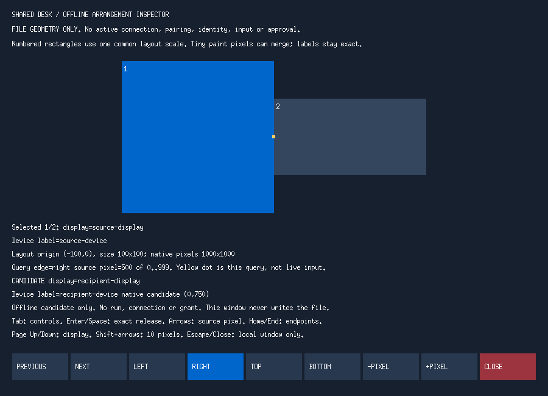
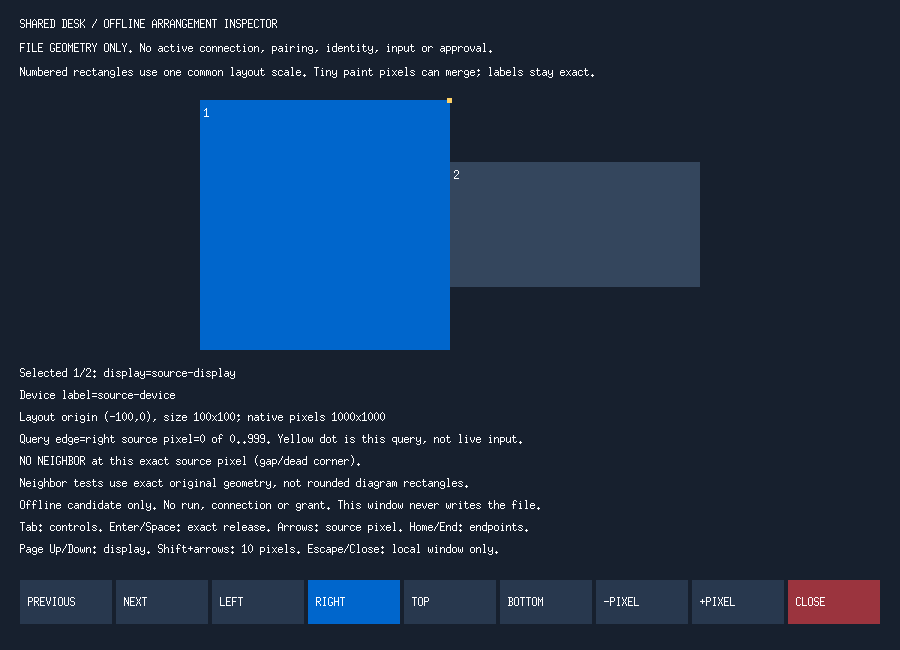
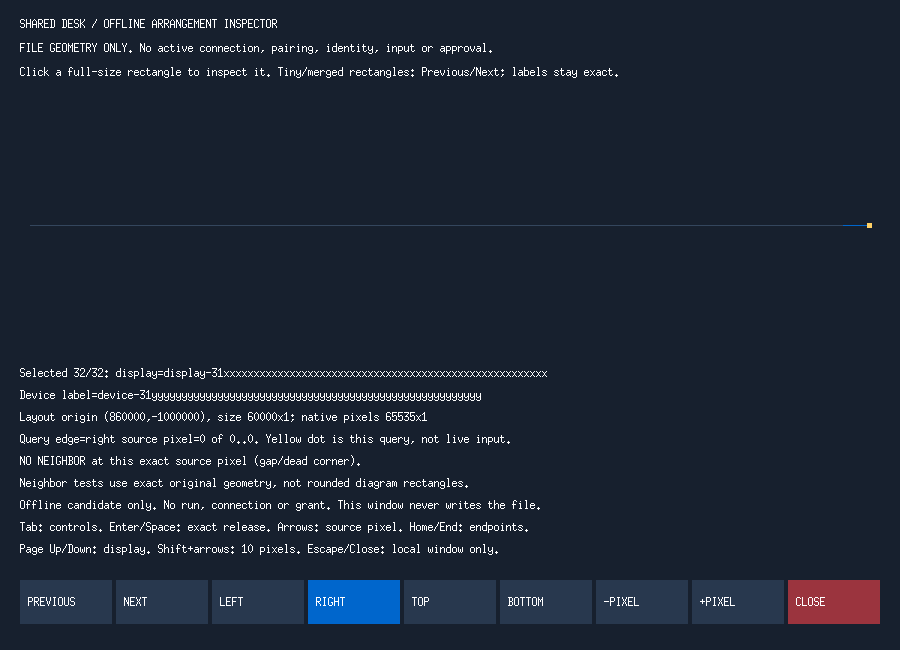
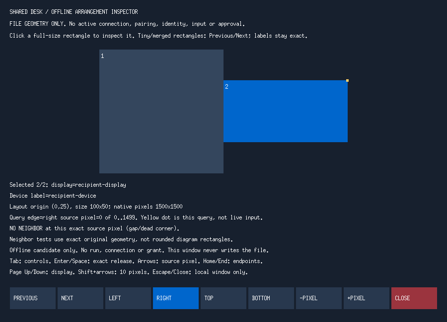

# Shared Desk offline arrangement inspector

`mnet desk layout-view FILE` opens the current file's validated geometry in a native Linux X11 window. It helps inspect display placement, partial shared edges and native-pixel mapping without reading JSON by eye. It is an offline inspector, not an editor, pairing flow, active session or permission prompt.

## What the window does

- Shows every validated display in a single aspect-preserving layout diagram. The selected display is blue; numbered rectangles refer to the file's display order.
- Shows the selected display's full display and device labels, layout origin and dimensions, and native pixel dimensions. Labels are file data, not verified people or devices. Untouched starter labels (`this-display`/`this-computer`, `next-display`/`next-computer`) are marked as placeholders in the diagram and detail text, matching the editor.
- Lets you choose Left, Right, Top or Bottom and an exact source native-edge pixel. The yellow marker names that geometry query, not a live pointer.
- Uses the existing exact `desk.Compiled.MapEdge` calculation for a destination candidate. Partial-edge gaps and dead corners say **NO NEIGHBOR**. Candidate coordinates are native destination pixels, not scaled preview pixels.
- Keeps all 2 to 32 supported displays selectable, including maximum-length labels. Very thin or tiny displays can collapse into touching paint pixels. The exact details and mapping come from original geometry, never those rounded pixels; some rectangle numbers cannot fit at that scale.

The window opens a static, bounded, strictly decoded and compiled file snapshot. Unknown/duplicate JSON fields, overlapping or disconnected layouts and invalid dimensions are rejected by the existing layout rules. A later replacement of the file does not change the open diagram. The inspector never writes or exports the file.

## Local controls

A full-size diagram rectangle can be selected directly with a matching left press and release inside that same unambiguous rectangle. Outside-to-inside or cross-display releases, focus loss and an intervening keyboard gesture cannot select it. Direct selection resets the native source pixel to zero; it does not activate a display or send input. Projected rectangles smaller than44pixels in either dimension and overlapping paint targets refuse mouse selection. Previous/Next remains available for every display, without inflating small hitboxes across a neighboring display.

Previous/Next or Page Up/Page Down selects another display and resets the source pixel. Choosing an edge also resets the source pixel. Left/Right changes it by one native pixel; Shift+Left/Right changes it by ten. Home/End selects its first/last native pixel. Values clamp at the endpoints rather than wrapping.

Tab/Shift+Tab shows keyboard focus across the local controls. Enter/Space requires a matching release on the same focused control. Moving focus, another gesture or focus loss cancels a pending activation. Mouse buttons likewise need an inside press and release on the same target. Escape/Close ends only this local window. Unsupported resize and display loss end it rather than switching to a terminal fallback.

A supported local X11 screen of at least 940x690 pixels is required. Windows/macOS binaries explicitly reject the native inspector. Cross-compilation is not runtime UI support.

## Authority remains separate

This command makes no local daemon request, enrollment, network connection, trust update, input capture/injection, host approval or Shared Desk run. It does not read a run specification or certificates. It cannot create the independent one-use pair, exact accepted layout binding or local reviews required by `mnetd -desk-run FILE`. Existing `mnet desk layout-check FILE [--edge DISPLAY EDGE PIXEL]` behavior stays unchanged.

See the [Shared Desk engine](shared-desk-engine.md) for actual finite launcher, native input and cleanup evidence, and the [three-tool map](three-tools.md) for the remaining installed setup, real Multies bridge and physical mixed-platform gates.

## Actual source evidence

Model checks cover all four exact offset edge mappings, dead corners, endpoint and integer-overflow clamping, aspect-preserving projection, all 32 displays, collapsed paint, invalid files and strict command separation. Thirty focused race repetitions pass.

The real built inspector runs on both equal and large disposable X11 screens. It checks an unequal/offset two-display arrangement, both dead corners, exact midpoint mapping `(0,750)` and reverse mapping `(999,250)`, actual keyboard focus pixels, mismatched mouse release, focus loss and Tab cancellation. It replaces the opened file while the window is active, checks that the existing snapshot stays exact, visits display 32 with full-length labels and checks source bytes remain unchanged. Resize and actual display loss end the process, malformed files are refused, the existing JSON layout-check still returns its exact candidate, and an owned local daemon trap records zero calls.

An initial fixture expected only the window event-loop's display-loss wording. An X server closing during a checked paint instead correctly returned EOF. The fixture now accepts either actual nonzero display-loss result; product behavior was not relaxed. Full uncached race/vet/build and Darwin/Windows CLI cross-builds pass. These are static synthetic file and same-host X11 checks, not paired physical displays or a consumer setup claim.

## Inspected native windows

## Supported control colors

The device window, Remote Desktop chooser and offline layout inspector paint literal RGB control pixels. They now require the root's exact supported 24-bit TrueColor RGB visual before creating a window or reading local daemon evidence. Palette, 16-bit, missing/mismatched-root, swapped-mask and other unsupported visuals fail rather than rendering misleading selection/disabled/focus colors. This is separate from the desktop viewer's stricter raw-frame upload format check; it does not claim new display support.

An actual old-source 8-bit device window rendered black controls with green text instead of the intended colors. The new real built three-window fixture rejects both 8-bit and 16-bit root visuals before any window or local daemon call. Exact root/mask model checks pass, and the complete supported 24-bit native device, chooser and offline inspector journeys still pass with inspected pixels. Full uncached race/vet/build and CLI cross-builds pass. This does not change networking, session or Shared Desk authority.

## Direct diagram selection evidence

Both equal and large actual inspector journeys pass direct source/recipient selection, outside/cross-target refusal, focus-loss/keyboard cancellation, native query reset and tiny-display refusal with all32 labels still reachable by keyboard. Thirty focused model races check half-open shared boundaries, outside points, invalid viewports and thin targets; full uncached race/vet/build and CLI cross-builds pass. Final selected and tiny-diagram pixels inspected. The file remains unchanged and the daemon trap records zero calls.

## Static files cannot become blocking streams

The native offline inspector now opens input nonblocking, inspects the actual opened descriptor and requires a regular file before decoding. A writerless FIFO, directory or endless device is refused before a native window or daemon request, rather than hanging on open/read. The existing64KiB strict decoder still bounds regular-file contents. Explicit symlinks to regular layout files retain their existing behavior. The open diagram remains an already-read immutable snapshot; later file changes cannot replace it. Legacy JSON `layout-check` behavior is unchanged.

A failing-first actual FIFO command hit a2second fixture timeout. Both-size fixed actual inspector journeys now reject FIFO/directory/device inputs promptly, then pass the complete ordinary mapping/selection/file-replacement/32display/resize/display-loss journey with zero daemon calls. Thirty focused model races cover regular files, explicit links, missing/nonregular/invalid/oversized inputs and snapshot ownership; full uncached race/vet/build and CLI cross-builds pass. Current mapped/tiny-layout pixels inspected. Windows/macOS reject this unsupported native inspector before reading its file, not as new platform UI support. No run, consent, input, export or file write is added.

## Static inspector owner termination

SIGTERM now takes the offline inspector's normal local owner-cancellation path, alongside Interrupt/Escape/Close, instead of default process termination. It closes only this static window and joins its existing X event ownership, without starting a run or writing the layout. A failing-first real window test observed the earlier signal exit; both-size fixed complete inspector journeys require bounded clean exit, unchanged source bytes and zero daemon calls after SIGTERM. Thirty focused model races, full uncached race/vet/build and CLI cross-builds pass. This is ordinary responsive X11 teardown, not a guarantee after SIGKILL or an unresponsive display.

## Fixed-size windows retire on desktop geometry change

These engineering controls now subscribe to root-window structure changes before opening the child window or reading local evidence. A geometry round trip after subscription also checks the setup-to-watch gap. Any later root width/height change ends that window instead of leaving fixed controls clipped or actionable on a changed desktop. Restoring the desktop size does not revive the old snapshot, selection or pending gesture. This is deliberately fail-closed, not automatic reflow; reopen the command for a fresh window. Ordinary window placement changes without a size change remain supported.

A failing-first actual offline-inspector case remained open after the root shrank while its own child size stayed unchanged. After the repair, the complete actual device and chooser fixtures pass ready, pending-read and immediately-restored root changes. Both-size offline inspectors end on root resize with unchanged files and zero daemon calls. Thirty focused race repetitions, fresh whole-repository race/vet/build, Darwin/Windows cross-builds, unsupported8/16bit refusal and both-size attended view/pointer chooser journeys pass. Current pre-change native pixels were inspected for all three windows. One combined fixture shell reached its outer time limit after both fixtures had printed their final passes; independent full race/vet/build and the remaining native checks then completed separately. No daemon polling, reconnect, admission, consent or release change.

## Independent projection and local-state fuzz oracle

A new offline-only target compares diagram rectangles against an arbitrary-precision rational projection, rather than using production projection output as its expected result. Connected strips in either orientation cover2to32displays, unequal layout dimensions/native densities, translated origins, one-pixel through4096pixel viewports and collapsed paint. An independent half-open hit counter requires exactly one full44px target; tiny, overlapping or outside paint cannot become a direct selection. It also walks every display and edge, clamps extreme signed native-pixel movements and checks that local inspection leaves the source geometry unchanged. No daemon, TLS, capture, input backend or permission path is involved.

Seven seeds, thirty focused race repetitions,64672executions over10seconds and fresh full uncached race/vet/build passed. The first generator incorrectly produced native dimension65536, outside the unchanged65535limit; its domain was corrected rather than relaxing product validation. No failing product input was found. This is model coverage, not native pixels or physical-display acceptance; the existing actual both-size inspector cases remain separate.

## Readable offline arrangement and secondary details

The later isolated branch uses embedded proportional fonts and the same local
visual style as the home. Primary content describes the saved arrangement,
selected display, neighbor result and pixel mapping in plain language. Layout
details reveals exact geometry and native query coordinates separately. Full
file display/device labels remain visible without truncating them into identity
claims. Neither screen is an enabled pair or an arrangement editor.

Projection and exact candidate geometry are unchanged. The existing nine bottom
controls and diagram hit targets retain their positions; a separate tenth
control opens only local details. Mouse and keyboard disclosure use matched
press/release rules and never read the daemon, write the file or start a run.
Actual native checks cover those transitions plus the existing unequal-size,
gap, reverse-edge, 32-label/tiny-target, gesture/focus, file-snapshot and root
resize cases at both disposable display sizes.

The first pixel implementation processed unchanged key releases as full paints
and waited for every upload strip separately. The original bounded navigation
check caught a responsiveness failure. Painting now skips events with no
presentation change, and bounded upload requests are queued together, with all
checked for errors before any completed image is displayed. No event, geometry
query or admission check is dropped, and the test deadline is unchanged. Both
native sizes then pass. This is a local responsiveness fix, not a hardware
latency guarantee. Primary, detailed and maximum-label pixels were inspected.

## Installed offline route acceptance

The installed acceptance now launches the real installed home with an explicit
synthetic layout at a special-character path, opens its actual offline diagram
and details, replaces the file path after opening, and checks the current query
still uses the opened immutable layout. Closing then deliberately reopening the
invalid replacement must return to a fresh failure home, not reuse old geometry.
Restoring the file and choosing it again must recover. Closing joins both home
and child; saved daemon fixture state is unchanged and guarded uninstall passes.

The first installed extension mistakenly expected the last source pixel to map
to the last destination pixel for unequal dimensions. Exact half-open rational
mapping gives source767 of768 to destination958 of960, not959. The independent
CLI and source formula confirmed that result, and only the fixture expectation
was corrected. No geometry or input behavior changed. Exact installed
`68d5594` passes this route; the prior `1a43556` fixture failure is not a pass.
